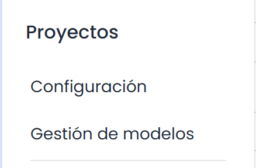

# Configuración Proyectos

En este apartado se podrán configurar los distintos aspectos relacionados con el módulo de Proyectos que dispone GlobalSUITE®, incluyendo los parámetros generales, el equipo de trabajo y los Consultores asociados, así como los Modelos de proyecto que se podrán definir para poder reutilizar en múltiples ocasiones.

* [Consultores Asociados](consultores-asociados.md)
* [Gestión de Modelos de Proyectos](gestion-de-modelos-de-proyectos.md)
* [Configuración General Proyectos](configuracion-general-proyectos.md)
