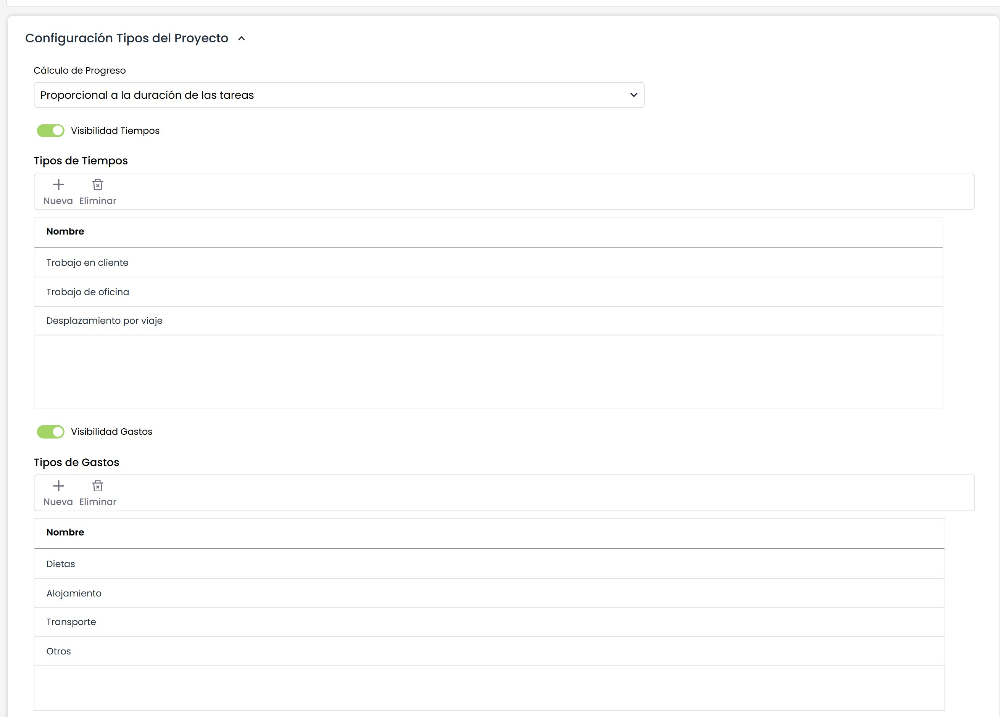
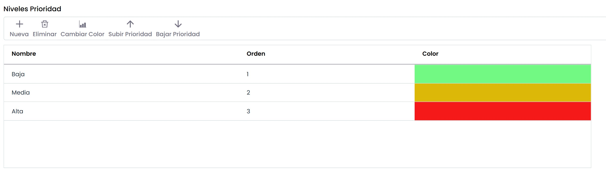
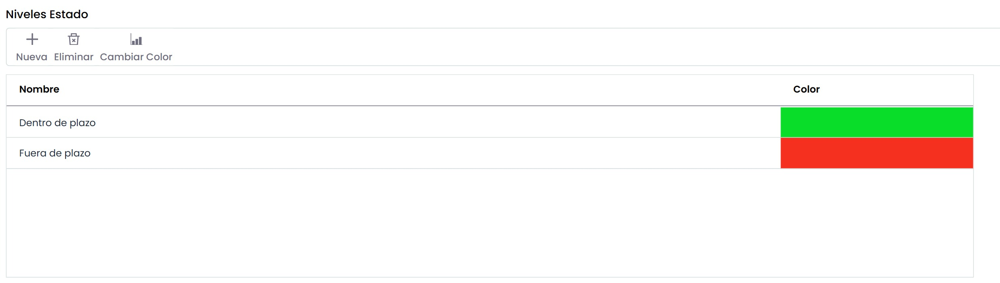
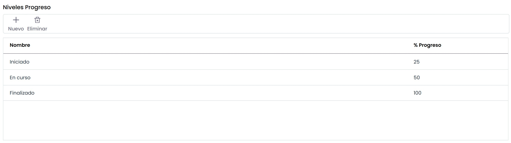

# Configuración General Proyectos

La opción de proyectos permite definir los tipos de tiempo y gastos que se aplicarán a la gestión de proyectos.

Las tablas de tipos de tiempo y tipos de gastos permiten las siguientes opciones:

* **Nueva:** Permite insertar una nueva entrada en la tabla pulsando sobre el botón.
* **Eliminar:** Ofrece la posibilidad de eliminar una entrada de las tablas. Para ello se ha de seleccionar la fila deseada y pulsar sobre el botón 'Eliminar'.

Por otro lado, se dispone de las siguientes opciones adicionales:

* **Visibilidad Prioridad:** Permite habilitar el campo prioridad a cada una de las tareas del apartado "Gestión del Proyecto". Una vez que se habilita, se muestra la siguiente tabla que permite realizar las siguientes acciones:

* **Nueva:** Permite insertar una nueva entrada en la tabla.
* **Eliminar:** Ofrece la posibilidad de eliminar una entrada de la tabla. Para ello se ha de seleccionar la línea deseada y pulsar sobre el botón.
* **Cambiar color:** Permite al usuario resaltar la prioridad en el desplegable que se mostrará mediante un color. Para ello se ha de seleccionar la línea deseada y elegir el color más representativo.
* **Subir Prioridad:** Permite elevar la posición de la prioridad en el desplegable.
* **Bajar Prioridad:** Permite posicionar en puestos inferiores la prioridad en el desplegable.

* **Visibilidad Estado:** Permite habilitar el campo estado a cada una de las tareas del apartado "Gestión del Proyecto". Una vez que se habilita, se muestra la siguiente tabla que permite realizar las siguientes acciones:

* **Nueva:** Permite insertar una nueva entrada en la tabla.
* **Eliminar:** Ofrece la posibilidad de eliminar una entrada de la tabla. Para ello se ha de seleccionar la línea deseada y pulsar sobre el botón.
* **Cambiar color:** Permite al usuario resaltar el estado en el desplegable que se mostrará mediante un color. Para ello se ha de seleccionar la línea deseada y elegir el color más representativo.

* **Visibilidad Progreso:** Permite habilitar el campo progreso a cada una de las tareas del apartado "Gestión del Proyecto". Una vez que se habilita, se muestra la siguiente tabla que permite realizar las siguientes acciones:

* **Nuevo:** Permite insertar una nueva entrada en la tabla.
* **Eliminar:** Ofrece la posibilidad de eliminar una entrada de la tabla. Para ello se ha de seleccionar la línea deseada y pulsar sobre el botón.

**NOTA:** El porcentaje de progreso definido en la tabla se tendrá en cuenta para el cálculo de progreso total del proyecto.
