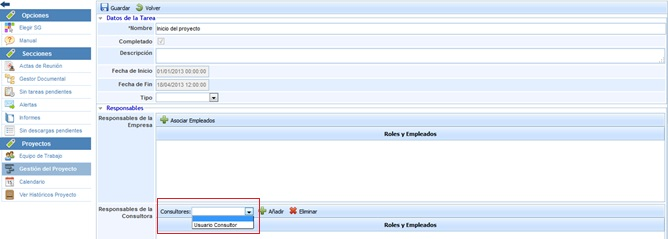

# Consultores Asociados

La presente opción permite establecer los usuarios que van a estar asociados a un proyecto. Una vez definidos, podrán seleccionarse en el apartado 'Proyectos/Gestión de proyecto'

Para seleccionar el usuario, se ha de seleccionar el mismo en el desplegable y pulsar sobre el botón 'Añadir'. En el caso de querer elminiar un usuario, se ha de seleccionar la fila deseada y pulsar sobre el botón 'Eliminar'.
