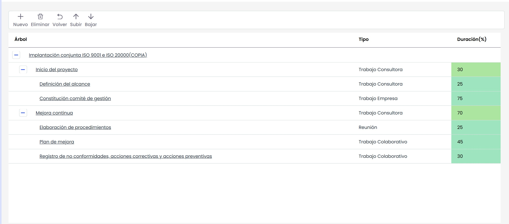
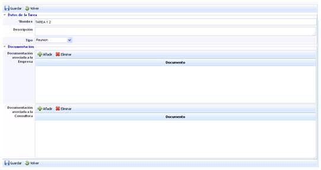
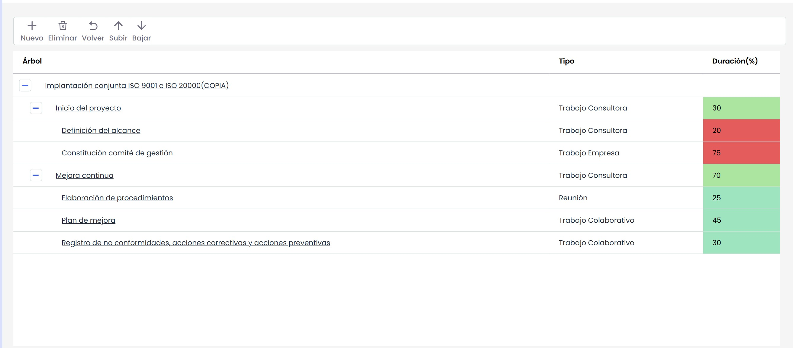

# Gestión de Modelos de Proyectos

La opción ‘Gestión de Modelos’ de GlobalSUITE permite al usuario la creación, modificación o eliminación de modelos de implantación de proyectos. Esta ventana contiene en la parte superior e inferior un desplegable para seleccionar un modelo ya existente. Si no existe ningún modelo, podrá crear uno nuevo pulsando el botón ‘Nuevo’.

Una vez creado el modelo nuevo la herramienta permite realizar las siguientes acciones:

* **Nuevo:** permite incluir una nueva tarea en el proyecto. Para ello se ha de seleccionar la fila sobre la sobre la cual queramos que dependa la tarea y pulsa el botón 'Nuevo'
* **Eliminar:** Posibilita la eliminación de una tarea. Para ello se ha de seleccionar la fila deseada y pulsar sobre el botón 'Eliminar'
* **Volver:** Permite volver a listado de modelos de proyecto
* **Subir:** Posibilita modificar la posición de una tarea, moviendo la misma a un nivel/es superior.
* **Bajar:** Permite modificar la posición de una tarea, moviendo la misma a un nivel/es inferior.

La tabla del modelo ofrece la siguiente información columnas:

* **Árbol:** Contiene los niveles de tareas generados: la raíz, con el nombre del modelo y las diferentes tareas, con el nombre asignado a cada una de ellas.
* **Tipo:** Este campo contiene los valores que fijarán el tipo de la tarea. Los valores son los siguientes": Reunión, Trabajo Consultora, Trabajo Empresa y Trabajo Colaborativo y Tarea Interna
* **Duración (%):** Porcentaje que se asigna a cada una de las tareas. Para que el modelo se pueda utilizar, las tareas deben sumar 100% dependiendo del nivel en el que se encuentren.

Al elemento proyecto o tareas, se les puede incluir un campo descripción. Para ello, deberá pulsar sobre el nombre del proyecto o de la tarea dentro de la columna Árbol. Se deberá mostrar el siguiente formulario:

**NOTA:** Para que un modelo sea válido, todas sus tareas deben sumar 100%. Mientras no sumen 100%, la herramienta destacará en color rojo este punto.

