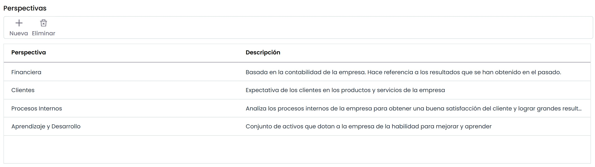
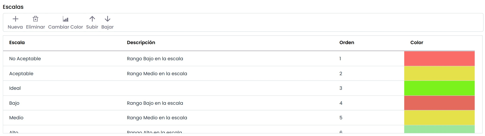

# Configuración ScoreCard

* **Tipos de perspectivas:** Ofrece la posibilidad de identificar las diferentes perspectivas que se muestran en el apartado de ‘ScoreCard/Objetivos de Negocio’. Para insertar una nueva perspectiva se ha de pulsar el botón ‘Nueva’ y en caso de que el usuario desee eliminar una perspectiva ha de pulsar sobre el botón ‘Eliminar’.

**NOTA:** Las perspectivas sombreadas aparecen por defecto, no siendo posible eliminarlas.

* **Escalas:** Permite identificar el rango de valores que se mostrarán en la gráfica del apartado ‘ScoreCard/Objetivos de Negocio’.

Las opciones que permite realizar sobre la tabla son las siguientes:

* **Nueva:** Pulsando sobre el botón inserta una nueva escala en la tabla.
* **Eliminar:** Permite eliminar una escala ya definida. Para ello se ha de seleccionar la fila deseada y pulsar sobre el botón ‘Eliminar’.
* **Cambiar color:** Ofrece la posibilidad de modificar el color de la escala que será mostrado. Para ello se ha de seleccionar la fila deseada y pulsar sobre el botón ‘Cambiar color’.

En caso de que el usuario desee modificar el orden de las escalas definidas, se han de utilizar las flechas de la columna ‘Orden’ para situarlo en la posición adecuada.
