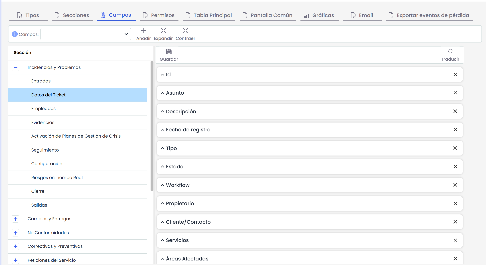

# Campos

Esta opción nos permite crear en cada uno de los tickets, diferentes tipos de campos para el formulario, también agruparlos en secciones y modificar su orden.

* **Añadir:** Para añadir un nuevo campo en una sección de un ticket, deberemos pinchar en la sección del ticket, después seleccionar en el desplegable "Campos" el tipo de campo a añadir, y por último, hacer click en el botón "Añadir". Veremos como se inserta el nuevo campo, al final del listado de campos de esta sección, pudiendo configurar este campo y modificar su orden de aparición en el formulario arrastrando hacia arriba o abajo el campo a ordenar.

* **Campos:** Desplegable donde aparecen los diferentes campos que pueden ser insertados en un ticket.

