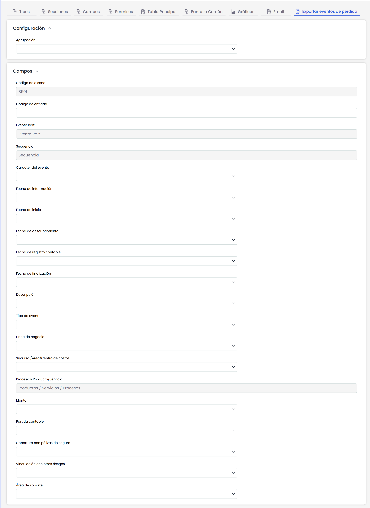

# Exportar Eventos de Pérdida

Esta opción permite generar un fichero en formato .txt respetando la estructura que establece el Banco Central de la República de Argentina.

El formulario incluye todos los campos del fichero .txt. Para cada uno de ellos, en esta pantalla se define qué campos del formulario de eventos de pérdida hay que utilizar para completar el archivo. Por ejemplo: El campo fecha de información, al ser una fecha, muestra en el desplegable aquellos campos de tipo "DATE" del formulario de eventos de pérdida.
