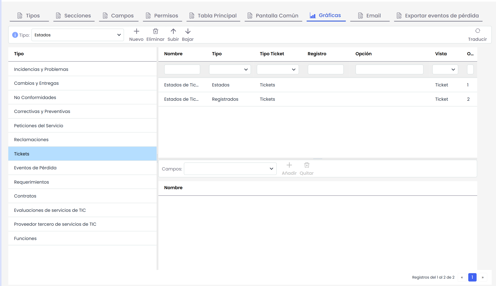
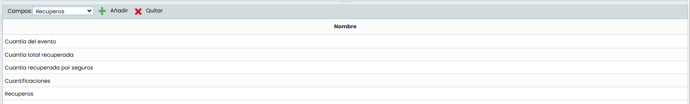

# Gráficas

Esta opción nos permite configurar una serie de gráficas, con el fin de poder ver un resumen del estado en que se encuentran los diferentes tipos de tickets respecto a algunos de sus campos.

Disponemos de los siguientes tipos de gráficas:

* **Generales (Ticket):** Gráficas disponibles en las opciones de Ticket de cualquier Sistema de Gestión.

  * **Estados:** Crea una gráfica a partir de los registros del campo "Status" o de alguno de los campos de tipo "SELECT". (Por defecto, el campo "Status")
  * **Registrados:** Crea una gráfica a partir de los registros del campo "Status" o de alguno de los campos de tipo "SELECT", organizado mensualmente. (Por defecto, el campo "Status", también debe estar configurado como mínimo un campo "Date" y este debe ser de tipo Inicial)
  * **Registrados por Año:** Crea una gráfica a partir de los registros del campo "Status" o de alguno de los campos de tipo "SELECT", organizado Anualmente. (Por defecto, el campo "Status", también debe estar configurado como mínimo un campo "Date" y este debe ser de tipo Inicial). La gráfica muestra únicamente los datos del año actual. Para visualizar información de años anteriores, es necesario utilizar el filtro de fechas.
  * **Registrados por Tipo:** Crea una gráfica a partir de los registros del campo "Status" o de alguno de los campos de tipo "SELECT", donde se ve la evolución de los tickets registrados por mes de cada uno de las opciones del Select.
  * **Registrados por Tipo (Sectores):** Crea una gráfica similar a la anterior donde, a partir de los registros del campo "Status" o de alguno de los campos de tipo "SELECT", muestra en una gráfica de sectores el número de tickets de cada uno.
  * **Comparativa:** Crea una gráfica donde se podrán comparar la evolución de los campos tipo "NUM" que seleccionemos, por meses.
  * **Sumatoria:** Crea una gráfica donde se mostrará el sumatorio del campo tipo "NUM" que se seleccione, por meses.

En las gráficas de Comparativa y Sumatoria se pueden seleccionar qué campos numéricos se van a incluir en la gráfica, en la tabla inferior (en la gráfica de Sumatoria se podrá seleccionar un único campo):

* **Consolidadas (Consolidación):** Gráficas disponibles en los entornos que dispongan de varias subentidades, y permiten la consolidación de la información de todas.

  * **Agrupación por Select:** Crea una gráfica a partir de los registros del campo "Status" o de alguno de los campos de tipo "SELECT". (Por defecto, el campo "Status")
  * **Salidas:** Crea una gráfica a partir de los registros del campo "Status" o de alguno de los campos de tipo "SELECT", relacionado con los Tickets de Salida especificados en el campo "Tickets-outputs". (Por defecto, el campo "Status", también debe estar configurado como mínimo un campo "Date" y este debe ser de tipo Inicial)
  * **Salidas por Plazo:** Crea una gráfica a partir de los registros del campo "Status" o de alguno de los campos de tipo "SELECT", relacionado con los Tickets de Salida especificados en el campo "Tickets-outputs". (Por defecto, el campo "Status", también debe estar configurado como mínimo cuatro campos "Date" y cada uno de estos con uno de los tipos disponibles "Inicial", "Final", "Inicio Previsto", "Final Previsto")

Algunas de las columnas de esta tabla son:

* **Nombre:** Permite definir el nombre que se mostrará en el apartado de consulta para esta gráfica, y que permitirá identificarla. Este nombre se podrá configurar en cualquiera de los idiomas de la empresa. Para ello, habrá que pulsar el botón "Traducir" que se encuentra en la esquina superior derecha de la vista.
* **Tipo Ticket:** Nos permite definir en las gráficas consolidadas, con que tipo de ticket de salida se comparan los registros. En las gráficas del tipo de Ticket, este campo no será editable, únicamente mostrará en qué opción del ticket se podrá mostrar.
* **Registro:** Nos permite indicar sobre que campo queremos las gráficas, ya sea el campo de tipo "Status" o todos los de tipo "Select" que tenga configurado el Ticket.
* **Opción:** Nos permite filtrar la gráfica con algún tipo de valor concreto de los campos "Status" o "Select" del Ticket.
* **Vista**: Permite mostrar si la gráfica se verá en la tabla principal del tipo de ticket correspondiente, o en el apartado de Consolidación (si el entorno dispone de subentidades).
* **Orden:** Nos muestra el orden en que se cargarán las gráficas en la vista correspondiente. Para ajustar ese orden, se puede pulsar los botones "Subir" y "Bajar", que cambiará el orden de la gráfica seleccionada.
