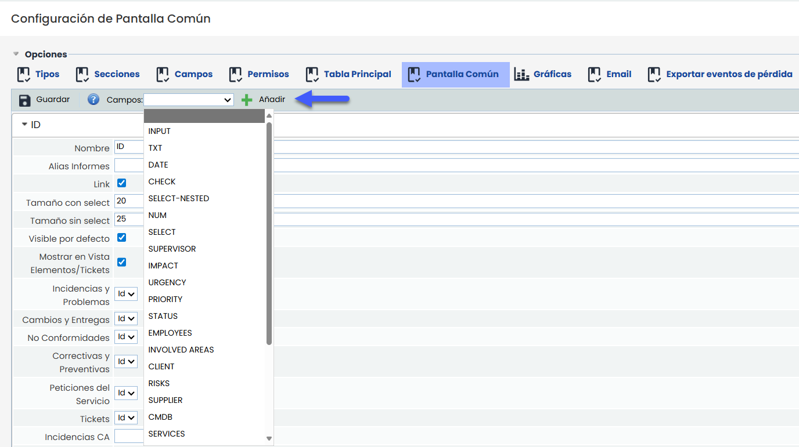
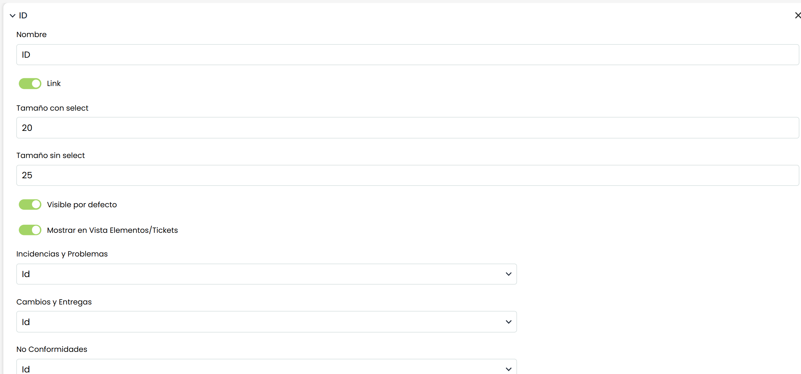

# Pantalla Común

La sección **Pantalla común** permite configurar qué campos del ticket se mostrarán en la tabla estándar que se utiliza en múltiples áreas de la herramienta para asociar tickets con otros módulos. Esta tabla también se emplea en los campos de tipo **Tickets - Input** y **Tickets - Output**.

## Crear la vista

Para configurar la vista de la **Pantalla común**, el primer paso consiste en seleccionar, desde el desplegable superior, el tipo de campo que se desea incluir.

Una vez seleccionado, basta con pulsar el botón **“Añadir”** para incorporarlo a la configuración. Esta acción habilita un nuevo bloque con las opciones específicas del campo, donde es posible ajustar su comportamiento y visualización.

### Configuración por campo

Una vez añadido un campo, es posible definir:

* **Nombre**: etiqueta con la que se mostrará ese campo en la tabla.
* **Link**: permite convertir el campo en un enlace al formulario del ticket.
* **Tamaño con select**: ancho de la columna cuando se usa en componentes con funcionalidad de selección.
* **Tamaño sin select**: ancho de la columna cuando se usa como tabla de solo visualización.
* **Visible por defecto**: define si el campo estará visible inicialmente o aparecerá oculto.
* **Mostrar en vista Elementos/Tickets**: activa la visualización del campo en la vista consolidada por Elementos y Tickets. Esta opción está sujeta a las siguientes restricciones:

  * Solo se puede marcar **un único campo de tipo INPUT** como visible en esta vista. Será el que se utilice como **asunto del ticket** en la vista consolidada. Si no se configura ningún campo INPUT, no se mostrará el asunto.
  * Solo se puede marcar **un único campo de tipo ID**, que será el que se utilice como identificador del ticket en la vista.
  * Solo se puede marcar **un único campo de tipo DATE**, que se utilizará como la **fecha del ticket**. Esta configuración se hace por cada tipo de ticket de forma individual.
  * Solo se puede marcar **un único campo de tipo OWNER, EMPLOYEES o SUPERVISOR**. Será el que se muestre como **responsable** del ticket. Si hay más de uno configurado en el formulario, se debe seleccionar cuál aplicar a través de esta pantalla.

### Asociación por tipo de ticket

En la parte inferior se listan los **tipos de ticket** disponibles. Para cada uno de ellos es posible seleccionar el campo concreto que se usará para representar la información configurada.

Por ejemplo: El campo **"ID"** de la pantalla común puede mostrar:

* El campo *ID* en tickets de tipo *Incidencias y Problemas*.
* El campo *Identificador del evento* en tickets de tipo *Eventos de Pérdida*.

Esta configuración asegura una visualización coherente, aunque cada tipo de ticket tenga formularios distintos.
