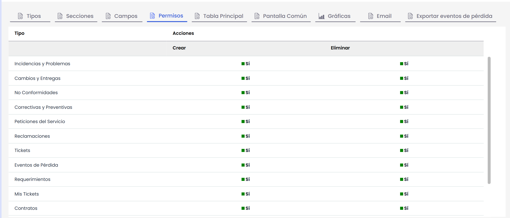

# Permisos

Gestión de permisos de Tickets:

Esta opción mejora la seguridad y la eficiencia del sistema de Ticketing, ya que se podrán gestionar los privilegios de los usuarios con acceso a Mi Información, evitando posibles errores o cambios no deseados los distintos tipos de tickets. Esto brinda un mayor control sobre quiénes pueden crear o eliminar tickets y qué tipo de tickets pueden manipular.

También permite una mayor personalización y adaptación del sistema a las necesidades específicas de cada equipo o empresa, asegurando un flujo de trabajo más fluido y organizado en la gestión de tickets.

* Es posible configurar y personalizar los permisos de creación y eliminación de Tickets para usuarios con acceso a Mi Información.
* Estos permisos también tendrán efecto en la creación de los tickets en las tablas de entrada y salida de la herramienta.
* Esta configuración, podrá realizarse por tipo de Ticket.
* Los permisos de creación y eliminación serán independientes entre sí.

