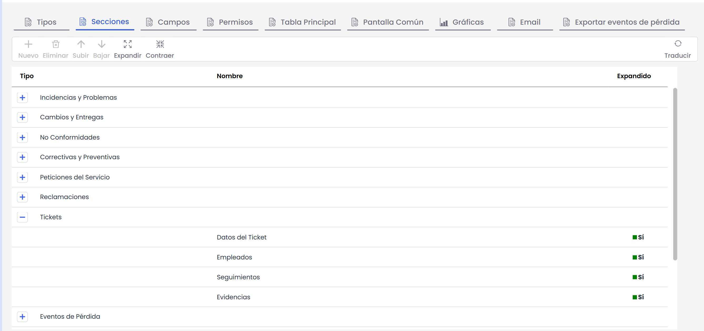
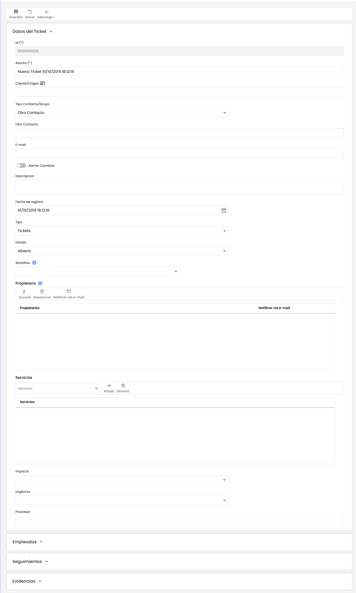

# Secciones Formulario

Esta opción nos permite crear y editar las secciones para cada uno de los Tickets. Dando con esto la posibilidad de agrupar los diferentes campos del ticket en diferentes módulos.

* **Nuevo:** Permite crear una "Nueva Sección", tendremos que tener seleccionado un tipo de ticket para que el botón esté habilitado.
* **Eliminar:** Elimina una sección existente.
* **Subir/Bajar:** Nos permitirá cambiar la ordenación en el ticket de la sección seleccionada.

Se permite cambiar el nombre de la sección en Español e Inglés y marcar si queremos que esta sección aparezca en el formulario de forma expandida o reducida.

A continuación, podemos ver como queda el formulario del ticket con las secciones, estas guardan un orden y aparecen expandidas o no según las hayamos configurado:

**NOTA**: Para que una sección aparezca en el formulario, debe tener configurado al menos un campo.
