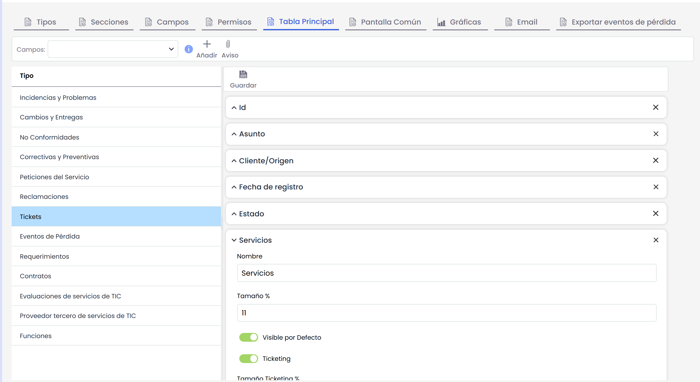
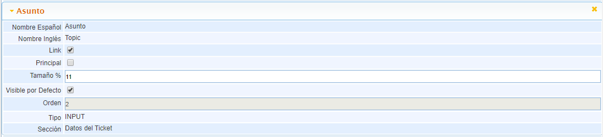

# Tabla Principal

Esta opción nos permite definir que campos y en que orden queremos que nos aparezcan en la Tabla Principal, esta tabla sería el listado general para cada uno de los tipos de Tickets.

* **Link:** Permite establecer el campo como link para redireccionar al formulario del ticket desde esta columna.
* **Principal:** Permite definir el campo como Principal, solo se permite uno por tipo de ticket, y con esto podremos establecer que campo es el que nos va a aparecer para seleccionar el ticket dentro de otras opciones.
* **Tamaño:** Permite definir el tamaño de cada columna en función del campo.
* **Visible por Defecto:** Permite definir el campo Visible inicialmente.

