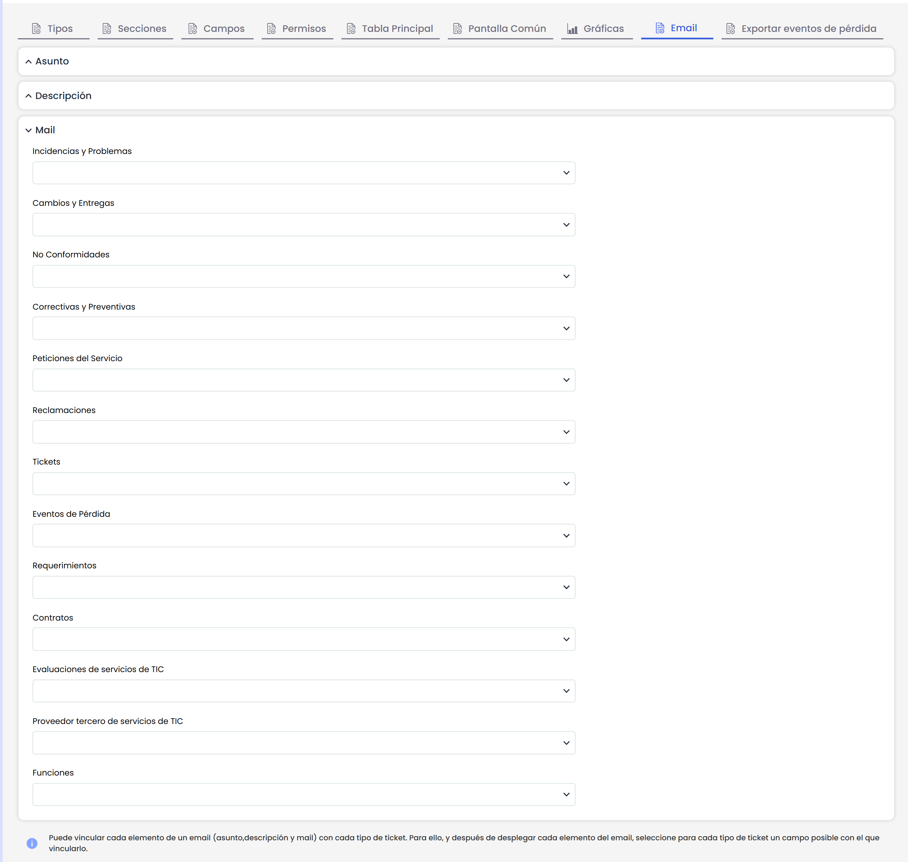

# Tickets: Email

Esta opción nos permite sincronizar cuentas de correo externas con los tickets de la herramienta. Para ello, debemos configurar en el apartado de Ajustes unas conexiones de tipo Email con las cuentas de correo, y en esta pestaña de tickets, definir con que campos se realizará el mapeo del correo.

* **Asunto:** Nos permite definir en que campo de cada ticket se va a guardar el título/asunto del correo, cuando se produzca la sincronización.
* **Descripción:** Nos permite definir en que campo de cada ticket se va a guardar el cuerpo del correo, cuando se produzca la sincronización.
* **Mail:** Nos permite definir en que campo de cada ticket se va a guardar el remitente del correo, cuando se produzca la sincronización.

