# Tipos de Campos

## Configuraciones generales

A continuación, vemos las opciones de configuración comunes para todos los campos:

* **Nombre:** Permite añadir el nombre con el que el campo se muestra en el formulario del ticket.
* **Alias Informes:** Identificador con el que el campo se referencia en los informes.
* **Obligatorio:** Si se activa, no permitirá dejar ese campo sin rellenar.
* **Ayuda:** Permite añadir un texto de ayuda sobre el campo configurado.
* **Tipo:** Texto informativo de qué tipo de campo estamos configurando.
* **Orden:** Número de ordenación asignado al campo, para su posicionamiento en el formulario.
* **Cambiar Sección:** Permite cambiar el campo a una sección diferente del Ticket.

En la parte superior del panel de configuración hay dos botones: **Guardar**, que confirma los cambios realizados en el campo, y **Traducir**, que da acceso a los textos del campo en el resto de idiomas.

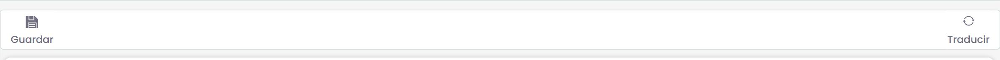

Al pulsar **Traducir** se abre la ventana **Seleccionar idioma**, que lista los idiomas disponibles en la instalación para introducir en cada uno de ellos los textos del campo.

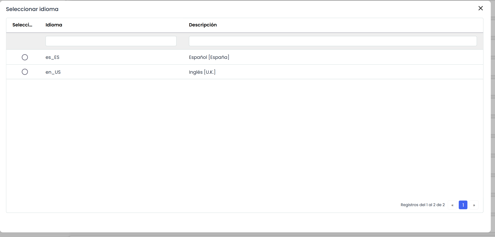

**NOTA:** el nombre y el texto de ayuda ya no se introducen en dos campos fijos, uno por idioma. Cada campo tiene un único **Nombre** y una única **Ayuda**, y los demás idiomas se gestionan desde el botón **Traducir**. Lo mismo se aplica a las tablas de configuración que aparecen dentro de algunos campos, que tienen una sola columna **Nombre** y una sola columna **Descripción**.

## Configuraciones por campo

En los siguientes puntos, trataremos cada uno de los campos disponibles, y el detalle de sus configuraciones propias:

### INPUT

 Permite añadir al ticket un campo de texto, este texto no debe superar un renglón.

* **E-mail:** Activando el check, solo permitirá añadir texto al campo con formato de Email. Ejemplo: [soporte@globalsuite.es](mailto:soporte@globalsuite.es)

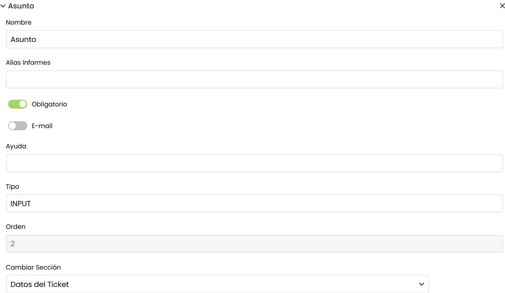

### TXT

 Permite añadir al ticket un campo de texto, el campo se irá adaptando al tamaño del texto insertado.

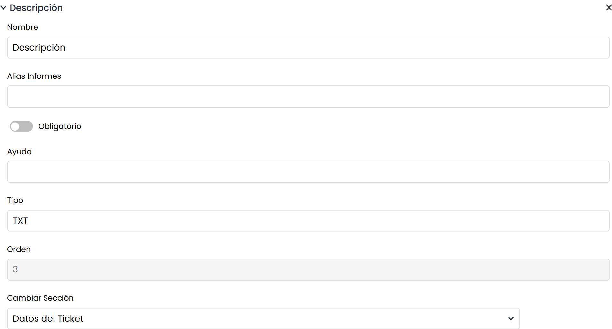

### DATE

 Permite añadir al ticket un campo de fecha, para poder establecer registros de tiempo.

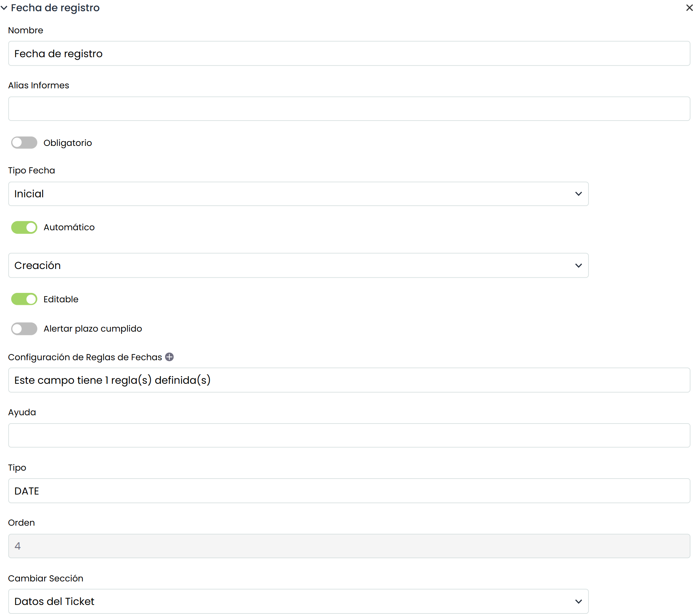

* **Tipo de Fecha:** Permite configurar diferentes tipos de fecha para establecer registros:

  * **Inicial:** Permite fijar la fecha inicial del ticket, puede ser utilizada para la generación de gráficas y como referencia para el envío de alertas.
  * **Final:** Permite fijar la fecha final del ticket, puede ser utilizada para la generación de gráficas.
  * **Inicio Previsto:** Permite fijar la fecha de inicio previsto del ticket, puede ser utilizada para la generación de gráficas.
  * **Fin Previsto:** Permite fijar la fecha de fin prevista del ticket, puede ser utilizada para la generación de gráficas.
* **Alertar plazo cumplido:** Activando este check, nos saldrá esa fecha en rojo, alertando con esto que la fecha del día de hoy es posterior a la fecha registrada en este campo.
* **Configuración de Reglas de Fechas**: Este botón permite definir restricciones que deben cumplir el campo de fecha respecto a otras, pudiendo obligar a que sea anterior posterior o igual a una dada. Cuando se abre la ventana, es posible seleccionar qué fechas y qué tipo de restricción existe respecto a la fecha que se está configurando.

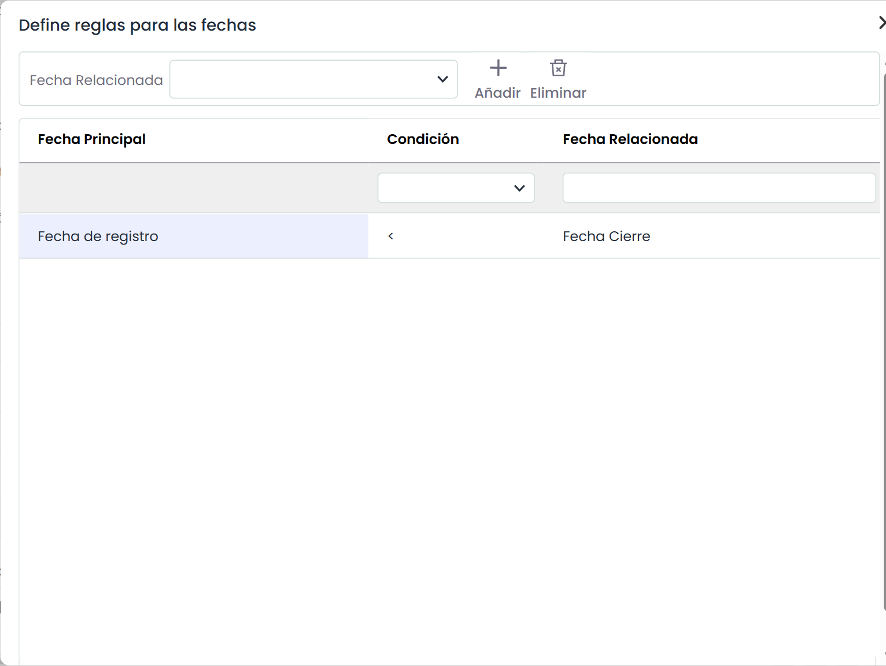

### CHECK

Permite añadir al ticket un campo de Check, que nos dará la posibilidad de completar el formulario de tickets con preguntas de respuesta rápida Sí/No.

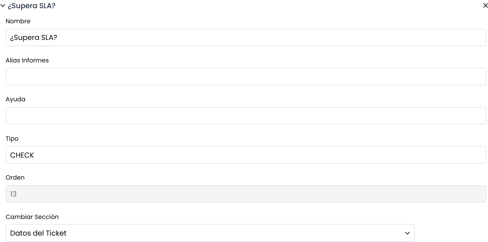

### SELECT-NESTED

Permite añadir al ticket un campo de Select Anidados, que nos dará la posibilidad de añadir dos Select dependientes el primero del segundo.

* **Mostrar Descripción:** Activando esta opción, habilitamos la visibilidad de un texto de descripción, debajo de los select anidados.
* **Descripción:** Texto descriptivo de los Select Anidados.

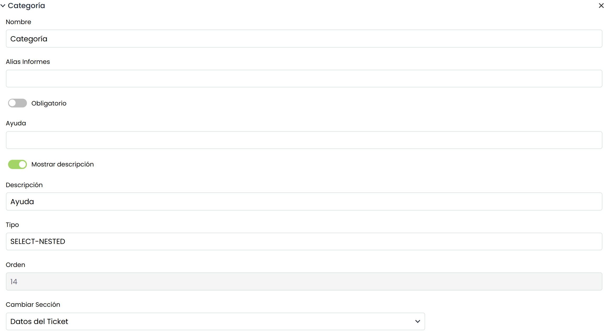

* **Opciones:** Tabla donde podremos añadir las diferentes opciones que van a estar disponibles en el primer select.
* **Subopciones:** Tabla donde podremos añadir las diferentes opciones que van a estar disponibles en el segundo select, estas serán dependientes de la opción marcada en el primer select.

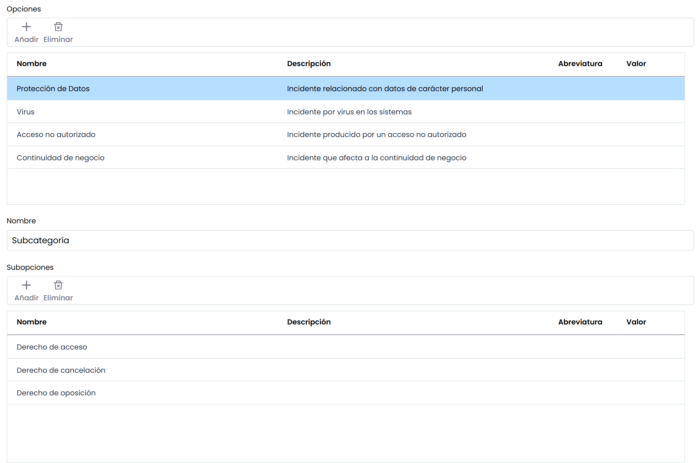

**NOTA**: Para añadir subopciones, deberemos crear en la primera tabla todas las opciones disponibles para el primer Select, una vez hecho esto, debemos seleccionar alguna de esas opciones, y iremos añadiento en la segunda tabla todas las subopciones dependiente de la opción.

**Ejemplo**

* **Opción 1**

  * **Nueva Subopción 1.1**
  * **Nueva Subopción 1.2**
* **Opción 2**

  * **Nueva Subopción 2.1**
  * **Nueva Subopción 2.2**

**TICKET-INPUTS:** Permite añadir al ticket un campo de Entradas de tickets, con él veremos una tabla en la que podremos asociar Tickets existentes o nuevos, al ticket en cuestión.

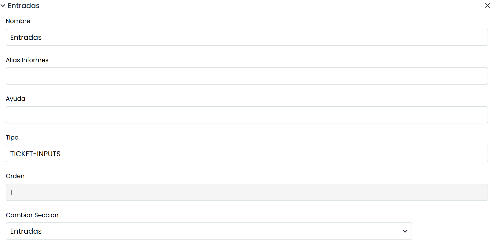

### NUM

Permite añadir al ticket un campo de tipo numérico, con él podremos restringir la entrada a solo números. Además nos dará la posibilidad de limitar el rango de inserción.

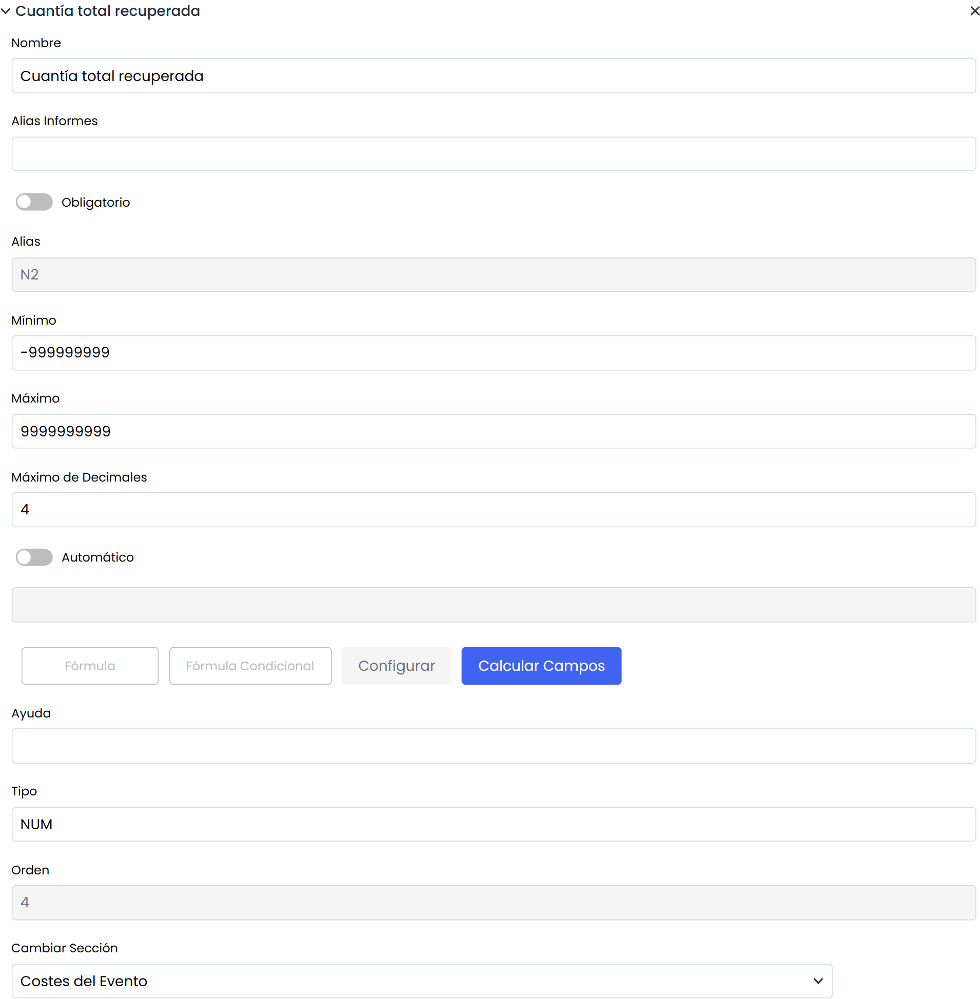

* **Mínimo:** Valor mínimo permitido en el campo.
* **Máximo:** Valor máximo permitido en el campo.
* **Máximo de Decimales**: Número de decimales máximo que se podrán introducir en el campo numérico.
* **Automático**: Indica si el valor del campo se introduce manualmente, o en caso de activarse, permite definir de qué forma se calcula a partir de otros campos numéricos del ticket:

  * **Fórmula**: Indica que el campo automático se obtiene mediante una fórmula.
  * **Fórmula Condicional**: Permite aplicar condiciones para obtener el valor del campo, y calcularlo de forma distinta en función de las mismas.
  * **Configurar**: Al pulsar este botón, se abre una ventana donde poder configurar la fórmula de cálculo del campo automático, a partir de otros campos numéricos de ese ticket.
* **Calcular Campo**: Mediante este botón se pueden recalcular el valor del campo de todos los registros, en caso de cambiar la fórmula utilizada. También ajusta el valor del campo para todos los tickets, en caso de que se haya cambiado el número de decimales máximo permitido, redondeando los números que lo superen.

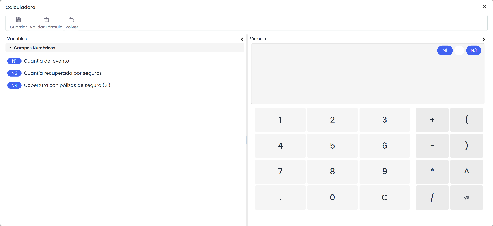

### SELECT

Permite añadir al ticket un campo de tipo selección, en el que dispondremos de diferentes opciones a elegir.

* **Opciones:** Tabla donde podremos añadir las diferentes opciones que van a estar disponibles en el select. También podremos añadir una descripción concreta para cada una de las opciones añadidas.

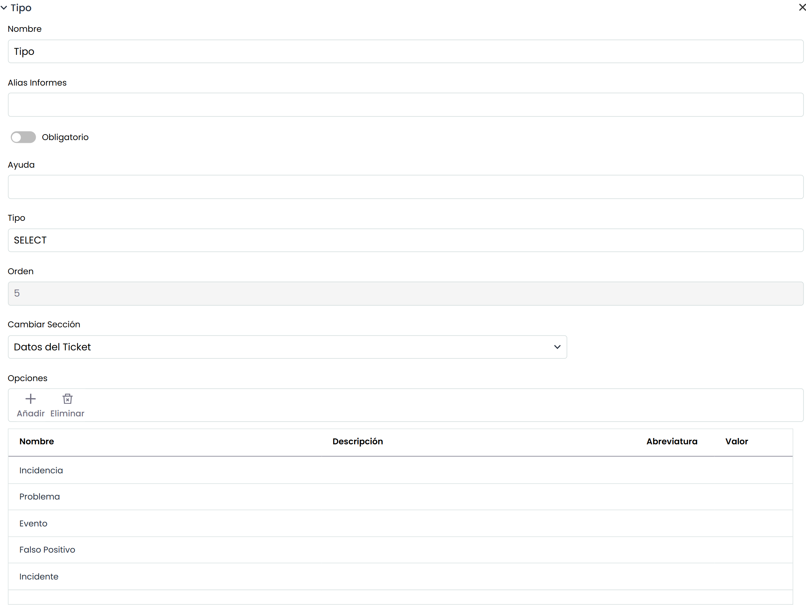

### SUPERVISOR

Permite añadir al ticket un campo de tipo supervisor, con él podremos relacionar uno o varios empleados con el ticket, en función del número de campos de este tipo que queramos añadir, además, nos dará la posibilidad de mandar alertas a estos empleados relacionados.

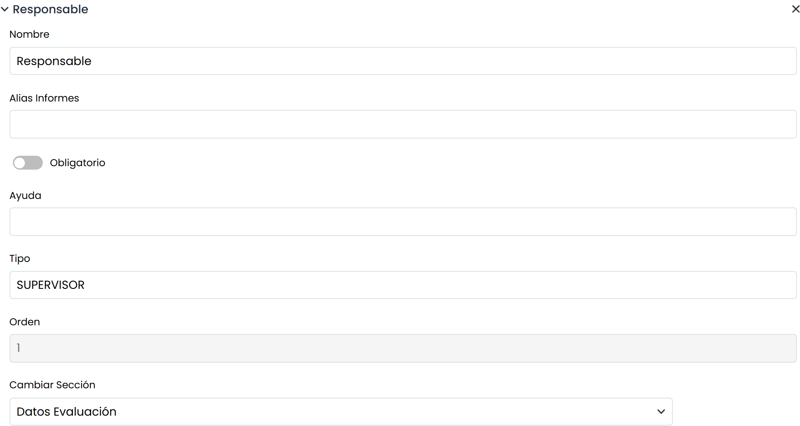

### TICKET-OUTPUTS

Permite añadir al ticket un campo de Salidas de tickets, con él veremos una tabla en la que podremos asociar Tickets existentes o nuevos, al ticket en cuestión.

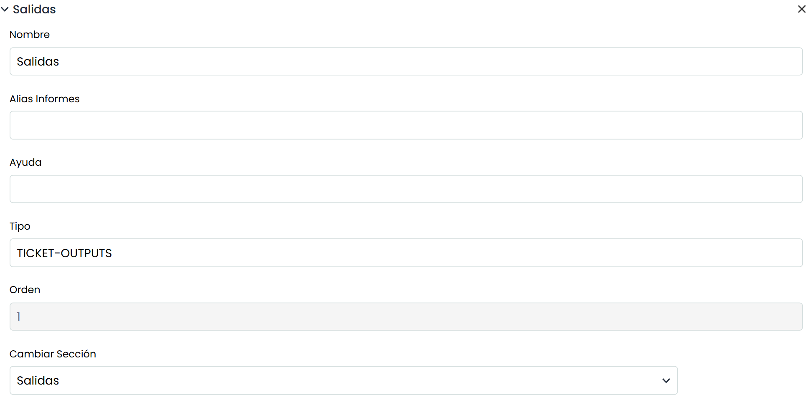

### IMPACT

Permite añadir un campo de tipo Select, con opciones configurables para valorar el impacto.

* **Impacto:** Tabla de configuración de las diferentes opciones del campo, con sus valores y descripciones.

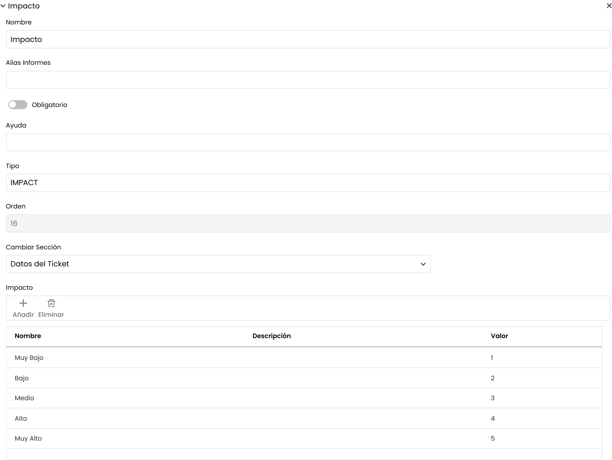

**NOTA**: Relacionado con los campos Urgency y Priority.

### URGENCY

Permite añadir un campo de tipo Select, con opciones configurables para valorar la urgencia.

* **Urgencia:** Tabla de configuración de las diferentes opciones del campo, con sus valores y descripciones.

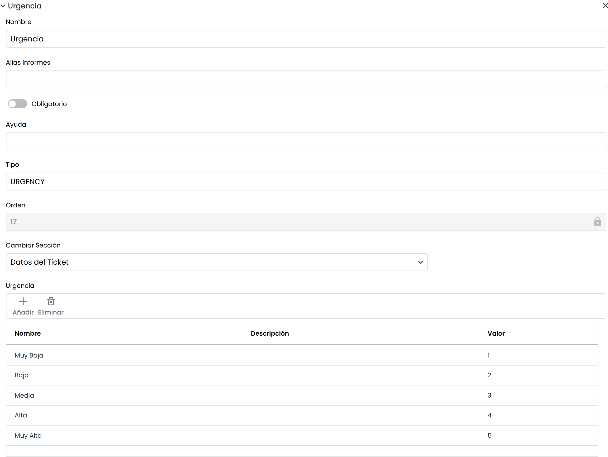

**NOTA**: Relacionado con los campos Impact y Priority.

### PRIORITY

Permite añadir una etiqueta de texto, resultante de valorar los campos Impact y Urgency. Este campo nos permitirá configurar una serie de etiquetas dependientes de unos rangos de valoración, para definir que resultado de prioridad tenemos en función de la urgencia y el impacto.

* **Prioridad:** Tabla de configuración de las diferentes opciones del campo, con su rango máximo y mínimo de valoración y las descripciones en cada caso.

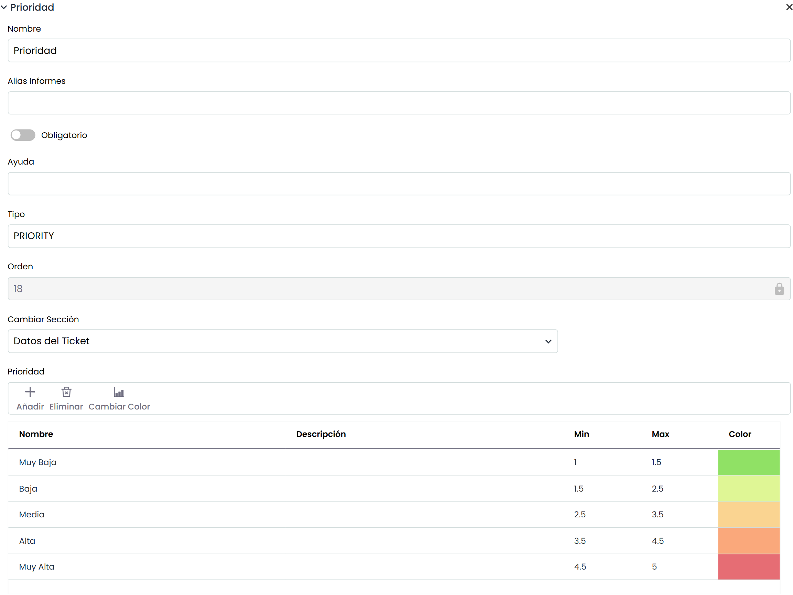

**NOTA**: Relacionado con los campos Impact y Urgency, nos dará un valor resultante de realizar la media de los valores seleccionados en el Impact y la Urgency (sumar ambos valores y dividirlo por 2). No se permite añadir este campo al formulario si no se ha añadido antes los campos de Impact y Urgency.

**Ejemplo** Si seleccionamos en el Impact la opción de Muy Bajo que tiene un valor de 1 y en Urgency la opción de Baja que tiene un valor de 2.

Priority = (Impact + Urgency) / 2

Priority = (1 + 2) / 2

Priority = 1.5

Por tanto, Priority tendrá la opción de Muy Baja, con un color Verde, ya que el resultado de 1.5, está dentro del rango máximo de ese nivel de Prioridad.

### STATUS

Permite añadir un campo de selección con los diferentes posibles estados de un ticket. Los estados pueden ser configurados tanto en nombre, descripción como tipo.

* **Estados:** Tabla de configuración de los diferentes estados del ticket.

  * **Tipo INICIAL:** Estado inicial por defecto cuando creamos un nuevo ticket. Solo puede haber configurado un estado de este tipo.
  * **Tipo INTERMEDIO:** Estado intermedio, puede haber múltiples estados de este tipo, utilizado generalmente para pasar diferentes etapas en el proceso de gestión de un ticket.
  * **Tipo FINAL:** Estado Final, puede haber múltiples estados de este tipo, bloquea el ticket a solo lectura, y permite reabrir el ticket para volver a un estado inicial, con notificaciones a responsables.

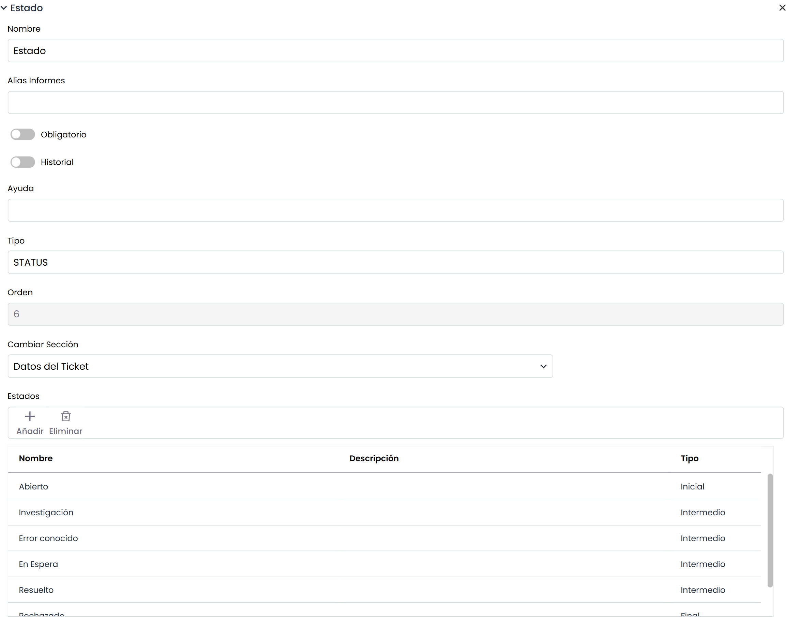

**NOTA**: Estos estados generales, estarán disponibles siempre que no haya ningún Workflow seleccionado en el ticket, en caso de que ocurra esto, los estados que aparecerán en el campo, serán los configurados en el Workflow.

### REFERENCES

Permite añadir una tabla de registros, estos registros serán referencias a URLs.

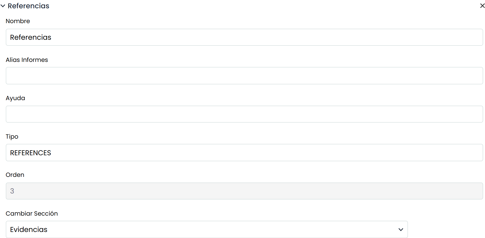

### EMPLOYEES

Permite añadir una tabla de registros, estos registros serán empleados de la herramienta. Nos dará la posibilidad de notificar vía e-mail que el empleado ha sido añadido al ticket, además se podrá alertar a este empleado de acciones de Creación, Modificación y Cierre de Tickets.

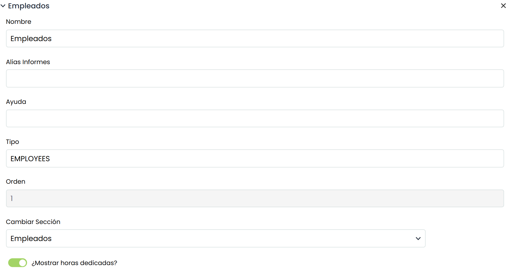

### INVOLVED AREAS

Permite añadir una tabla de registros, estos registros serán Áreas de la empresa que estarán relacionadas con el ticket.

### CLIENT

Permite añadir un conjunto de campos de contacto con diferentes variantes. Podremos asociar directamente algún nombre y e-mail de contacto, o utilizar alguno existente en la parte de Relaciones con el Negocio.

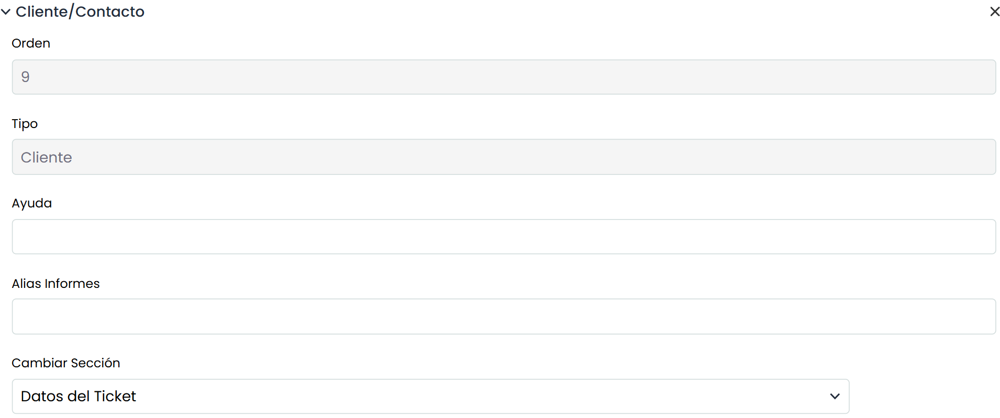

* **Cliente/Contacto:** Permitirá añadir un nombre de Cliente/Empresa nuevo o asociar uno existente.
* **Grupo:** Campo de selección con los diferentes Grupos disponibles en Relaciones con el Negocio, depende de si se ha asociado algún Cliente/Contacto.
* **Otro Contacto:** Campo de texto para completar con el nombre del contacto.
* **E-mail:** Campo de texto para completar con el e-mail del contacto.
* **Alertar E-Mail:** Marcando esta opción, cuando guardemos avisará al contacto.
* **Contacto/Grupo:** Campo de selección con los diferentes Contactos disponibles en Relaciones con el Negocio, depende de si se ha asociado algún Cliente/Contacto.

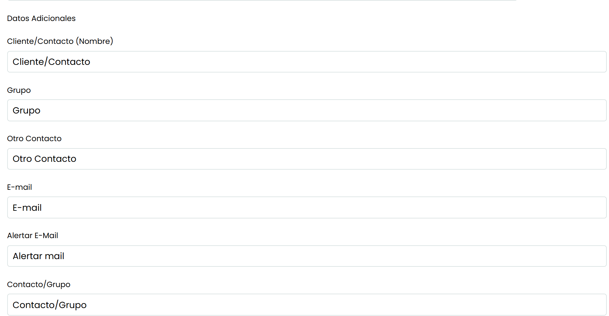

### MANAGERS

Permite añadir una tabla de registros, estos registros serán empleados de empresas superiores. Por tanto, la tabla aparecerá en el formulario, solo si está en una empresa hija.

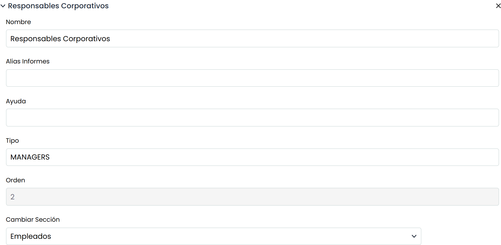

### RISKS

Permite añadir una tabla de registros, estos registros serán riesgo creados en la parte de configuración en la tabla de Categoría Riesgos.

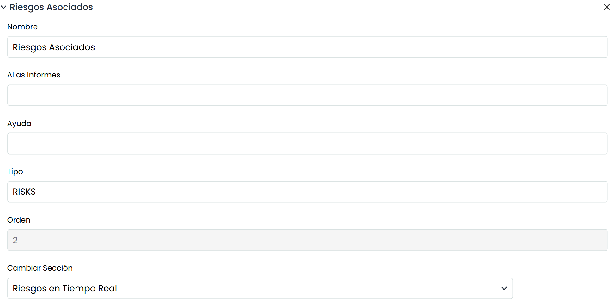

### EVIDENCES

Permite añadir una tabla de registros, estos registros serán de documentación asociada al ticket, nos permitirá adjuntar documentos, añadirles una fecha y una serie de descripciones para tener un control total de las evidencias registradas.

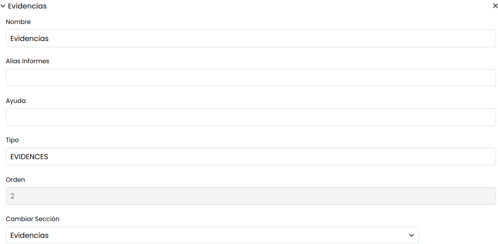

### DELIVERABLES

Permite añadir una tabla de registros, estos registros serán de documentación asociada al ticket, nos permitirá adjuntar documentos, añadirles una fecha y una serie de descripciones para tener un control total de los entregables.

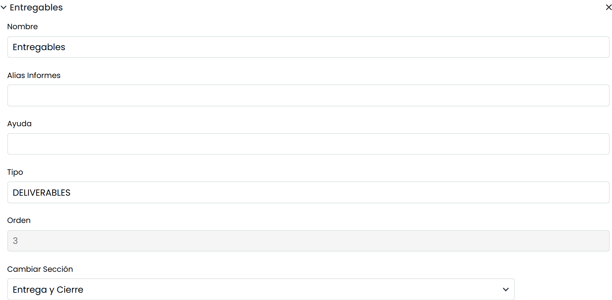

### SUPPLIER

Permite asociar al ticket un proveedor del listado que tengamos cargado en la opción de Proveedores. Podremos añadir más de un campo de este tipo, para poder registrar que proveedores están relacionados con el ticket.

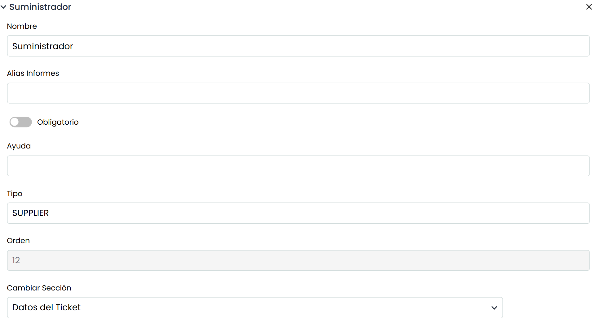

### INCIDENT MANAGEMENT PLANS

Permite añadir una tabla de registros, estos registros estarán relacionado con un plan de gestión de incidentes. Nos permitirá asociar al ticket una serie de impactos y niveles.

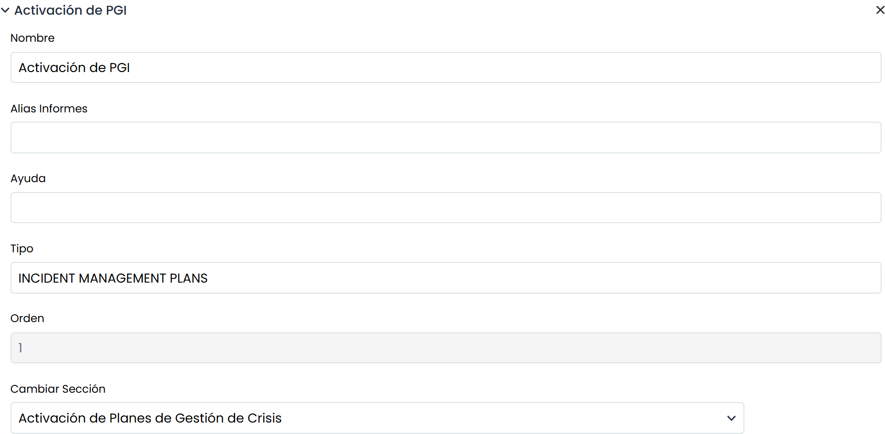

### FOLLOWS UP

Permite añadir una tabla de registros, estos registros serán seguimientos del ticket, donde quedará constancia de que usuario realizó el seguimiento, con una fecha y su descripción. También nos dará la posibilidad de enviar el seguimiento a un listado de correos que definamos separados por ";".

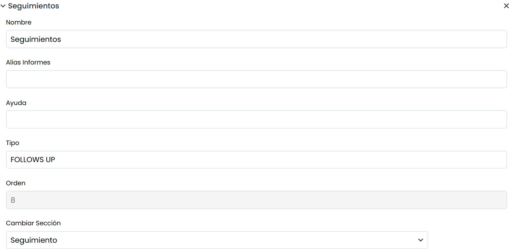

### SERVICES

Permite añadir una tabla de registros, estos registros serán servicios definidos en el Catálogo de Servicios del SG. Podremos asociar con esta tabla, un ticket con los servicios a los que afecta o está relacionado.

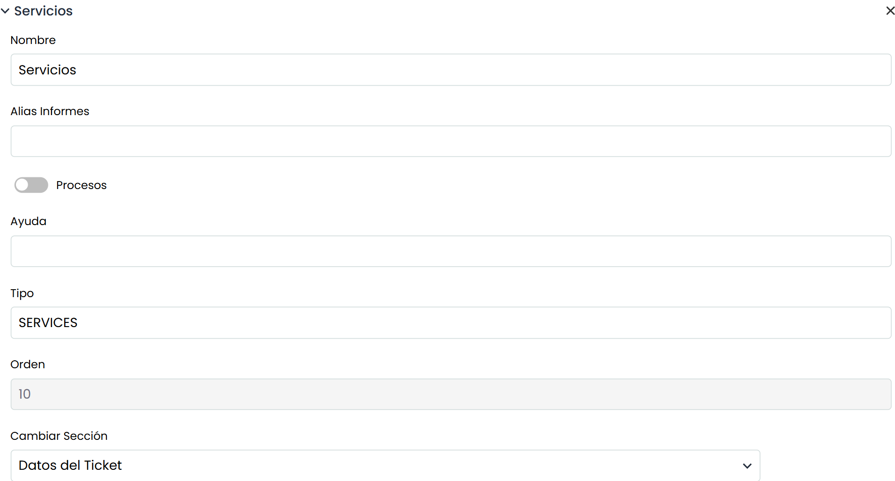

### ORGANIZATIONAL STRUCTURE

Permite añadir una tabla de registros, estos registros serán parte del árbol de la Estructura Organizativa definida en la opción de Inicio/Estructura Organizativa del SG. Podremos asociar con esta tabla, un ticket con la parte de la empresa a la que afecta o está relacionado.

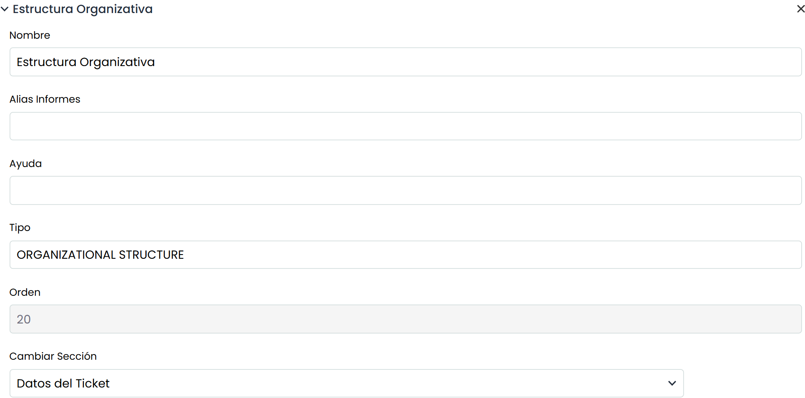

**ID:** Permite añadir un campo de texto que generará una numeración única para cada uno de los tickets, esta numeración podrá ser automática(aleatoria) o podrá ser Manual (patrón definido).

* **Inicio Secuencia:** Permite definir si la secuencia es automática y por tanto generar un número aleatorio, o Manual y definir el patrón de numeración por el que va a comenzar.
* **Editable:** Permite definir si una vez creado el ticket con una numeración única, esta podrá modificarse.

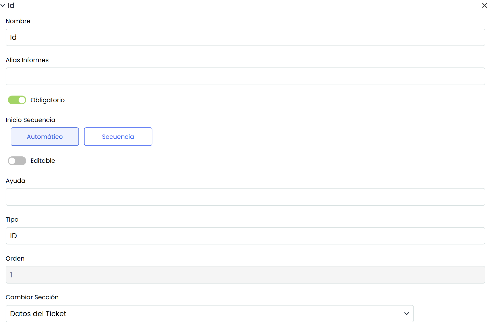

### WORKFLOW

Permite añadir un campo de selección donde aparecerán los flujos de trabajo que tengamos definidos para cada uno de los tickets. Una vez seleccionemos un Workflows para el ticket, en el campo estado se modificarán los diferentes estados por defecto, por los estados del Workflow seleccionado.

**NOTA**: Para poder añadir este campo, es necesario añadir antes el campo "STATUS".

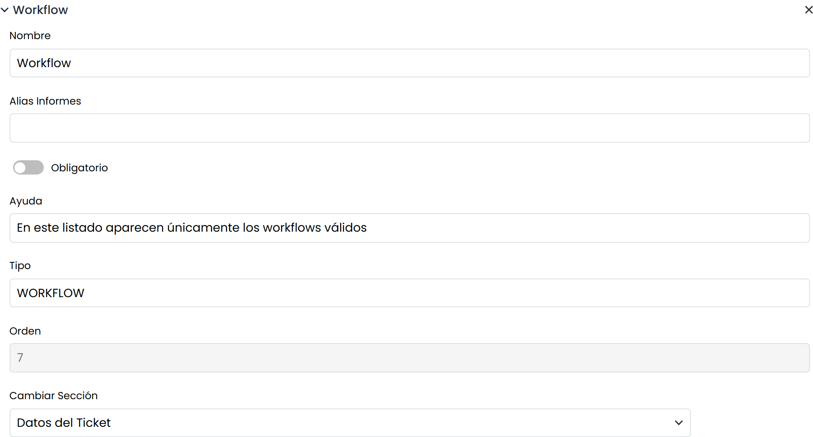

### SIMULATION RISK

Permite añadir una tabla de registros, donde podremos definir para una incidencia o ticket concreto, como afecta a los elementos de un análisis de riesgo concreto. Podremos realizar la simulación y posterior incorporación al análisis para que afecte a los valores generales.

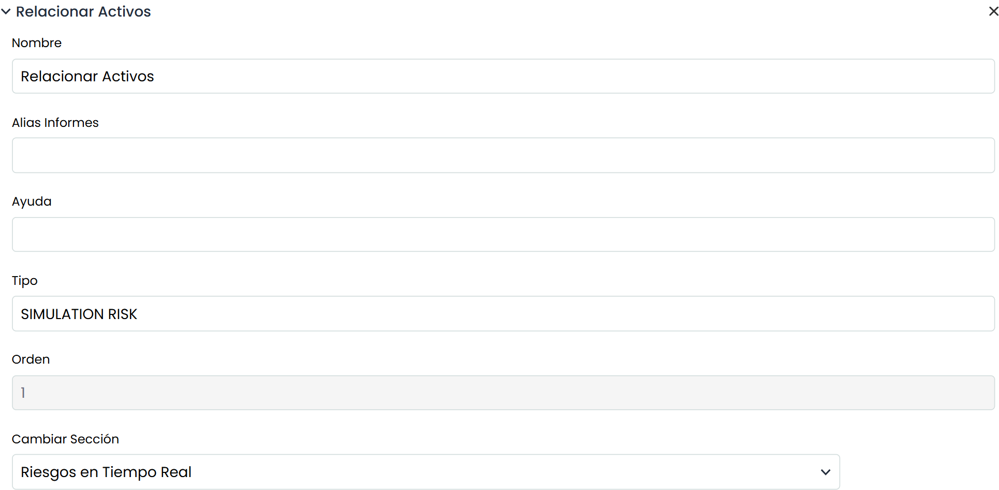

### TYPE

Permite añadir un campo de selección donde nos aparecerán todos los tipos de tickets del SG, con este campo, podremos categorizar los tickets según hayan entrado, para realizar con esto un registro previo para valorar con qué está relacionado, bien sea No conformidad, Acción, Correctiva, etc.

**NOTA**: Solo podrá ser añadido una vez y en un solo tipo de ticket, desde donde se podrá realizar la categorización.

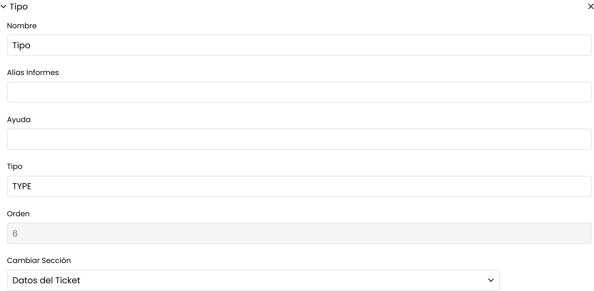

### OWNER

Permite añadir una tabla de registros, donde podremos definir que Empleados(con usuario) son propietarios del ticket, y por tanto, queremos que tengan acceso al mismo.

* **Visible con Workflow:** Esta opción permite a los usuarios propietarios (Owners) de un ticket tener visibilidad cuando el ticket se asigna a un Workflow, aunque no sean los responsables del mismo. Se podrá definir de forma específica para cada tipo de ticket, pudiendo activarse selectivamente para cada uno de ellos.

**NOTA:** En cualquier caso, los Propietarios podrán seguir teniendo acceso a los registros de los que son propietarios en el apartado [Mis Tickets](https://help.globalsuite.es/display/GlobalSUITEes/.Mis+Tickets+vv5.1)

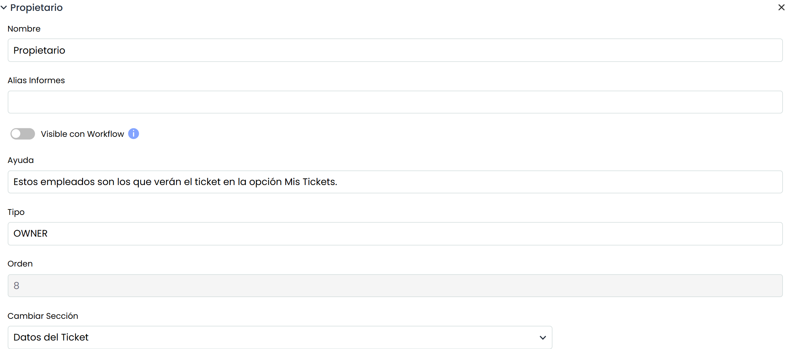

### PROCESSES

Permite seleccionar procesos sin depender de servicios.

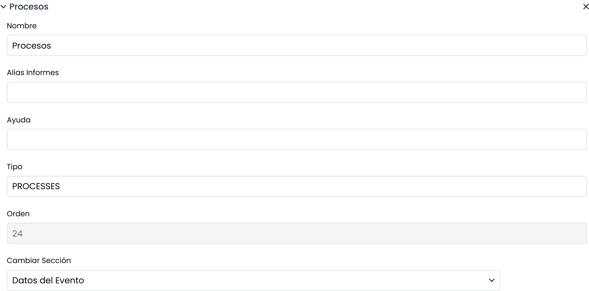

### EVENTS-ID

Muestra el identificador del Evento. Este campo siempre es secuencial (un número correlativo). Es posible indicar en qué número comenzará la secuencia, en caso de que se haya estado gestionando previamente de forma externa a GlobalSuite®.

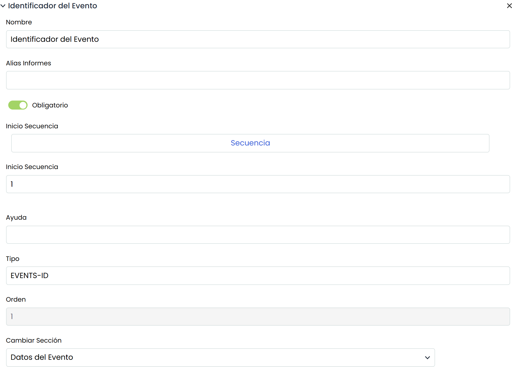

### LINKED-EVENT

Permite seleccionar un evento y vincularlo al ticket que se está editando. De este modo, se rellenarían automáticamente los campos "ROOT-EVENT" y "SEQUENCE".

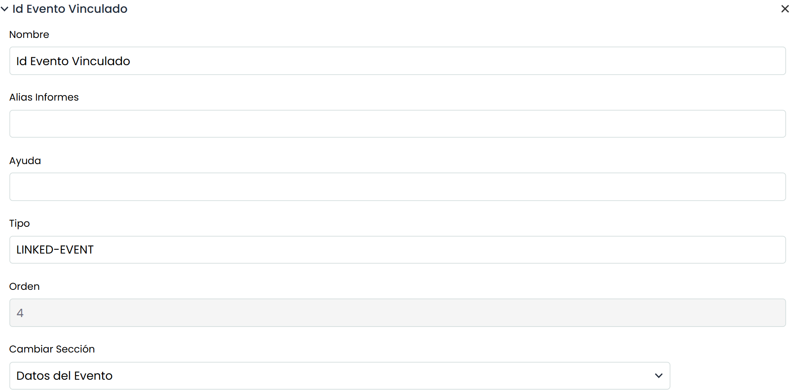

### ROOT-EVENT

Permite indicar el evento raíz del que depende el ticket. Éste se rellena automáticamente en relación al "LINKED\_EVENT".

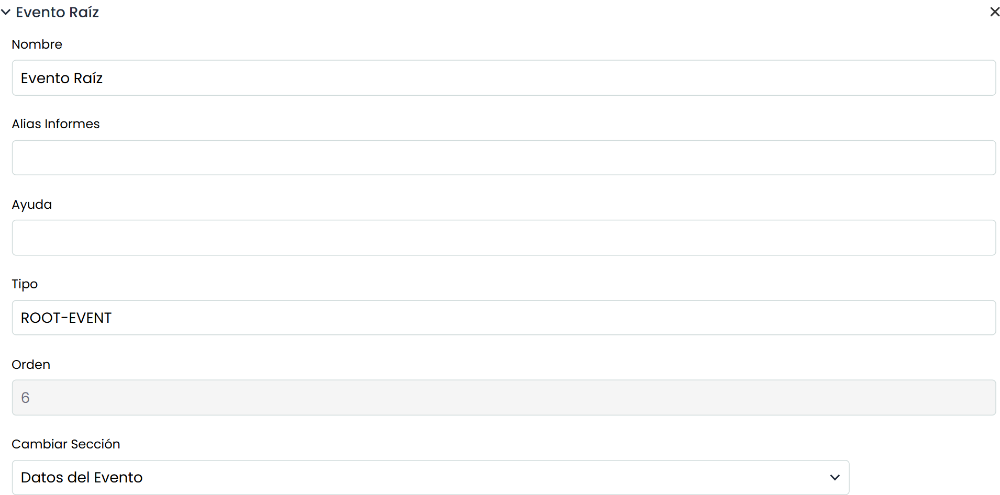

### SEQUENCE

Posición que ocupa el ticket dentro de la secuencia de tickets que hay dependientes dentro del mismo evento raíz.

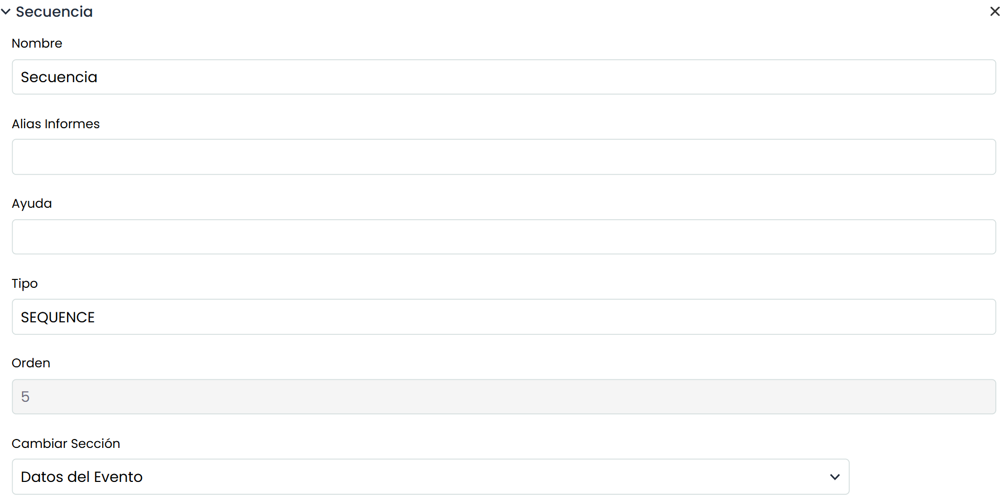

### QUANTIFICATIONS

Permite configurar tanto las cuantificaciones como los recuperos.

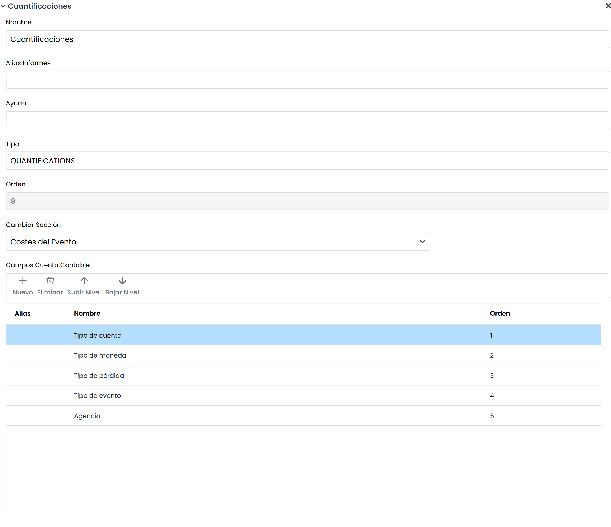

Para cada uno de ellos, se pueden configurar dos tipos de campos:

* **Campos Cuenta Contable**: Esta tabla nos permite definir qué campos se van a utilizar para definir la cuenta contable de las cuantificaciones y los recuperos (la configuración es común a ambas). Al seleccionar un campo, en la tabla inferior se podrán definir las opciones que se pueden elegir para ese campo, incluyendo el valor numérico correspondiente.

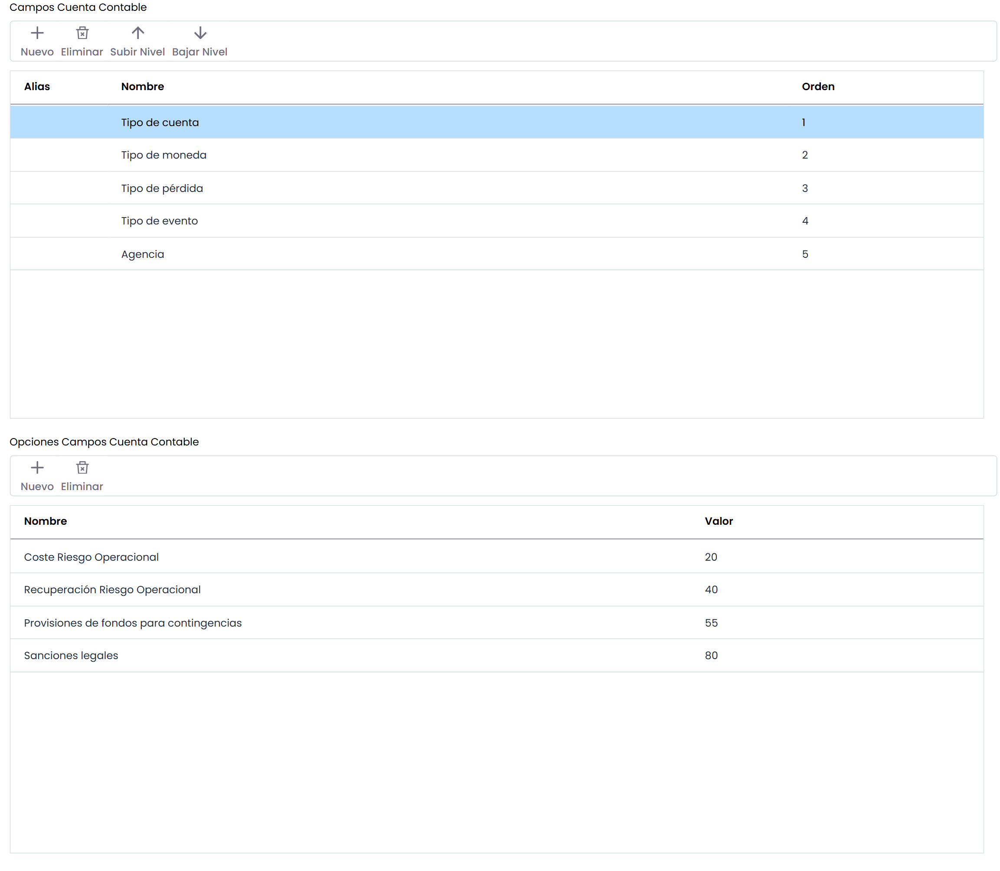

* **Columnas Adicionales Cuantificaciones / Recuperos**: Aquí se pueden configurar campos adicionales para definir las cuantificaciones o los recuperos. Es posible definir campos distintos para cada tipo.

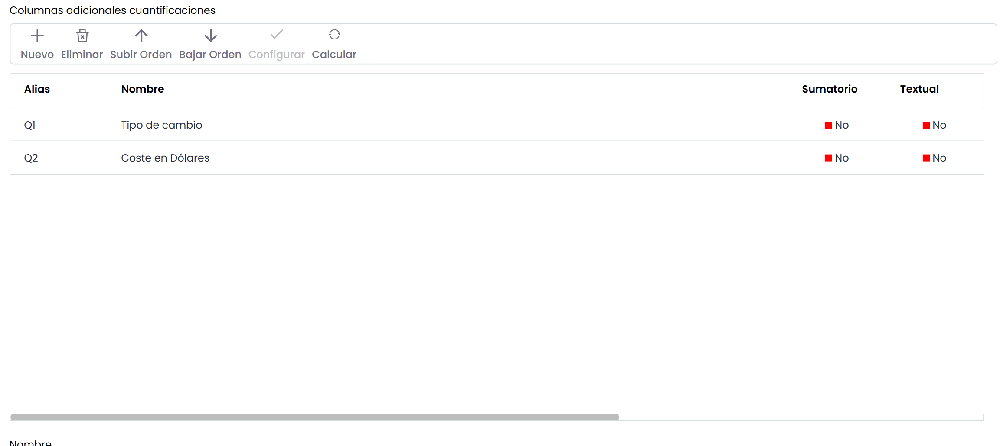

Las columnas de esta tabla son:

* Alias: Identificador automático único para cada campo.
* Nombre: Nombre del campo.
* Sumatorio: Permite indicar si para ese campo numérico, vamos a poder visualizar el valor acumulado al final de la tabla.
* Textual: En caso de estar marcado, el campo permitirá introducir texto, en lugar de solo valores numéricos.
* Automática: Indica si el campo se introduce manualmente o se calcula de forma automática mediante una fórmula.
* Tipo Fórmula: Permite definir de qué forma se calculan los campos numéricos automáticos, si mediante una fórmula única o una fórmula condicional. La fórmula se puede definir mediante el botón "Configurar" de la tabla superior. En caso de añadir una nueva fórmula o modificar una existente, es posible actualizar esos campos automáticos mediante el botón "Calcular".
* Fórmula: Muestra qué fórmula está definida.
* Orden: Indica en qué orden se mostrará el campo en la tabla de cuantificaciones o recuperos. Es posible ajustarlo mediante los botones Subir y Bajar.

### THREATS

Permite la relación directa de un ticket con uno o varios riesgos (y viceversa). Una vez que se ha asociado el riesgo con el ticket, la relación establecida también aparece desde la opción de Análisis de Riesgos.

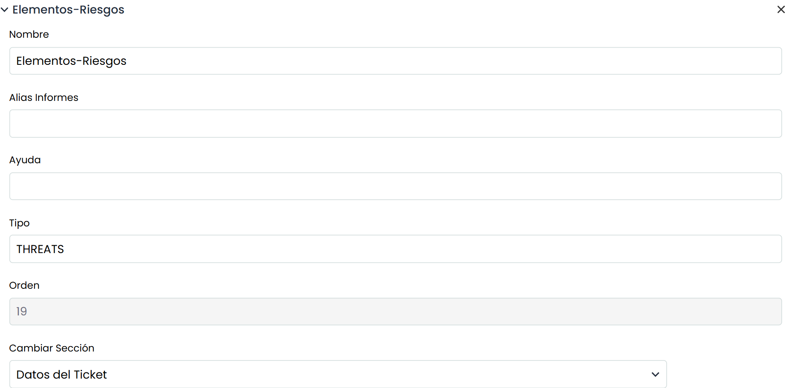
