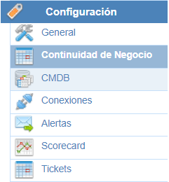

# Continuidad de Negocio

En esta opción se encuentran diferentes tablas y campos para configurar las funcionalidades específicas de Continuidad de Negocio (BIA, Planes, Pruebas y y Gestión de Crisis). A continuación se explican las diferentes secciones que se encuentran en esta opción.

Dentro de la opción, existen diferentes apartados para configurar los aspectos relativos a:

* **BIA**: Parametrización del Análisis de Impacto en el Negocio.
* **Planes**: Permite personalizar la definición de Planes de Continuidad, y Planes de Recuperación, así como el Programa de Pruebas de los mismos.
* **Gestión de la Crisis**: En esta sección se configura el funcionamiento del módulo de Gestión de Crisis y respuesta a incidentes.

* [Configuración Planes](configuracion-planes.md)
* [Configuración BIA](configuracion-bia.md)
* [Configuración Gestión de Crisis](configuracion-gestion-de-crisis.md)
