# Configuración BIA

### Tipos de Impactos en el Negocio

Se pueden añadir o eliminar tipos de impacto que pueden afectar a la organización. El administrador de la plataforma podrá definir por cada uno de los impactos la escala de manera independiente.

Estos tipos de impacto pueden clasificarse como Cualitativos y Cuantitativos, dependiendo de si se quieren valorar en el BIA en base a los niveles de impacto configurados o introduciendo magnitudes numéricas (como cantidades económicas). Además, para cada tipo de impacto podrá indicarse si se quiere valorar de manera adicional en un período crítico o no. Por último, se podrá definir de qué manera se calculará la criticidad para cada uno de ellos, con alguno de los siguientes criterios: Valor Acumulado, Máximo, Mínimo o Media.

### Cálculo Global Tabla Impacto

Permite definir el criterio que se utilizará para obtener el valor de criticidad de la tabla de impacto, que podrá ser: Valor Acumulado, Máximo, Mínimo, Media o Media Ponderada asignando pesos a cada tipo.

### Tipo Cálculo Criticidad

Este campo indica si el cálculo del valor global de criticidad de la tabla de impacto se hará a partir de los valores finales de cada tipo de impacto (por filas), utilizando los valores calculados para cada uno de los escalones de interrupción (por columnas) o con ambos conjuntos de valores (por filas y columnas).

### Impactos por Escala Temporal

Esta tabla permite definir los criterios de los tipos de impacto creados para cada nivel. Los criterios definidos en la tabla aparecerán en los BIA y las encuestas de BIA, de forma que el usuario podrá consultar el criterio asociado a cada nivel de evaluación (Bajo, Medio, Alto, etc.). Para editar un criterio, se debe seleccionar la celda correspondiente en la tabla y hacer doble click.

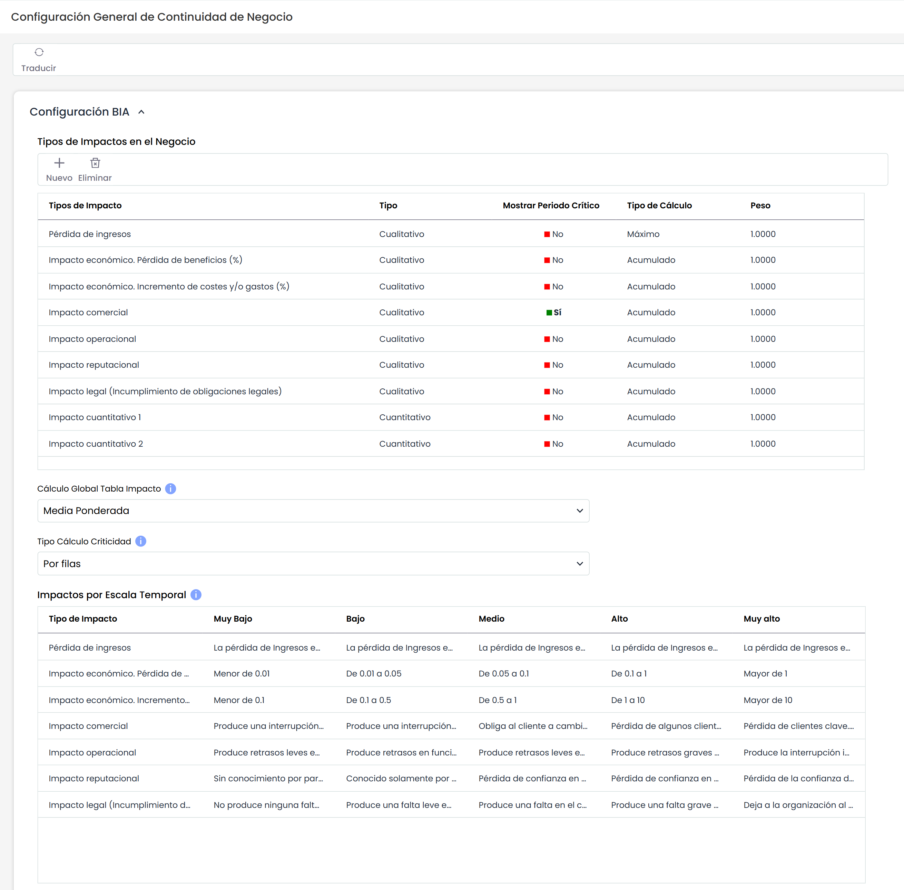

### Tabla de Escala Temporal

Permite la creación de la escala temporal en la que se basará el BIA. Se pueden definir distintos registros introduciendo la cantidad (sólo valores numéricos) y la unidad deseada (segundos, minutos, horas, días, semanas), con la restricción de que no puede haber dos unidades con la misma cantidad y unidad. La tabla se ordenará automáticamente con cada cambio.

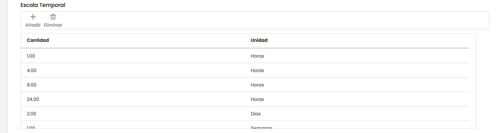

### Niveles

Este apartado permite definir los niveles de evaluación de los diferentes impactos definidos en la escala temporal establecida. Estos niveles se utilizan en la realización de Encuestas, BIAs y Pre-BIAs. Es posible asignar un valor numérico a cada nivel, que se usará en el cálculo de la criticidad.

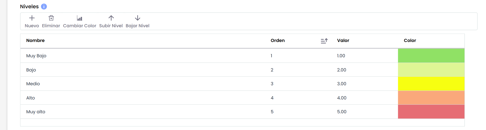

Las opciones que permite este apartado son:

* **Nuevo:** Permite insertar una nueva entrada en la tabla.
* **Eliminar:** Posibilita eliminar niveles de la tabla. Para ello se selecciona la fila deseada y se pulsa el botón 'Eliminar'
* **Cambiar Color:** Permite cambiar el color con el que se resalta el nivel.
* **Subir Nivel:** Ofrece la posibilidad de subir la posición en el que el nivel se mostrará en el listado.
* **Bajar Nivel:** Ofrece la posibilidad de bajar la posición en el que el nivel se mostrará en el listado.

### Habilitar Criticidad

Este apartado permite la posibilidad de ocultar la criticidad en los BIAS. En caso de que no se quiera utilizar la funcionalidad para obtener y calcular un valor de criticidad de los procesos (en función de la valoración de impacto), es posible desactivarla.

* En caso de estar deshabilitado, ya no aparecerá el campo en la tabla de impacto, ni en las distintas vistas donde se muestra actualmente. Tampoco aparecerá en los Informes del Listado de BIAs (Informe CSV) ni en los Informes de formulario de los BIAs (Informe Docx).
* Si la criticidad está habilitada, se podrá seguir obteniendo en función de los criterios de cálculo establecidos, y se visualizará en todas las partes de la herramienta.

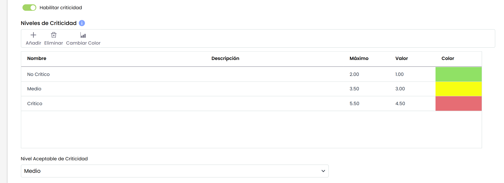

### Niveles de Criticidad

Este apartado permite definir los niveles cualitativos en los cuales se expresará la criticidad resultante del BIA. Este nivel se obtiene a partir del cálculo de la tabla de impactos.

En este apartado se pueden realizar las siguientes acciones:

* **Nuevo:** Permite insertar una nueva entrada en la tabla.
* **Eliminar:** Posibilita eliminar niveles de la tabla. Para ello se selecciona la fila deseada y se pulsa el botón 'Eliminar'
* **Cambiar Color:** Permite cambiar el color con el que se resalta el nivel.

Para cada nivel se puede definir el rango de valores englobados en él, editando el valor máximo de cada nivel. La tabla se ordenará automáticamente una vez modificada. La edición de cada campo se realiza haciendo doble click.

**Nivel Aceptable de Criticidad:**Esta campo permite indicar qué nivel, de los configurados en la tabla de Niveles anterior, corresponde al Nivel de Criticidad que acepta la organización. El Nivel Aceptable de Criticidad indicado se podrá comparar con el nivel de Criticidad obtenido en cada uno de los BIA.


\*\*NOTA:\*\*Si la criticidad esta deshabilitada, los apartados Niveles de Criticidad y Nivel Aceptable de Criticidad no aparecerán en la configuración.


### Configuración de cálculo MTPD y RTO

La configuración establecida en esta sección impacta directamente en:

* **BIAs consolidados**
* **Pre-BIAs**
* **Encuestas BIA**
* La vista **Análisis > Cálculo RTO y RPO**

De este modo, los criterios definidos aquí determinan si el cálculo de los valores será manual o automático, y en caso de ser automático, bajo qué regla se generarán.

#### MTPD

##### Configuración

En el campo **Cálculo MTPD** se puede seleccionar una de estas opciones:

* **Manual**: el valor se introduce directamente en cada servicio o proceso.
* **Automático**: el valor se calcula en base a los impactos registrados en el BIA, siguiendo el criterio configurado.
* **Configurado en cada BIA**: en cada BIA se define individualmente si el cálculo es manual o automático.

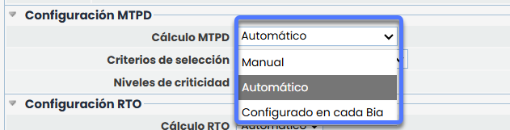

##### Criterios de cálculo automático

Si se selecciona la opción **Automático**, se habilitan los siguientes criterios:

* **Primer impacto**: asigna el MTPD cuando el primer nivel de impacto coincide con la escala definida por el usuario.
* **Primera media de impacto**: asigna el MTPD según la media de los impactos registrados.
* **Primer impacto de tipo**: asigna el MTPD cuando el primer nivel de un tipo concreto de impacto coincide con la escala definida.

En función del criterio elegido, se muestran campos adicionales:

* Para *Primer impacto* o *Primera media de impacto*: un desplegable con los **niveles de impacto** configurados (Muy Bajo – Muy Alto).
* Para *Primer impacto de tipo*: un desplegable con los **tipos de impacto** configurados (ej. económico, legal, reputacional, etc.).

---

#### RTO

##### Configuración

En el campo **Cálculo RTO** se puede seleccionar una de estas opciones:

* **Manual**: el valor se introduce directamente en cada servicio o proceso (opción por defecto en clientes actuales y nuevos).
* **Automático**: el valor se calcula en base a los impactos registrados en el BIA, siguiendo el criterio configurado.

##### Criterios de cálculo automático

Si se selecciona la opción **Automático**, se habilitan los siguientes criterios

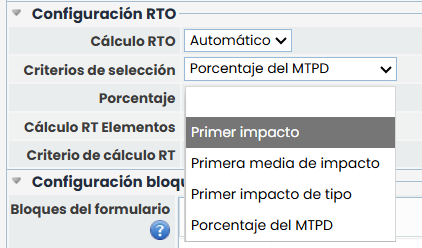

* **Primer impacto**: asigna el RTO cuando el primer nivel de impacto coincide con la escala definida por el usuario.
* **Primera media de impacto**: asigna el RTO según la media de los impactos registrados.
* **Primer impacto de tipo**: asigna el RTO cuando el primer nivel de un tipo concreto de impacto coincide con la escala definida.
* **Porcentaje del MTPD**: calcula el RTO aplicando un porcentaje del MTPD.

En función del criterio elegido, se muestran campos adicionales:

* Para *Primer impacto* o *Primera media de impacto*: un desplegable con los **niveles de impacto** configurados.
* Para *Primer impacto de tipo*: un desplegable con los **tipos de impacto** configurados.
* Para *Porcentaje del MTPD*: un campo numérico que permite introducir valores entre **1 y 100**.

### Configuración bloques y visibilidad

#### Bloques del formulario

Este apartado permite editar el título de cada bloque o apartado del formulario del BIA.

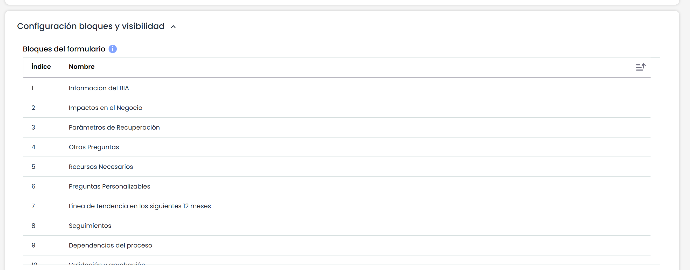

Existen un total de 10 bloques posibles. Los campos y preguntas configurables de los BIAs se incluirán en estos bloques. En el formulario de BIA sólo aparecerán los bloques con algún campo asociado.

## Visibilidad y orden de campos

En esta tabla se puede definir la visibilidad de los campos y tablas fijos que se pueden utilizar en la realización de BIAs. Existen campos que son obligatorios: Nombre, Tabla de Impactos y MTPD.

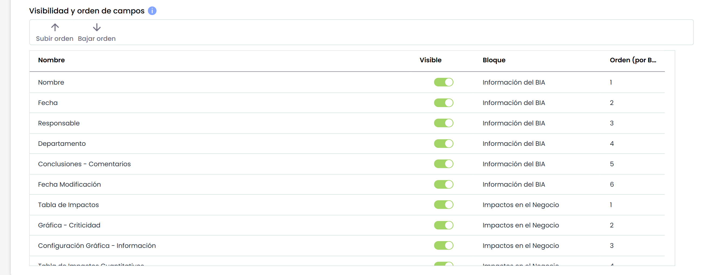

La información que aparece en la tabla es:

* **Nombre:** Muestra el identificador del campo.
* **Visible:** Check que permite mostrar u ocultar un campo.
* **Bloque:** Al hacer doble click en esta celda, se despliega el listado de bloques disponible, para poder seleccionar en qué bloque se mostrará el campo dentro del formulario.
* **Orden (por bloque):** Esta columna indica el orden de cada campo dentro de cada bloque. Al cambiar un campo de bloque se añadirá al final del mismo. También es posible ordenar manualmente los campos seleccionando uno y pulsando los botones "Subir Orden" ó "Bajar Orden".


\*\*NOTA:\*\* Si se oculta un campo en la configuración general de BIAs, también se desmarcará en los Modelos de Encuesta.


## Preguntas Personalizadas

Este apartado permite definir un listado de preguntas que permitan obtener la información requerida para la realización de los BIAs.

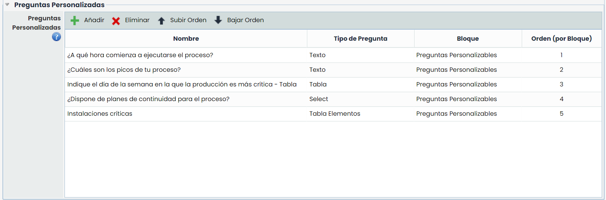

La información que permite definir la tabla es:

* **Nombre:** Permite definir la pregunta que se quiere formular.
* **Tipo de pregunta:** Ofrece la posibilidad de parametrizar el tipo de pregunta, pudiendo optar entre tipo 'Texto', 'Select', 'Tabla' ó 'Tabla Elementos'.
* **Bloque:** Al hacer doble click, se muestra el listado de bloques disponible, permitiendo seleccionar en cual de ellos se mostrará la pregunta dentro del formulario.
* **Orden (por bloque):** Esta columna indica el orden de cada pregunta dentro de cada bloque. Al cambiar una pregunta de bloque se añadirá al final del mismo. También es posible ordenar manualmente cada pregunta seleccionándola y pulsando los botones "Subir Orden" o "Bajar Orden".

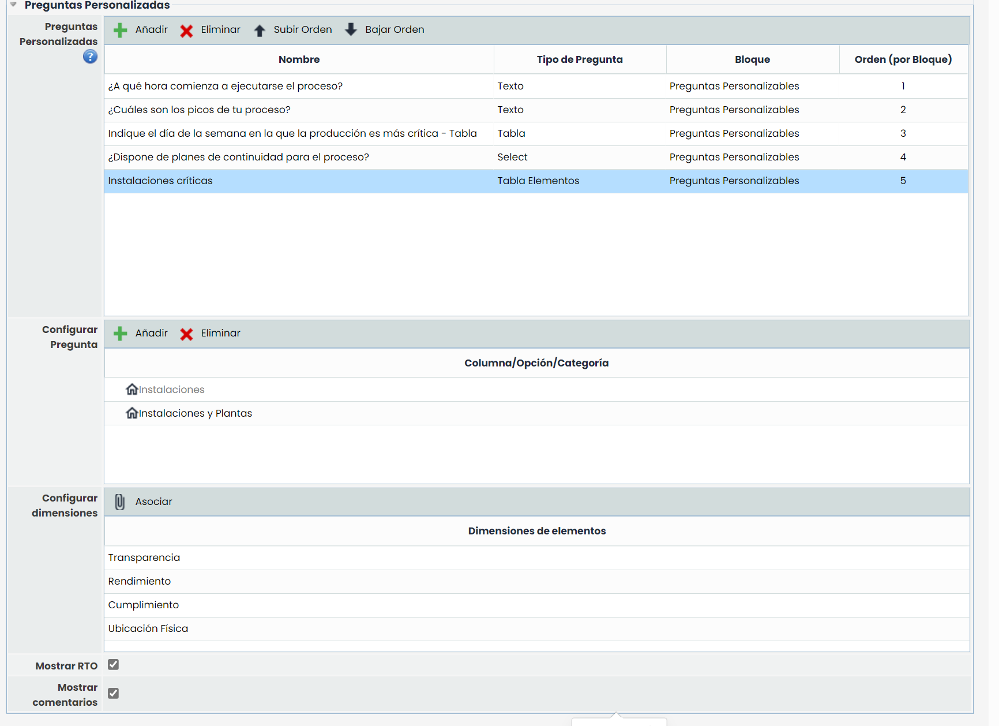

Para insertar un tipo de pregunta en la tabla se debe pulsar sobre el botón 'Nuevo'. En caso de querer eliminar un tipo de pregunta, se ha de seleccionar la fila deseada y pulsar sobre el botón 'Eliminar'.

En caso de configurar la pregunta como tipo 'Select', 'Tabla' o 'Tabla Elementos', se muestra en la parte inferior una tabla que permite definir los parámetros deseados. En función de tipo de pregunta se permite:

* **Tipo de Pregunta 'Select':** Se puede definir las opciones posibles que se podrán seleccionar en la lista desplegable.
* **Tipo de Pregunta 'Tabla':** Se puede definir las columnas que tendrá la tabla.
* **Tipo de Pregunta 'Tabla Elementos':** Se puede definir las categorías que estarán disponibles para realizar el registro de los elementos. Las categorías de activos corresponden a las categorías definidas en la opción Ajustes> Metodologías > [Elementos](https://help.globalsuite.es/pages/viewpage.action?pageId=107020381).

**Configurar dimensiones**

En este apartado se podrán configurar las opciones de visibilidad de dimensiones manuales del inventario.

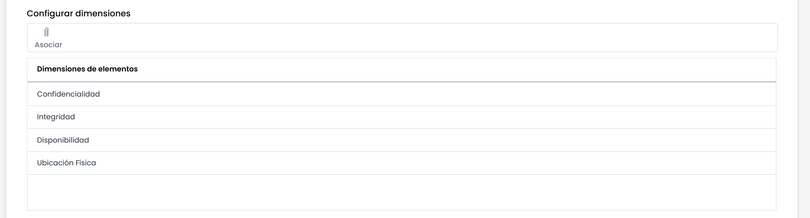

Al pulsar "Asociar" se abrirá una ventana con las opciones de dimensiones disponibles (según lo configurado en Ajustes> Metodologías > [Elementos](https://help.globalsuite.es/pages/viewpage.action?pageId=107020381)),  las cuales podrán asociar o desasociar según corresponda.

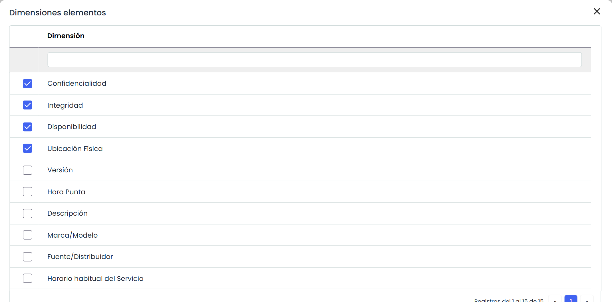
