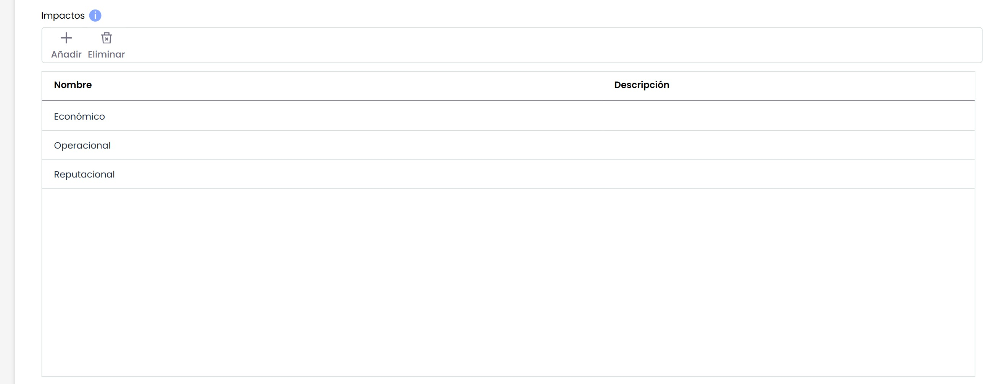
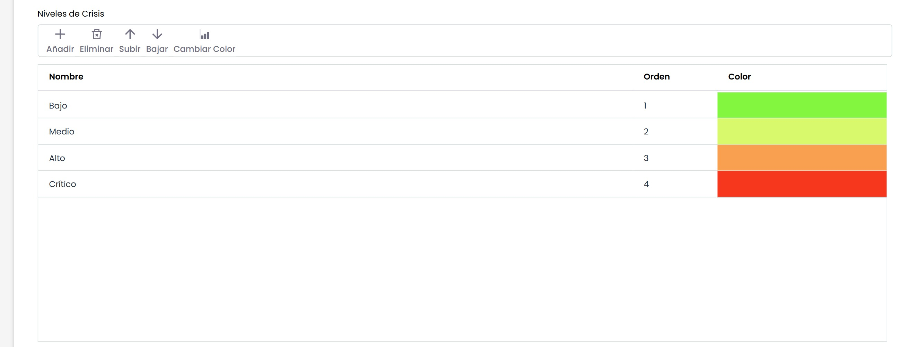
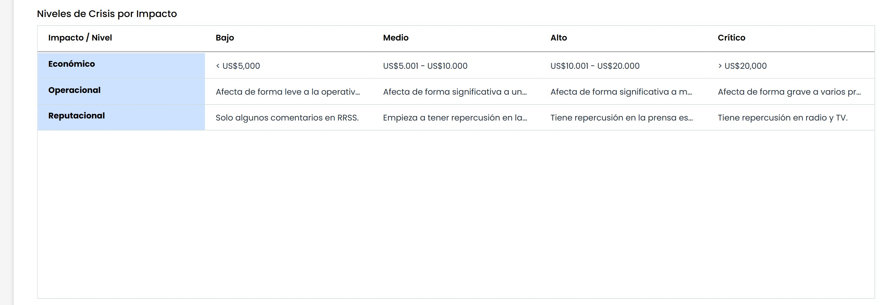
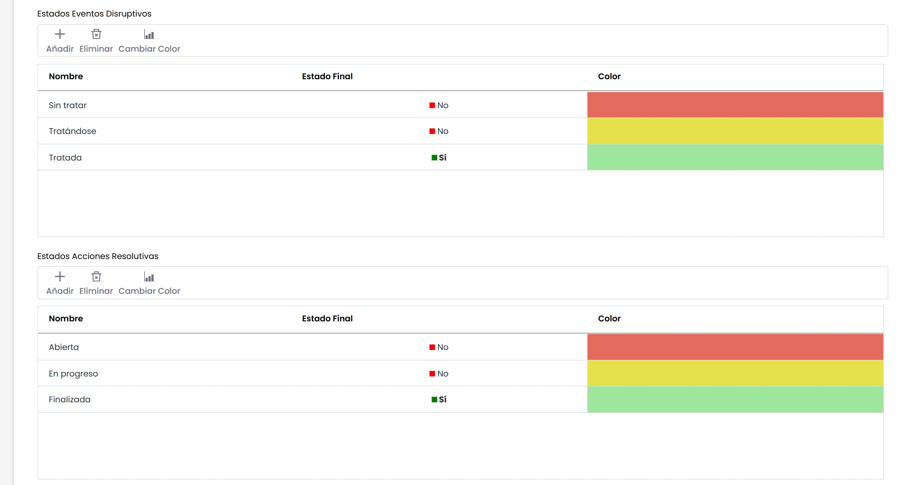

# Configuración Gestión de Crisis

En esta opción se encuentran diferentes tablas y campos para configurar las funcionalidades específicas de Gestión de Crisis.

# **Criterios**

* **Criterio Área Afectada:** Al marcar este campo se habilita la aparición del criterio "Área Afectada" en el listado de criterios de activación en los Planes de Gestión de Crisis.
* **Criterio Servicio:** Al marcar este campo se habilita la aparición del criterio "Servicio" en el listado de criterios de activación en los Planes de Gestión de Crisis.
* **Criterio Prioridad:** Al marcar este campo se habilita la aparición del criterio "Prioridad" en el listado de criterios de activación en los Planes de Gestión de Crisis.

# **Impactos**

Este apartado permite definir los diferentes impactos que pueden afectar a una crisis. Estos niveles se utilizan en los Planes de Gestión de Crisis y en las Gestiones de Crisis. Es posible asignar el nombre y la descripción tanto en español como en inglés.

# **Niveles de Crisis**

Este apartado permite definir los niveles que pueden tener una crisis. Estos niveles se utilizan en los Planes de Gestión de Crisis y en las Gestiones de Crisis. Es posible asignar el nombre y la descripción tanto en español como en inglés, el orden y el color.

Las opciones que permite este apartado son:

* **Añadir:** Permite insertar una nueva entrada en la tabla.
* **Eliminar:** Posibilita eliminar niveles de la tabla. Para ello se selecciona la fila deseada y se pulsa el botón 'Eliminar'
* **Subir:** Ofrece la posibilidad de subir la posición en el que el nivel se mostrará en el listado.
* **Bajar:** Ofrece la posibilidad de bajar la posición en el que el nivel se mostrará en el listado.
* **Cambiar Color:** Permite cambiar el color con el que se resalta el nivel.

# **Niveles de Crisis por Impacto**

Este apartado permite definir el mapeo entre los Impactos y los Niveles definidos previamente.

# **Estados: Eventos Disruptivos y Acciones Resolutivas**

Este apartado permite definir **estados** de los Eventos Disruptivos y las Acciones Resolutivas que se utilizarán en la opción de Gestión de la Crisis. Es posible asignar el nombre tanto en español como en inglés.

* **Estado Final:** Permite indicar si un estado debe ser considerado como final.

**Mostrar Elementos en Gestión Crisis:** Al marcar este campo se habilita la aparición de una tabla para asociar Elementos en los Planes de Gestión de Crisis y Gestión de Crisis.

