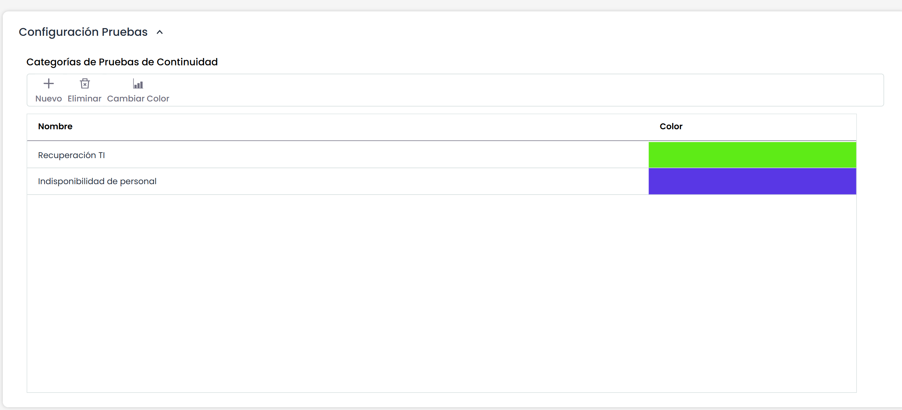
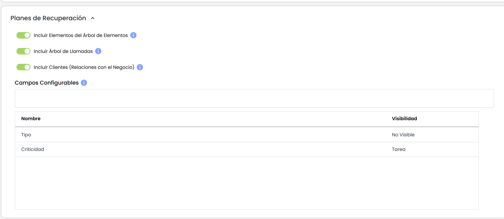
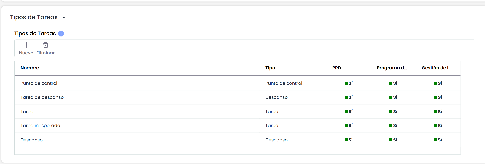

# Configuración Planes

# **Configuración Pruebas**

GlobalSUITE ofrece la posibilidad de configurar las categorías de las pruebas de los Planes de Recuperación, las cuales se desarrollan en la opción ‘Planes/Programa de Pruebas’.

Las opciones que se pueden realizar sobre la tabla son:

* **Nuevo:** Permite insertar una nueva categoría en la tabla.
* **Eliminar:** Ofrece la posibilidad de eliminar una o varias categorías definidas. Para ello se debe seleccionar la fila o filas deseadas, y pulsar el botón ‘Eliminar’.
* **Cambiar Color:** Permite, seleccionando la fila deseada, definir el color que se mostrará en el gráfico de la opción ‘Planes/Programa de Pruebas’.

# **Planes de Recuperación**

Esta sección permite indicar si se requiere añadir a los Planes de Recuperación un conjunto de tablas y campos configurables disponibles de manera opcional.

* **Incluir Activos del Árbol de Dependencias:** Al marcar este campo se habilita una tabla en los Planes de Recuperación que permite añadir activos a cada Plan de Recuperación y sus Secuencias de Recuperación asociadas.
* **Incluir Árbol de Llamadas:** Al marcar este campo se habilita una tabla en los Planes de Recuperación que permite configurar un árbol de llamadas entre Roles y Empleados.

* **Incluir Clientes (Relaciones con el Negocio):** Al marcar este campo se habilita una tabla en los Planes de Recuperación para asociar clientes a cada Plan de Recuperación.


\*\*NOTA\*\*: Si el entorno tiene habilitada la funcionalidad 'Relaciones con el Negocio' (disponible en algunos módulos de GlobalSUITE), se permitirá seleccionar los clientes registrados en dicha opción. Si, por el contrario, no se dispone de esta funcionalidad habilitada, se permitirá crear clientes específicos para cada Plan.


* **Campos Configurables:** Esta tabla permite configurar dos campos adicionales que podrán asociarse al formulario de Secuencias de Recuperación o al formulario de Tareas. En la tabla se permite editar el nombre de los campos configurables (tanto en Español como en Inglés) e indicar dónde se quiere visualizar cada campo haciendo doble click en la columna 'Visibilidad'. Las opciones disponibles en dicha columna son: 'No Visible', 'Secuencias' y 'Tarea'.

# **Tipos de Tareas**

Esta sección permite definir las tipologías de tareas que se pueden establecer en las opciones de 'Plan de Recuperación', 'Programa de Pruebas' o 'Gestión de la Crisis'.

La información que permite definir la tabla es:

* **Nombre:** Permite definir el nombre del tipo de la tarea.
* **Tipo:** Permite configurar la tipología del tipo de tarea, pudiendo optar entre 'Punto de control', 'Descanso' o 'Tarea'.
* **PRD:** Permite definir si queremos mostrar el tipo de tarea en la opción de Plan de Recuperación. Para ello, se debe hacer click sobre la celda correspondiente.
* **Programa de pruebas:** Permite definir si queremos mostrar el tipo de tarea en la opción de Programa de Pruebas. Para ello, se debe hacer click sobre la celda correspondiente.
* **Gestión de la crisis:** Permite definir si queremos mostrar el tipo de tarea en la opción de Gestión de la Crisis. Para ello, se debe hacer click sobre la celda correspondiente.

Para insertar un tipo de tarea en la tabla se debe pulsar el botón 'Nuevo'. En caso de querer eliminar un tipo de tarea, se debe seleccionar la fila deseada y pulsar sobre el botón 'Eliminar'.
