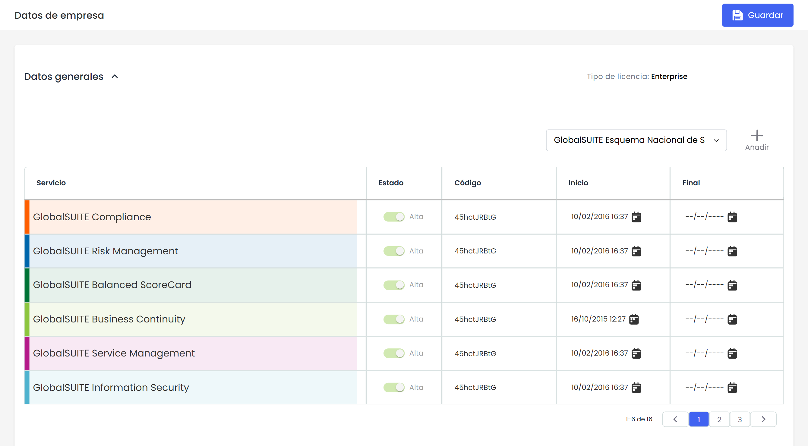
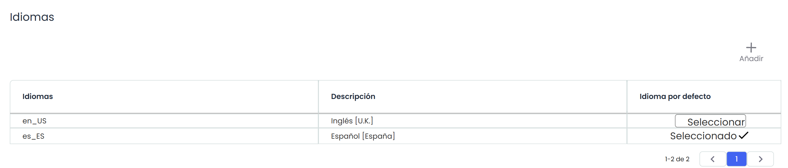
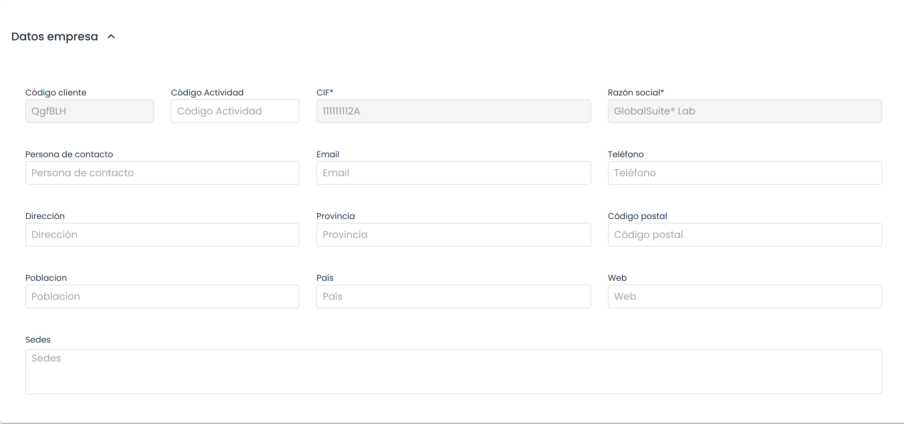

# Datos Empresa


Esta sección centraliza la información esencial de la empresa en GlobalSuite®, incluyendo detalles generales, opciones de idiomas y datos de contacto. Permite configurar y consultar los aspectos básicos de los servicios contratados y el perfil corporativo.


## Datos Generales

Permite visualizar información referente a los servicios y módulos contratados en GlobalSuite® por la empresa seleccionada, como son los servicios contratados, los módulos disponibles y el tipo de licencia.

## Idiomas

Permite seleccionar qué idiomas de entre los disponibles en GlobalSUITE® se van a utilizar en la empresa, marcando uno por defecto. Estos idiomas serán en los que se podrán configurar los parámetros personalizables.

Los usuarios podrán seleccionar qué idioma quieren utilizar de entre los disponibles, creándose con el idioma por defecto.

Los idiomas disponibles actualmente en GlobalSUITE® son:

* Español
* Inglés
* Portugués
* Euskera
* Catalán
* Alemán
* Francés
* Brasileño


\*\*NOTA:\*\* La habilitación de nuevos idiomas entre los disponibles debe solicitarse al servicio de soporte.


## Datos empresa

Podrá visualizar datos como el CIF, Razón Social, Teléfono, Dirección, Personas de Contacto, etc. sobre la empresa seleccionad

