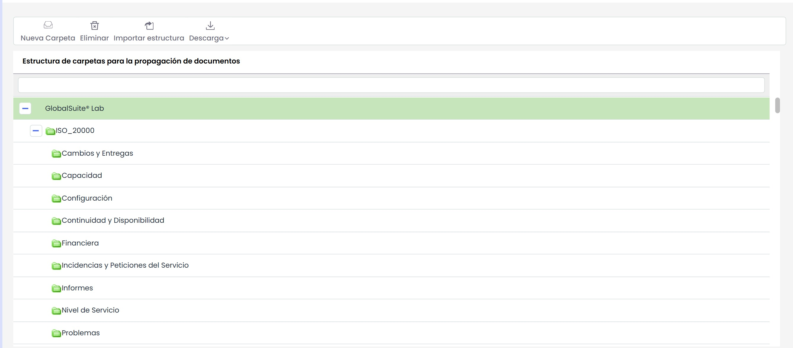

# Estructura de Propagación

La opción permite definir la estructura de carpetas del gestor documental. Las opciones que se pueden realizar sobre la opción son las siguientes:

* **Nueva Carpeta:** Permite insertar una nueva carpeta en la estructura
* **Eliminar:** Ofrece la posibilidad de eliminar una carpeta ya generada. Para ello se ha de seleccionar la carpeta y pulsar sobre el botón 'Eliminar'
* **Importar estructura:** Ofrece la posibilidad de importar una estrucutra ya generada por el usuario.
* **Descargar:** Permite la descarga de la estructura documental en formato editable (xlxs) o en PDF.
