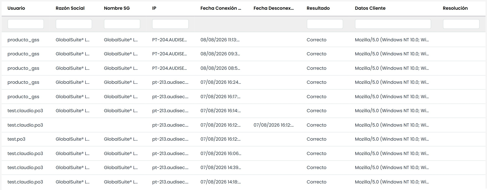

# Logs de Accesos

El presente apartado permite visualizar los difentes accesos que se han realizado sobre la plataforma, obteniendo información como el usuario, IP, fecha de conexión, datos del cliente, etc.

Las acciones que se permite realzair sobre la tabla son las siguientes:

* **Seleccionar Año:** Permite filtrar el listado de accesos por años.
* **Descarga:** Ofrece la posibilidad de descargar el listado en formato editable (xlsx) o en PDF.
