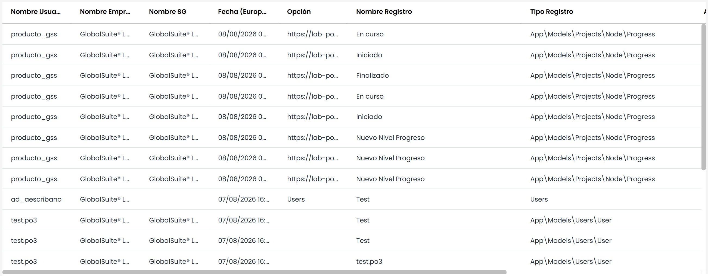
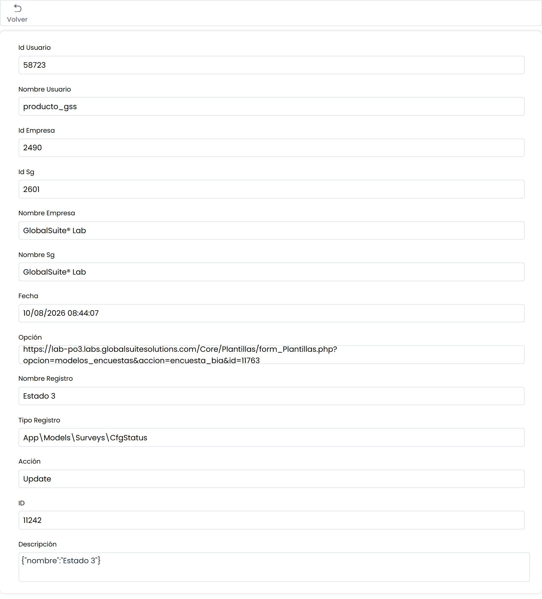

# Logs de Acciones

La opción seleccionada ofrece la posibilidad de visualizar la actividad que se ha realizado en la plataforma por los diferentes usuarios que han accedido, es decir, las actualizaciones o modificaciones que se han realizado en las diferentes apartados de la herramienta, en base a campos como Usuario, Opción, Registro, etc.

* **Seleccionar Año:** Permite filtrar el listado de acciones por años.
* **Abrir Log:** Una vez seleccionado un log de la tabla, ofrece la posibilidad de ampliar la información que aporta la tabla de acciones, tal y como se muestra en la siguiente imagen:

