# Metodología Elementos

Este apartado permite al usuario de la herramienta definir los valores necesarios a la hora de realizar el inventario de elementos.

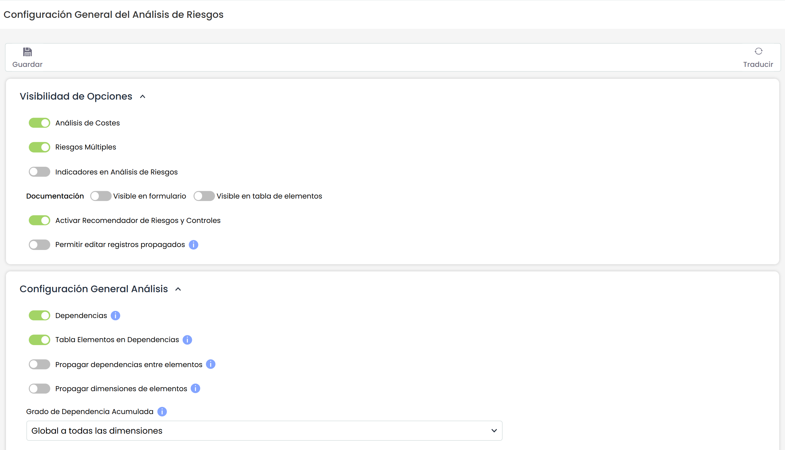

## Visibilidad de Opciones

* **Análisis de Costes:** Si está activado, permite acceder a la funcionalidad de "Análisis de Costes" en la opción de Análisis de Riesgos.
* **Riesgos Múltiples:** Si está activado, permite acceder a la funcionalidad de "Riesgos Múltiples" en la opción de Análisis de Riesgos.
* **Mapa de Riesgos Repercutidos:** Si está activado, permite acceder a la funcionalidad de "Grafo de Análisis Repercutido" en la opción de Evaluación de Riesgos.
* **Indicadores en análisis de riesgos:** Si está activado, permite asociar Indicadores del cuadro de mando a los riesgos de los Análisis de Riesgos.
* **Documentación**

  * Visible en formulario: Al seleccionar esta opción se añadirá la posibilidad de añadir documentación en el formulario de los elementos del inventario, de los tratamientos y de los casos de uso de IA.
  * Visible en tabla de elementos: Al seleccionar esta opción se añadirá la posibilidad de añadir documentación en la [Tabla de elementos](../../analisis/inventario/tabla-de-elementos/README.md), en la [Tabla de tratamientos](../../analisis/tratamientos.md) y en la tabla de [Casos de uso de IA](https://globalsuitesolutions.atlassian.net/wiki/x/B4AsdQ).
* **Permitir editar registros propagados:** Si está activado, los registros de Servicios, Procesos, Elementos del Inventario que sean propagados a entidades inferiores, se podrán editar. En caso de estar desmarcado, no serán editables.

## Configuración General Análisis

* **Dependencias:** Seleccionando esta opción se habilitará la posibilidad de gestionar el **árbol de dependencias**, permitiendo modelar el inventario de elementos de manera sencilla mediante dependencias entre los mismos.
* **Tabla Elementos en Dependencias:** Si está activado, permite mostrar la tabla de elementos de la derecha en la opción "Inventario" / "Árbol de Elementos".
* **Propagar dependencias entre elementos:** Si está activado, cuando se propaguen elementos a entidades inferiores, también se propagarán las dependencias entre ellos.
* **Propagar dimensiones de elementos:** Si está activado, cuando se propaguen nuevos elementos a subentidades inferiores, o se actualicen los elementos ya propagados,  se incluirá la valoración de las dimensiones.
* **Grado de dependencia acumulada:** Permite identificar si se quieren establecer dependencias entre elementos "por dimensión" (diferente para cada una) o de manera global.
* **Grados de dependencias:** Posibilita definir los niveles de dependencia entre las dimensiones establecidas y el porcentaje de reducción de cada una de ellas.

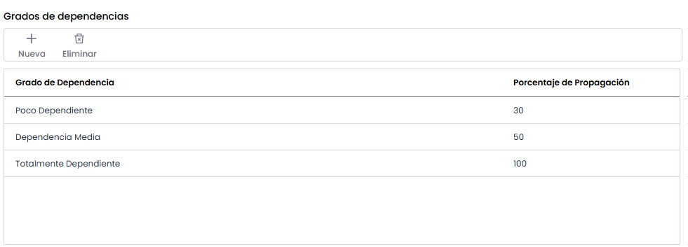

### Categorías

### Categoría activos:

Opción que permite definir las categorías o subcategorías a las que asociar los activos del inventario y la CMDB. Para crear categorías se ha de pulsar sobre el botón 'Nueva categoría', lo que genera una nueva entrada en la tabla en el primer nivel. En el caso de querer generar niveles asociados a una categoría, se ha de pulsar sobre el botón 'Nueva Subcategoría'. Al generar una nueva entrada en la tabla, la herramienta asocia un icono por defecto, pudiendo modificar el mismo seleccionado la categoría/subcategoría deseada y pulsando sobre el botón 'Cambiar Icono'.

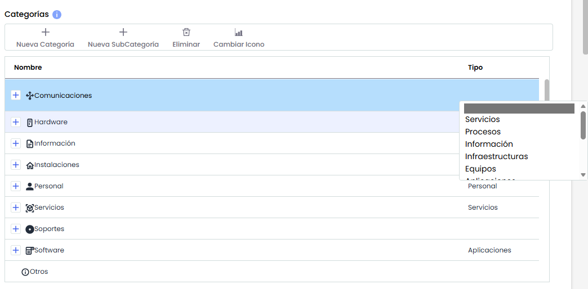

La columna 'Tipo' permite asociar una categoría de activo a una de las opciones de la herramienta que se encuentran en el desplegable que aparece al hacer doble click. De esta forma, cuando se crea un elemento en alguna de estas opciones, ese elemento es registrado en el inventario de activos como activo de la categoría asociada.

Cuando se crea una empresa, por defecto se genera un conjunto de categorías de activos donde algunas de ellas tienen asociado automáticamente un tipo. Esto se realiza para que, por defecto, la herramienta considere como activos los servicios, procesos, etc. que se registran en dichas opciones. Cada uno de los tipos disponibles en el desplegable corresponden a:

* Servicios: Opción "Catálogo de Servicios". Todos los servicios que se registran en esta opción se registran en el inventario de activos con el nombre de la categoría asociada al tipo.
* Procesos: Opción "Procesos". Todos los procesos que se registran en esta opción se registran en el inventario de activos con el nombre de la categoría asociada al tipo.
* Información: Opción "Cálculo RTO y RPO". Todos los elementos que se registran en la pestaña "Cálculo RPO" de esta opción se registran en el inventario de activos con el nombre de la categoría asociada al tipo.
* Infraestructuras: Opción "Infraestucturas". Todas las infraestructuras que se registran en esta opción se registran en el inventario de activos con el nombre de la categoría asociada al tipo.
* Personal: Opción "Empleados". Todos los empleados que se registran en esta opción se registran en el inventario de activos con el nombre de la categoría asociada al tipo.
* Suministradores: Opción "Proveedores". Todos los proveedores que se registran en esta opción se registran en el inventario de activos con el nombre de la categoría asociada al tipo.

### Categoría Riesgos**:**

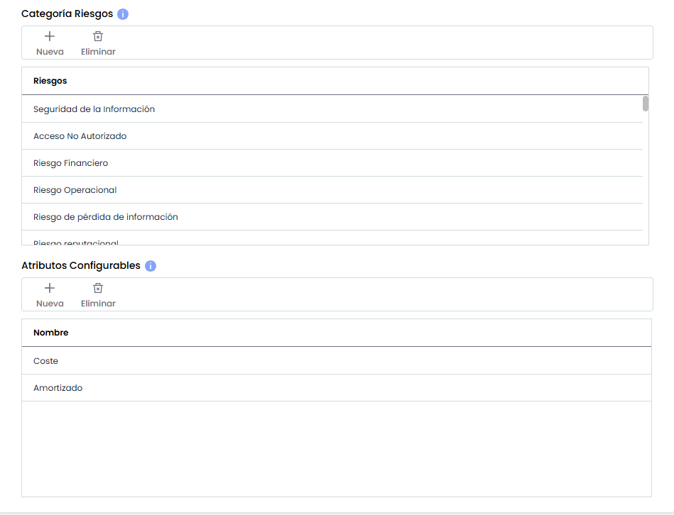

Permite establecer categorías de riesgos generales para tipificar cualquier tipo de amenaza analizada en los análisis de riesgos. Las categorías de riesgos establecidas en esta opción son independientes a los análisis de riesgos realizados, pudiéndose clasificar amenazas de diferentes análisis de riesgos en una misma categoría. Esto permite obtener el listado total de amenazas asociado a cada categoría de riesgo.

### Atributos configurables

 Los Atributos configurables permiten definir nuevos atributos personalizados asociados a los elementos dentro del sistema de gestión.

## Configuración de dimensiones

### Tratamiento de valores acumulados

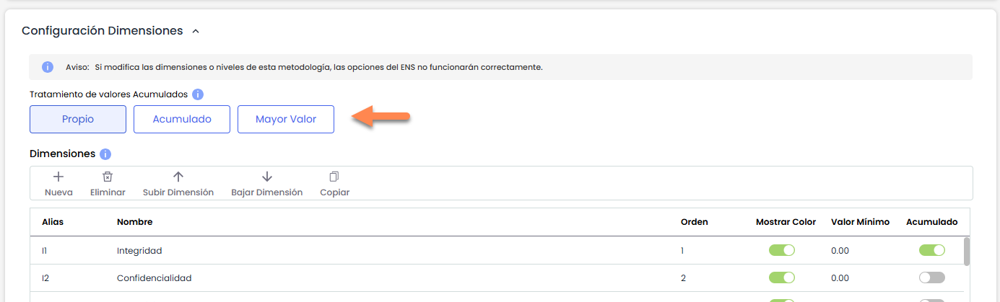

Permite establecer que valor seleccionar para realizar el cálculo establecido por el usuario. Se puede optar entre las siguientes opciones:

* **Propio:** Permite definir que sea el valor de la dimensión seleccionada el que forme parte del cálculo.
* **Acumulado:** Permite establecer que sea el valor de la dimensión acumulada, el que forme parte del cálculo.
* **Mayor Valor:** Ofrece la posibilidad de que sea el valor máximo entre la dimensión seleccionada o su acumulada la que forme parte del cálculo.

### Dimensiones

Permite configurar las dimensiones que se valorarán en el inventario de activos. Se pueden crear y eliminar dimensiones, además de configurar el orden de aparición en la tabla correspondiente con los botones ‘Subir Dimensión’ y ‘Bajar Dimensión’.

Para facilitar el modelado, el botón “Copiar” permite duplicar una dimensión junto con su configuración.

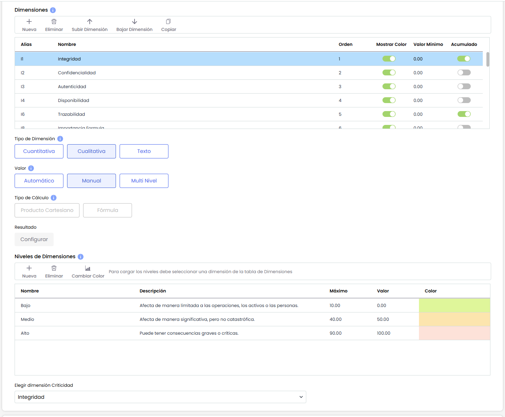

La información que nos ofrece la tabla es la siguiente:

* **Alias:** Identificador que genera la herramienta de manera automática
* **Nombre:** Muestra el nombre de la dimensión. Pulsando 2 veces sobre la celda permite cambiar al nombre de la misma.
* **Orden:** Identifica el orden en el que la dimensión aparecerá en el inventario de activos.
* **Mostrar Color:** Permite definir si se desea resaltar la dimensión mediante un color.
* **Valor Mínimo:** Identifica el número mínimo sobre el cual se calcula la fórmula de la dimensión seleccionada.
* **Acumulado:** Posibilita incluir y establecer las dependencias de la dimensión seleccionada (Tabla de dependencias) y visualizar los valores acumulados de esta en el apartado 'Análisis/Inventario de Activos'

#### Tipo de dimensión

Ofrece la posibilidad de establecer el método de cálculo de las dimensiones, pudiendo optar entre las siguientes:

* **Cuantitativa:** Permite definir que el cálculo de la dimensión seleccionada sea cuantitativo, pudiendo establecer un valor numérico en la dimensión.
* **Cualitativa:** Permite definir que el cálculo de la dimensión seleccionada sea cualitativo, pudiendo establecer un rango de valores determinado (ejemplo: Alto, Medio, Bajo).
* **Texto:** Permite definir que el valor de la dimensión sea de tipo texto libre, pudiendo introducir cualquier valor alfanumérico.

#### Valor

Permite definir cómo se realizará el cálculo de la dimensión seleccionada en la tabla superior, pudiendo establecerse como:

* **Manual**: El valor se introduce directamente por el usuario.
* **Automático**: El valor se calcula automáticamente en base a una configuración previa, pudiendo definirse el tipo de cálculo (fórmulas, fórmulas con condicionales o producto cartesiano).
* **Multinivel**: Permite seleccionar varios valores de la dimensión en lugar de uno único. Esta opción solo está disponible para dimensiones de tipo Cualitativa.

#### Tipo de cálculo

 En el caso de haber seleccionado en la opción anterior un cálculo automático, la herramienta ofrece las siguientes opciones:

* **Producto Cartesiano:** Permite establecer el cálculo de la dimensión seleccionada, en base a una matriz de dos dimensiones definidas en la opción 'Dimensiones'. Para ello se ha de seleccionar una dimensión en el 'Eje X' y otra dimensión en el 'Eje Y' y dar valores en función de los niveles establecidos.


\*\*NOTA:\*\*  El producto cartesiano no puede generarse a partir de dimensiones de tipo cuantitativo


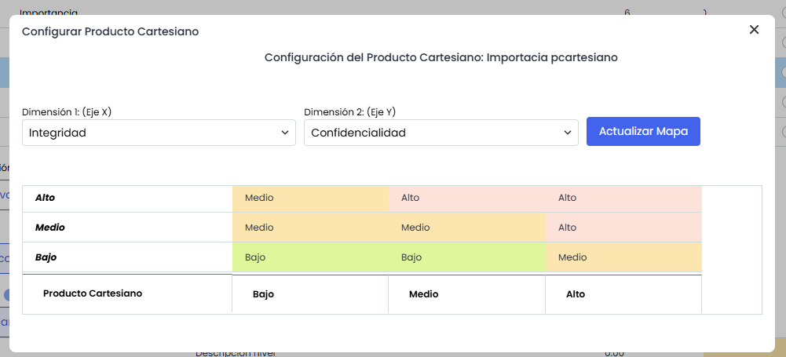

* **Fórmula:** Permite definir cómo se calcula la dimensión seleccionada mediante una fórmula matemática. Para ello, la herramienta ofrece un editor donde se pueden combinar variables, valores numéricos y operadores.

  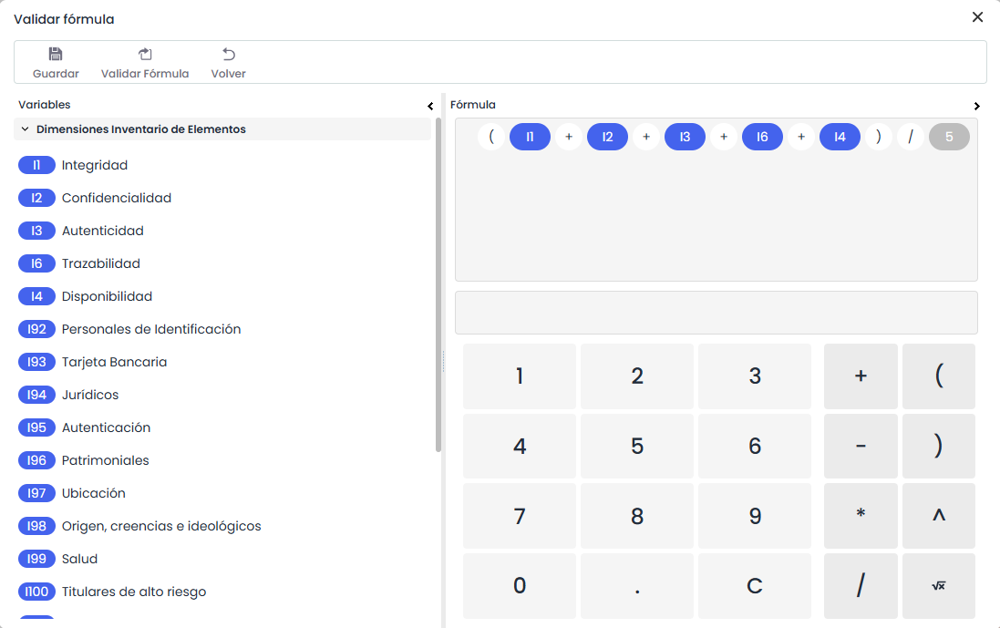

El usuario podrá optar entre las diferentes dimensiones y opciones de cálculo para generar la fórmula en base a la cual se obtendrá el resultado de la dimensión seleccionada.

Es necesario validar la fórmula antes de **guardar** la misma pulsando sobre el botón '**Validar Fórmula'**


El cálculo de dimensiones automáticas mediante \*\*Fórmula\*\* se ejecuta siempre que al menos uno de los parámetros tenga valor (ya sea otra dimensión —manual, automática o multinivel— o un valor numérico).
Si la fórmula se evalúa y existen parámetros sin valor (dimensiones vacías), estos se considerarán como \*\*0\*\*.
En el caso de las dimensiones multinivel, cuando una dimensión tenga varios valores seleccionados y se utilice dentro de una fórmula, el sistema tomará automáticamente el valor más alto de entre los seleccionados.


**Resultado**

 Posibilita definir los valores de la opción de cálculo seleccionada en el punto superior (Producto Cartesiano o Fórmula)

**Niveles de Dimensiones**

Posibilita definir los niveles de valoración de la dimensión seleccionada. Al igual que el resto de opciones, se podrán crear y eliminar niveles, además de parametrizar el color deseado para que resalten los niveles a la hora de la valoración, seleccionando el nivel a modificar y pulsando el botón ‘Cambiar color’.

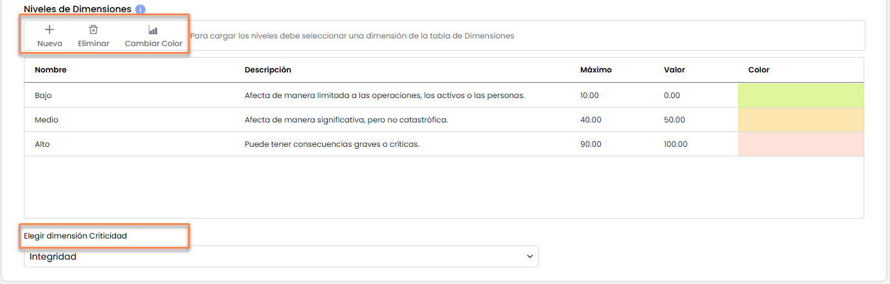

**Elegir dimensión Criticidad:** Adicionalmente, en la metodología de elementos se permite elegir qué dimensión corresponde a la criticidad del elemento.


\*\*NOTA:\*\* Si los niveles se definen para una dimensión cualitativa, las opciones que permite la herramienta es definir el rango de cálculo del nivel seleccionado y el valor sobre el cual se va a calcular la misma. Si los niveles se definen para una dimensión cuantitativa, permite definir el color en el cual se van a resaltar los valores numéricos en el inventario de activos.


## Configuración Visibilidad Dimensiones

* **Visibilidad Dimensiones (formularios)**

Esta tabla permite configurar GlobalSuite de forma que la visualización y/o valoración de algunos tipos de elementos (servicios, procesos, proveedores, infraestructuras, empleados, etc.) e incluso del formulario de los elementos en sí, se pueda realizar en la opción dónde se generan, de manera adicional a la opción 'Inventario'.

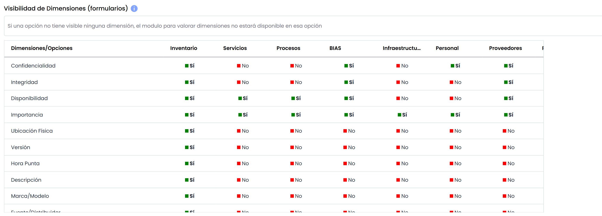

Como se puede observar en la imagen superior, se permite configurar algunas opciones de la herramienta (servicios, procesos, suministradores, infraestructuras y empleados) para indicar qué dimensiones del inventario se pueden valorar en la opción correspondiente de GlobalSuite. Para indicar 'Sí' o 'No', simplemente hay que pulsar sobre la celda correspondiente. Si alguna opción tiene todas las dimensiones con 'No', el formulario correspondiente no tendrá la sección que permite realizar la valoración.


Las dimensiones de tipo \*\*Multinivel\*\* no se pueden marcar como visibles en todos los formularios. Por ahora solo se pueden ver en el \*\*Inventario, Servicios, Procesos, Proveedores, Tratamiento y Casos de Uso de IA.\*\*


**Visibilidad Dimensiones en Tablas**

Esta tabla permite configurar GlobalSuite de forma que la visualización de las dimensiones en las tablas de opciones determinadas pueda modificarse.

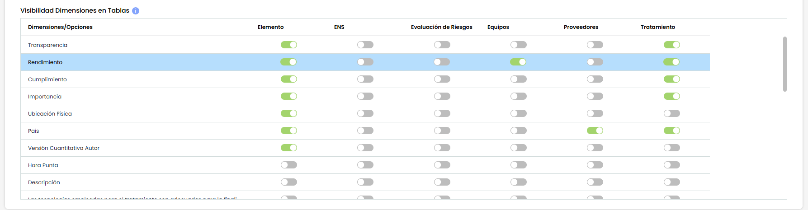


Las dimensiones de tipo \*\*Multinivel\*\* no se pueden marcar como visibles en todos los tablas. Por ahora solo se pueden ver en el \*\*Inventario, Proveedores, Tratamiento y Casos de Uso de IA.\*\*


**Filtros predefinidos.**

Aquí se puede configurar distintas vistas en el inventario. Estos filtros nos permite configurar que dimensiones ver según la Categoría del elemento.

* Administración de filtros:

  * **Nuevo**: Crea un nuevo filtro con el nombre “Nuevo filtro + fecha y hora” y por dentro sin categorías ni dimensiones seleccionadas.
  * **Duplicar**: Se realiza la copia de un filtro predefinido, esta se realiza con el nombre por defecto “Copia de + nombre del filtro copiado”
  * **Eliminar**: Elimina el filtro seleccionado.
* 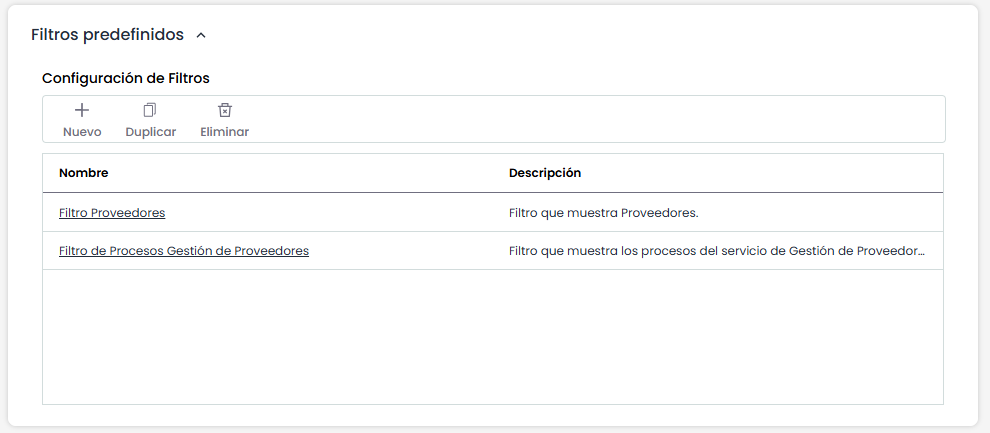

  Configuración de filtros

Al ingresar al filtro se muestra una ventana emergente en donde se podrá configurar el filtro seleccionado.

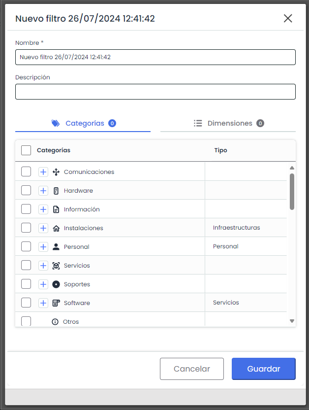

**Nombre**: Campo obligatorio en donde se ingresa el nombre con que se mostrará el filtro en el Inventario.

**Descripción**: Campo que permite ingresar la descripción /proposito del filtro.

**Pestaña categoría:** En esta pestaña se muestran todas las categorías y subcategorías configuradas en el sistema. Esta selección, indicará que categorías de elementos mostrará el filtro en el inventario.

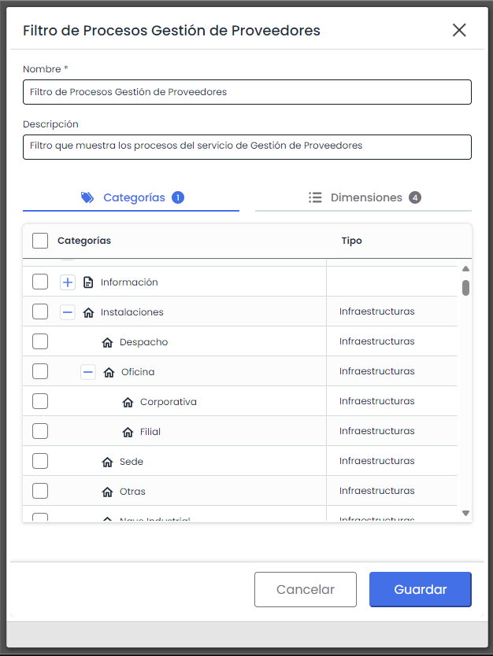

**Pestaña dimensiones:** En esta pestaña se muestran todas las dimensiones definidas en el sistema. En esta selección, se podra seleccionar que dimensiones se mostraran para la o las categorías seleccionadas.

Tener en cuenta que a pesar de que no estén visibles en esta pestaña, los campos Nombre, categoría, Ruta categoría y Responsable se mostraran por defecto en todos los filtros.

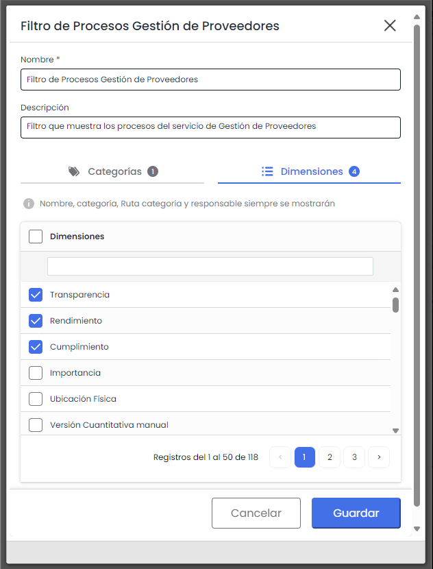

## Configuración de Campos de Controles

* **Asociar Normas a Controles:**Si está activado, permite asociar normativas a controles. Estas normas se configuran en [Configuración de Normas](../configuracion-general/configuracion-de-normas.md).

* **Requisitos Compliance en Ficha del Control:** Si está activado, permite consultar dentro del formulario de un control, en [Gestión de Controles](../../analisis/gestion-de-controles/README.md), qué requisitos de [Compliance](../../analisis/compliance/README.md) están asociados a dicho control.

* **Niveles Controles Gestión de Riesgos / Plan de adecuación:** Permite definir los niveles de los distintos estados de un Plan de Tratamiento y Plan de Adecuación.

Como se muestra en la tabla superior, podemos definir tantos niveles como queramos, definiendo su nombre. También definiremos el grado de completitud que tendrá el plan, cuando seleccionemos ese estado. Se medirá en %.

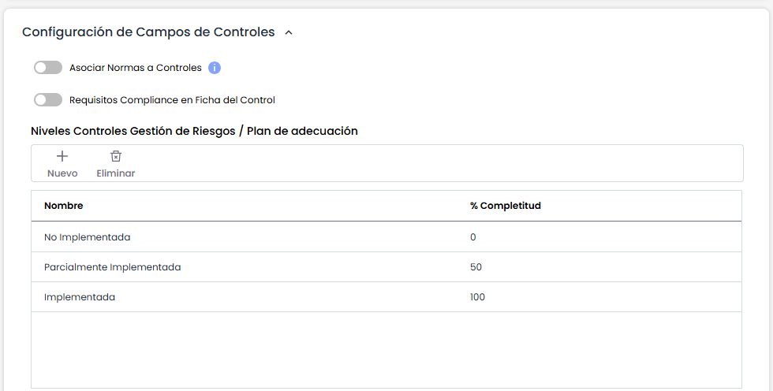

* **Ficha de Control**

Permite configurar los campos que se mostrarán en la ficha de control.

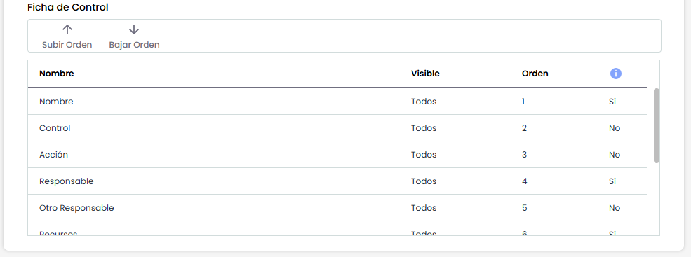

Como se muestra en la tabla superior, podremos modificar los nombres de todos los campos. Podemos decidir para cada campo la siguiente visualización:

* **Ficha de Control:** Este campo sólo se podrá visualizar al acceder a una ficha de control.
* **Tablas:** Este campo sólo se podrá ver desde las tablas de Análisis de Riesgos, Gestión de Controles, etc.
* **Todos:** Se podrá ver tanto en la Ficha de Control, como en las Tablas
* **Ninguno:** No se visualizará este campo en ningún sitio.

Podemos configurar el orden de los campos con la ayuda de los botones Subir Orden y Bajar Orden. En la última columna indica los campos que se van a visualizar en el Plan de Tratamiento.

## Traducir

En la parte superior derecha de la vista, existe un botón que permite pasar a una vista donde podremos configurar las etiquetas y nombres de campos en otro de los idiomas que tengamos disponibles.

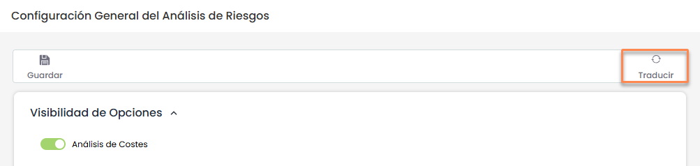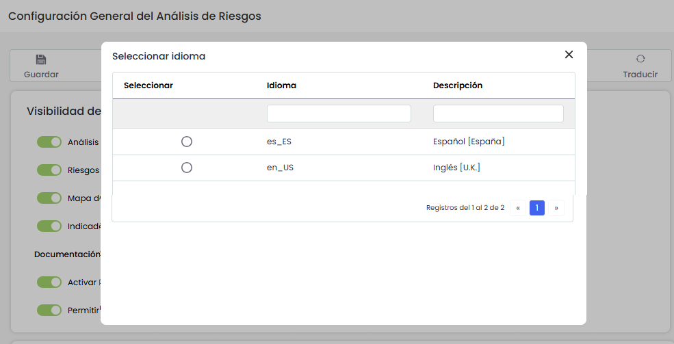

Al seleccionar uno de los idiomas disponibles, pasaremos a la vista de traducción, donde se podrán cambiar los textos y campos en dicho idioma. Los usuarios de GlobalSuite® que tengan configurado ese idioma, les aparecerán esos nombres.

Si algún campo configurado no tiene traducción definida, aparece sombreado en gris, con el texto en el idioma por defecto.

En caso de que queramos salir de la vista de traducción a la vista de configuración, solamente hay que pulsar "Volver".

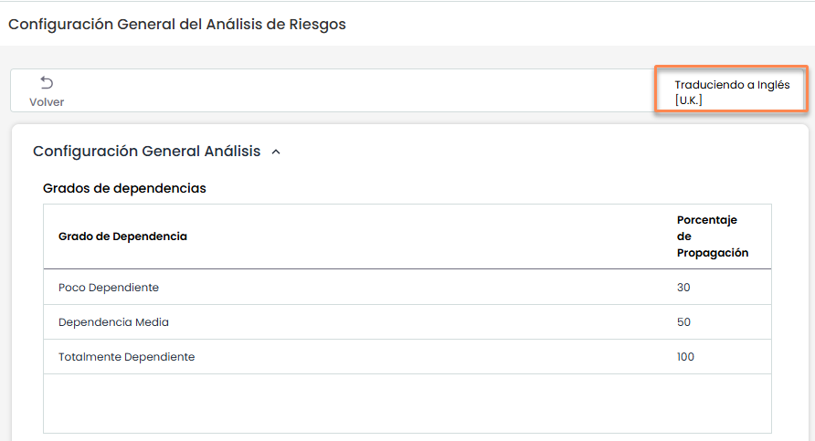
