# Metodología Riesgos

Este apartado permite establecer diferentes metodologías con las que realizar el Análisis de Riesgos de la organización.

## Creación Metodología de Riesgos

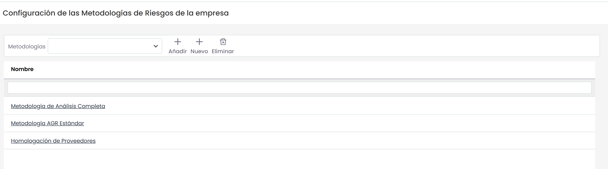

La opción de metodologías, permite al usuario parametrizar los cálculos del análisis de riesgos. La herramienta permite realizar las siguiente acciones iniciales:

* **Añadir:** Permite seleccionar una de las metodologías creadas. Para ello se selecciona la metodología en el desplegable y se pulsa sobre el botón 'Añadir'
* **Nuevo:** Posibilita insertar una nueva entrada en la tabla.
* **Eliminar:** Ofrece la posibilidad de eliminar una metodología del listado. Para ello se ha de seleccionar la fila deseada y pulsar sobre el botón 'Eliminar'.

## Configuración Dimensiones de la Metodología

Al pulsar sobre una de las metodologías se facilitan las siguientes opciones de parametrización.

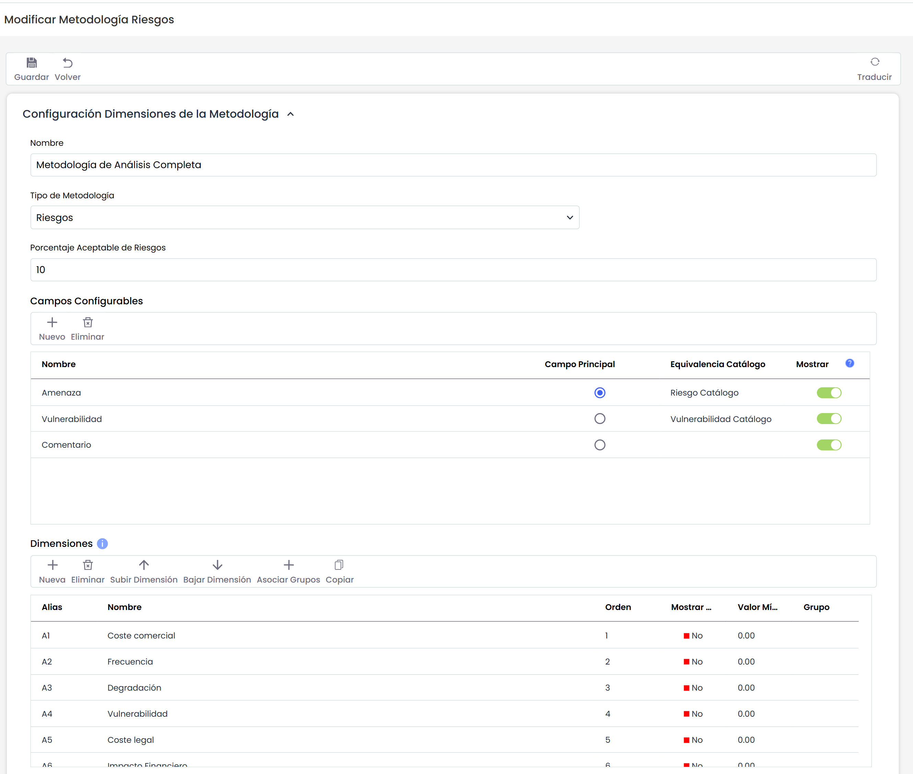

* **Nombre:** Identifica el nombre de la metodología. Este nombre se muestra en el listado de metodologías.
* **Porcentaje aceptable amenazas:** Permite al usuario definir el porcentaje de amenazas que se quiere visualizar en el apartado de 'Análisis/Evaluación de Riesgos'
* **Campos configurables:** Ofrece la posibilidad de definir las columnas textuales que queremos que aparezcan en la opción 'Análisis de Riesgos'. Las información que muestra la tabla es la siguiente:

  * **Nombre** Identifica el nombre del elemento. Para modificar el texto se ha de pulsar dos veces sobre la celda.
  * **Campo Principal** Permite definir el campo que se va a mostrar en las diferentes opciones del análisis de riesgos, como Evaluación de Riesgos, Gestión de Riesgos, etc.
  * **Equivalencia Catálogo** Permite definir la equivalencia del campo seleccionado. Existe las siguientes opciones:
  * **Amenaza Catálogo:** Al seleccionar esta opción, en el campo se mostrará la información definida en el campo Amenaza de la opción 'Ajustes/Catálogos Análisis'
  * **Vulnerabilidad Catálogo:** Al seleccionar esta opción, en el campo se mostrará la información definida en el campo Vulnerabilidad de la opción 'Ajustes/Catálogos Análisis'
  * **Campo Vacío:** Si el campo se deja vacío se interpreta como campo texto libre.

### Dimensiones

Permite la configuración de las dimensiones a valorar en el análisis de riesgos. Se pueden crear y eliminar dimensiones, además de configurar el orden de aparición en la tabla correspondiente con los botones ‘Subir Dimensión’ y ‘Bajar Dimensión’.

Para facilitar el modelado, mediante el botón "Copiar" es posible copiar una dimensión de la metodología de riesgos con toda su información.  (niveles, fórmulas, visibilidad, grupos).

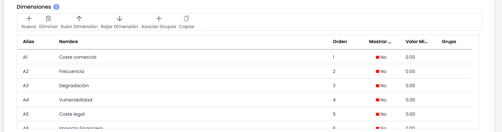

La información que nos ofrece la tabla es la siguiente:

* **Alias:** Identificador que genera la herramienta de manera automática
* **Nombre:** Muestra el nombre de la dimensión. Pulsando 2 veces sobre la celda permite cambiar al nombre de la misma.
* **Orden:** Identifica el orden en el que la dimensión aparecerá en el análisis de riesgos.
* **Mostrar Color:** Permite definir si queremos resaltar la dimensión en un color.
* **Valor Mínimo:** Identifica el número mínimo sobre el cual se calcula la fórmula de la dimensión seleccionada.
* **Tipo:** Identifica si la dimensión es de tipo Texto o no.
* **Grupo:** Muestra los grupos a los que pertenece cada dimensión.

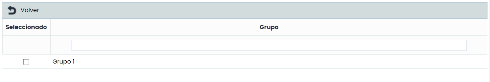

En la tabla se pueden realizar diferentes acciones, entre ellas:

* **Asociar Grupos:** Al pulsar en el botón Asociar Grupos, se abre una ventana emergente como la de la imagen superior, que nos permite seleccionar a que grupo o grupos de dimensiones pertenece esa dimensión.
* **Copiar:** Permite copiar la dimensión seleccionada con toda su información.

### Tipo de dimensión

Ofrece la posibilidad de establecer el método de cálculo de las dimensiones, pudiendo optar entre las siguientes:

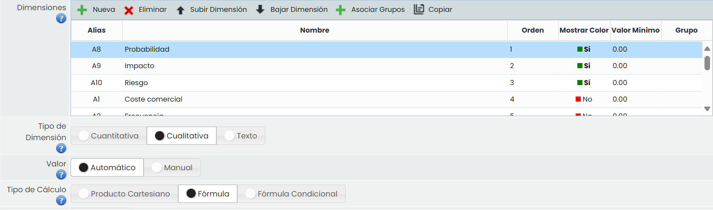

* **Cuantitativa:** Permite definir que el cálculo de la dimensión seleccionada sea cuantitativo, pudiendo establecer un valor numérico en la dimensión.
* **Cualitativa:** Permite definir que el cálculo de la dimensión seleccionada sea cualitativo, pudiendo establecer un rango de valores determinado (ejemplo: Alto, Medio, Bajo).
* **Texto:** Permite definir que la dimensión sea de tipo texto.

**Valor:** Permite definir como queremos que se realice el cálculo (Manual o Automático) de la dimensión seleccionada en la tabla superior.

### Tipo de cálculo

 En el caso de haber seleccionado en la opción anterior un cálculo automático, la herramienta no ofrece las siguientes opciones:

* **Producto Cartesiano:** Permite establecer el cálculo de la dimensión seleccionada, en base a una matriz de dos dimensiones definidas en la opción 'Dimensiones'. Para ello se ha de seleccionar una dimensión en el 'Eje X' y otra dimensión en el 'Eje Y' y dar valores en función de los niveles establecidos.

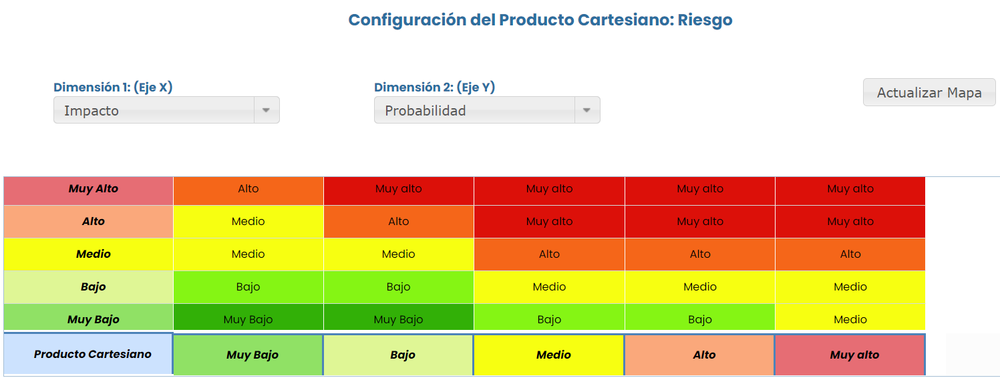

\*\*NOTA:\*\* El producto cartesiano no se puede generar en base a dimensiones cuyo cálculo sea cuantitativo.


* **Fórmula:** La opción permite definir como se obtendrá el cálculo de la dimensión seleccionada, en base a una fórmula matemática. Para ello la herramienta muestra la siguiente opción

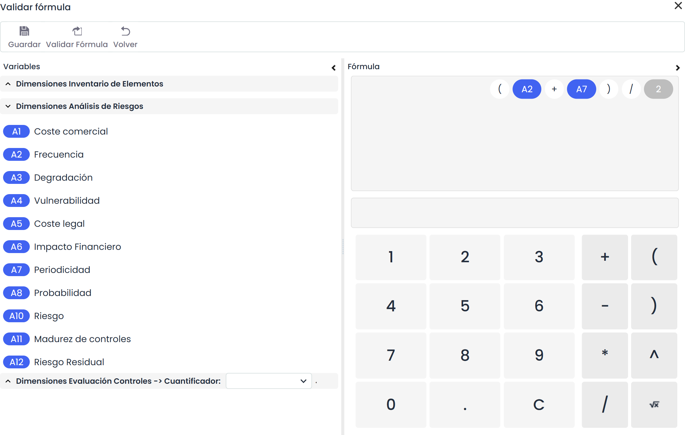

\*\*NOTA:\*\* El cálculo de dimensiones automáticas con Fórmula se realiza siempre que se tenga algún parámetro de la fórmula con valor (un parámetro puede ser otra dimensión manual o automática, o un dígito numérico).
En caso de que se evalúe la fórmula, los parámetros que no tengan valor (dimensiones vacías) se sustituirán por un valor cero.


En el caso de tener asociada una 'metodología de controles' la fórmula de cálculo permite incorporar las dimensiones que se han definido en dicha metodología de controles.

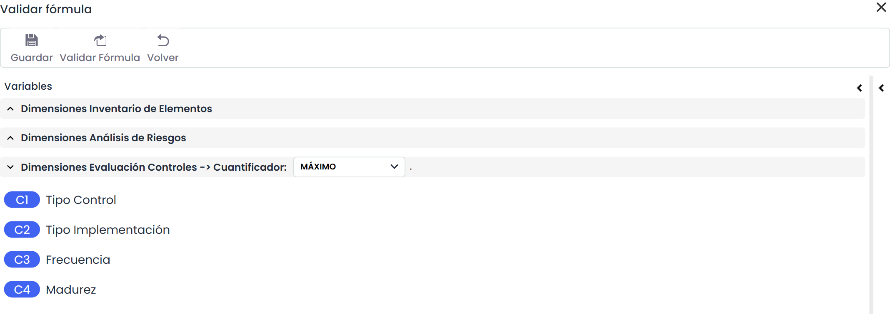

En el caso de querer establecer una fórmula teniendo en cuenta los controles implantados, es necesario establecer un cuantificador para estas dimensiones, pudiendo optar entre las siguientes:

* **CONTADOR:** Realiza un cálculo para obtener como valor el número de controles asociados a cada amenaza. Ejemplo: Si tengo 3 controles asociados a una amenaza, este cálculo estará dando como resultado el valor 3.
* **MÁXIMO:** Realiza un cálculo para obtener el valor máximo de la dimensión seleccionada de todos los controles aplicados a cada amenaza. Ejemplo: Si tengo 3 controles con valor 1, 2 y 3, este cálculo estará dando como resultado el valor 3.
* **MÍNIMO:** Realiza un cálculo para obtener el valor mínimo de la dimensión seleccionada de todos los controles aplicados a cada amenaza. Ejemplo: Si tengo 3 controles con valor 1, 2 y 3, este cálculo estará dando como resultado el valor 1.
* **SUMATORIO:** Realiza un cálculo para obtener el valor de la suma de la dimensión seleccionada de todos los controles aplicados a cada amenaza. Ejemplo: Si tengo 3 controles con valor 1, 2 y 3, este cálculo estará dando como resultado el valor 6.

* **Fórmula Condicional:** La opción permite establecer un calculo condicional entre diferentes dimensiones establecidas en la metodología.

Para configurar esta apartado, se ha de pulsar sobre el botón 'Configurar' accediendo a la siguiente pantalla:

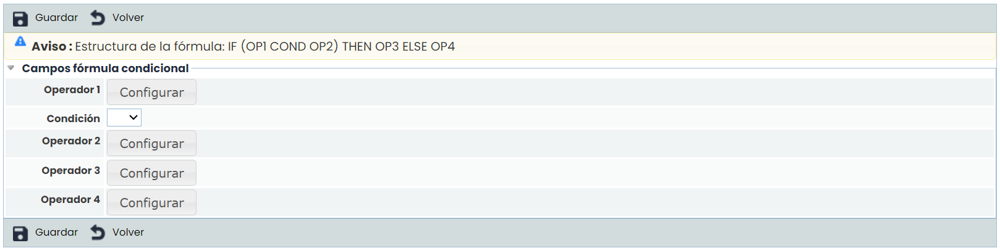

La configuración de la fórmula condicional se establece en base a los operadores, donde los operadores 1 y 2 sirven para establecer la condición, siendo necesario fijar el mismo en el desplegable. Las opciones que permite la herramienta son:

* **==:** Igual a
* **!=:** Distinto a
* **<:** Menor que
* **>:** Mayor que
* **<=:** Menor o igual que
* **>=:** Mayor o igual que

Una vez se establece la fórmula de la condición, se han de fijar los resultados que se quieren obtener, para ello, en el caso de cumplirse la condición los resultados mostrados se corresponden con el operador 3 y en caso contrario con el operador 4.

El usuario podrá optar entre las diferentes dimensiones y opciones de cálculo para generar la fórmula en base a la cual se obtendrá el resultado de la dimensión seleccionada.


\*\*Nota\*\*
Es necesario validar la fórmula antes de guardar la misma pulsando sobre el botón 'Validar Fórmula'


* **Resultado:** Posibilita definir los valores de la opción de cálculo seleccionada en el punto superior (Producto Cartesiano o Fórmula)

### Niveles de dimensiones

 Permite definir los niveles de valoración de la dimensión seleccionada. Al igual que el resto de opciones, se podrán crear y eliminar niveles, además de parametrizar el color deseado para que resalten los niveles a la hora de la valoración, seleccionando el nivel a modificar y pulsando el botón ‘Cambiar color’.

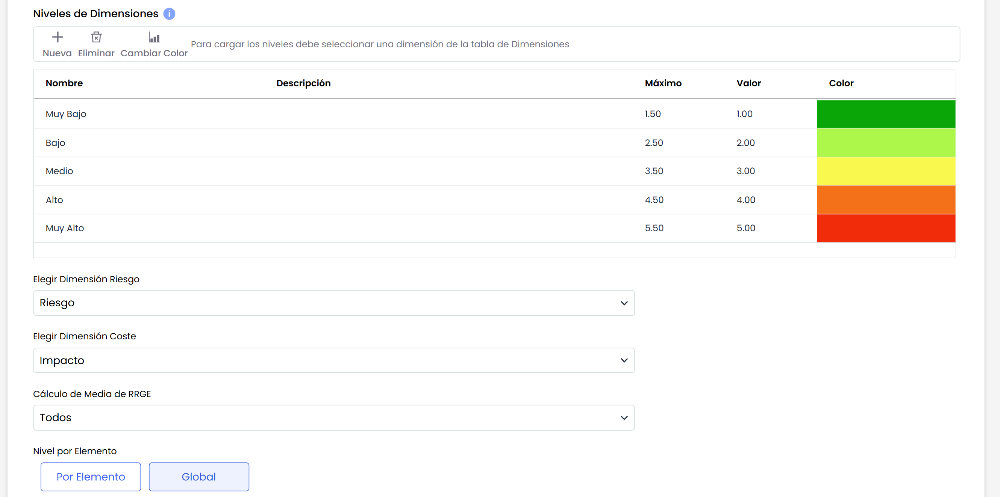

\*\*Nota\*\*
Si los niveles se definen para una dimensión cualitativa, las opciones que permite la herramienta es definir el rango de cálculo del nivel seleccionado y el valor sobre el cual se va a calcular la misma. Si los niveles se definen para una dimensión cuantitativa, permite definir el color en el cual se van a resaltar los valores numéricos en el inventario de activos.


* **Elegir dimensión de riesgo:** Permite definir la dimensión que queremos marcar como dimensión final del riesgo. Esta dimensión será la que se muestre por defecto en las distintas vistas y resúmenes del análisis de riesgos, y en el mapa de riesgos.
* **Elegir dimensión de coste:** Permite definir la dimensión sobre la que queremos obtener el coste. En base a ella y a la configuración de los tipos de coste, se podrán obtener costes de los riesgos.
* **Cálculo de Media de RRGE**: En este campo se puede configurar de qué forma se calcula, en caso de que tengamos definido Media como criterio, el Riesgo Repercutido Global por Elemento (RRGE), en el apartado [Resumen de Riesgos](../../analisis/evaluacion-de-riesgos/resumen-de-riesgos.md). Se puede calcular a partir de todos los elementos o únicamente a partir de los que estén valorados.
* **Nivel por elemento:** Ofrece la posibilidad de definir que el nivel de riesgo aceptable (NRA) sea Global, es decir, establecer el mismo para todos los riesgos, o que sea por Elemento, permitiendo particularizar por cada elemento/riesgo cual será su nivel de riesgo aceptable.

## Configuración Visibilidad Dimensiones

* **Grupo de Dimensiones:** Permite crear grupos de dimensiones, los cuales se pueden asociar a las dimensiones.

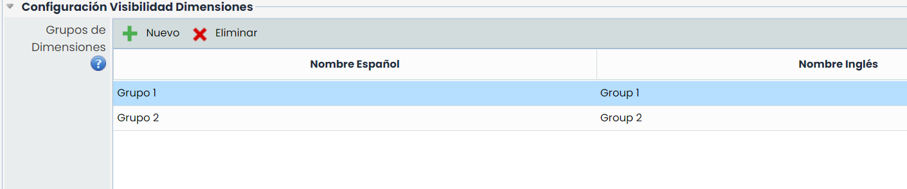

Para cada uno de los grupos configurados, tendremos la opción en el Análisis de Riesgos, de mostrar únicamente las dimensiones de ese grupo.

## Configuración de Costes

La materialización de una amenaza pude llevar asociado un coste determinado para la organización, para ello, GlobalSuite permite definir un listado de costes que asociar a las amenazas del análisis de riesgos.

La tabla ‘Costes’ permite crear o eliminar costes utilizando los botones ‘Nuevo’ o ‘Eliminar’.

Una vez definidos los costes, se ha de indicar la cuantía económica que implica para la organización, pudiendo establecer rangos económicos pulsando dos veces sobre la celda a modificar.

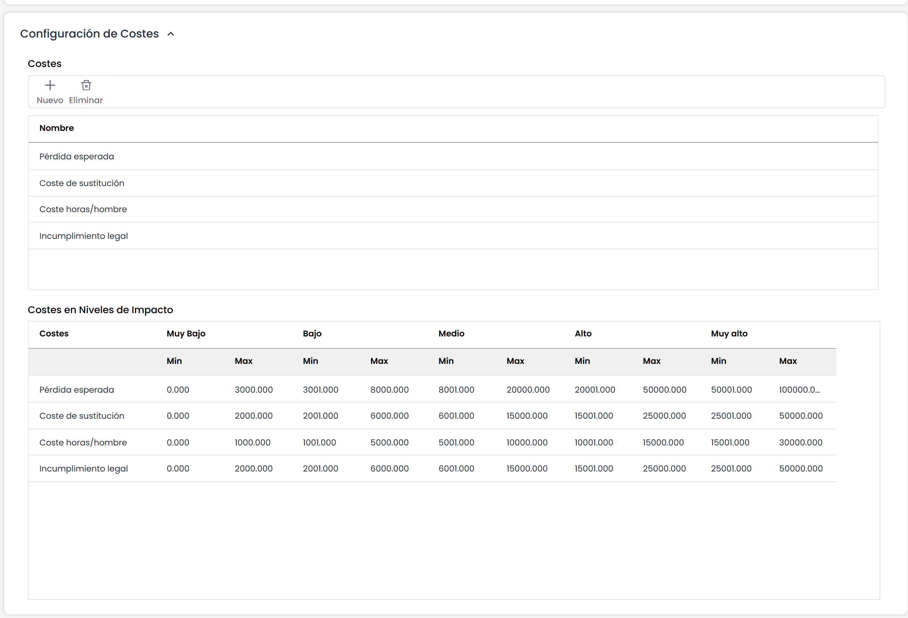

## Eficacia Controles

Permite establecer el cálculo de la eficacia de los controles en el apartado de 'Análisis > Gestión de Riesgos > [Proyección y Simulación](../../analisis/gestion-de-riesgos/proyeccion-y-simulacion.md)'.

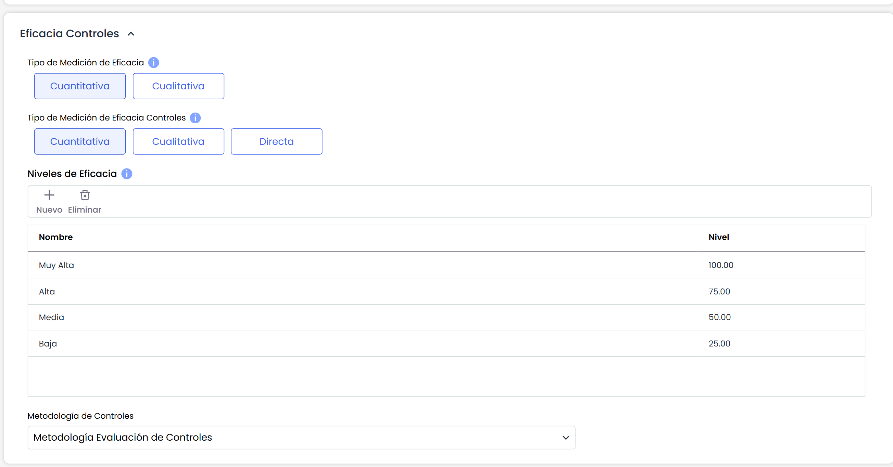

Para ello se pueden definir los siguientes parámetros:

* **Tipo de medición de eficacia:** Ofrece la posibilidad de establecer el porcentaje de mejora de las dimensiones de riesgos del apartado de proyección y simulación, pudiendo optar entre las siguientes:

  * **Cuantitativa:** Permite definir que el porcentaje de mejora de las dimensiones de riesgo sea cuantitativo, pudiendo establecer el porcentaje de mejora de los riesgos en el apartado de Proyección y Simulación.
  * **Cualitativa:** Permite definir que el porcentaje de mejora de las dimensiones de riesgo sea cualitativo, pudiendo establecer un rango de valores determinado (ejemplo: Alto, Medio, Bajo). Esta tipificación se establece en el apartado siguiente de 'Niveles de eficacia'

* **Tipo de medición de eficacia controles:** Ofrece la posibilidad de establecer el porcentaje de mejora de las dimensiones de controles del apartado de proyección y simulación, pudiendo optar entre las siguientes:

  * **Cuantitativa:** Permite definir que el cálculo de la eficacia de los controles sea cuantitativo, pudiendo establecer el porcentaje de reducción del control en el apartado de Proyección y Simulación.
  * **Cualitativa:** Permite definir que el cálculo de la eficacia de los controles sea cualitativo, pudiendo establecer un rango de valores determinado (ejemplo: Alto, Medio, Bajo). Esta tipificación se establece en el apartado siguiente de 'Niveles de eficacia'.
  * **Directa**: Con este modo, el cálculo de la eficacia de los controles (planes de tratamiento) se definirá directamente en el apartado de Proyección y Simulación. Con este tipo, no es necesario tener definida una valoración de eficacia previa.

* **Niveles de eficacia:** Permite definir los niveles de eficacia de los controles. Al igual que el resto de opciones, se podrán crear y eliminar niveles pulsando sobre el botón 'Añadir' o 'Eliminar'. Cada nivel podrá tener un porcentaje de mejora asociado.

### Metodología de controles

 Ofrece la posibilidad de definir la metodología de controles que estará asociadas a la metodología de análisis de riesgos.
