# Metodologías Auditorías

## General


Este apartado permite configurar:
\* Tipos de Auditor
\* Visibilidad del Código de Plan y Código de Trabajo.
\* Cuadro de Mando
\* Configuración de campos


### Configuración General

#### Tipos de Auditor

* **Nuevo:** Permite crear un "Nuevo tipo de auditor", habrá que pulsar encima del botón nuevo para ello.
* **Eliminar:** Elimina un tipo de auditor que previamente se haya creado. Para ello hay que pulsar encima de alguno de los que estén ya creados que será el registro que se elimine.

Para traducir el nombre de los tipos de auditor a otros idiomas disponibles, es necesario pulsar el botón "Traducir".

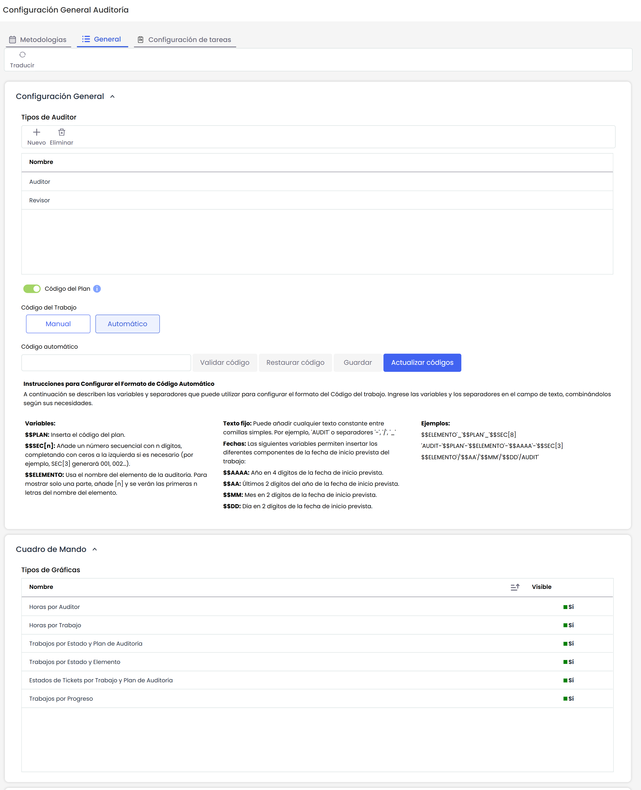

#### Código de Plan

Al marcar el check Código de Plan, los campos "Código de Plan" y "Código de Trabajo" se mostrarán en los formularios, tablas e informes correspondientes.

Al activarlo, se habilitan las opciones de configuración para el Código de Trabajocomo Manual o Automático.

#### Código de trabajo - Manual

En los formularios correspondientes, el campo 'Código de Trabajo' estará habilitado para edición.

* Sin validación de formato: El sistema no verifica el formato del código ingresado.
* Sin validación de duplicados: Es posible ingresar códigos repetidos.
* Sin validación de campos vacíos: Se permite guardar trabajos sin completar este campo.

#### Código de trabajo - Automático.

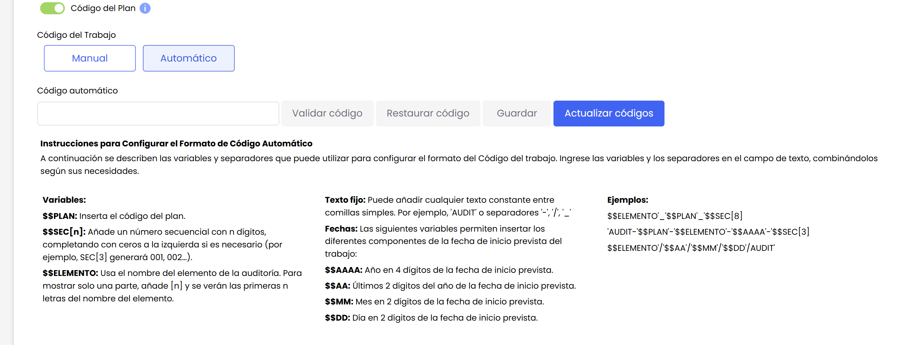

* **Validar código**: La acción "Validar Código" permite comprobar si el formato ingresado es correcto. Al presionar este botón, el sistema analiza las variables y la estructura del código. Si el formato es válido, muestra el mensaje "Código Correcto". En caso contrario, muestra mensajes de error específicos para indicar qué parte del formato no es correcta.
* **Restaurar Código**: En caso de que se haya guardado un formato previamente y luego se modifique, se habilita la acción "Restaurar Código". Esta opción permite recuperar el formato anterior sin necesidad de ingresarlo manualmente, asegurando que los códigos vuelvan a seguir la estructura guardada previamente.
* **Guardar:** Está disponible solo si el formato ingresado es válido. Al guardar, el sistema aplica el formato a todos los trabajos de los planes abiertos y permite elegir entre dos opciones: recalcular el número secuencial para todos los códigos o mantener el número secuencial existente. Una vez seleccionado el modo, el sistema guarda la configuración y muestra un mensaje confirmando que los códigos se han actualizado exitosamente.
* **Actualizar códigos**: Permite renumerar los trabajos existentes sin modificar el formato actual. Esta función es útil para eliminar huecos en la secuencia o asegurarse de que todos los trabajos tengan un código asignado. Al presionar este botón, aparece un mensaje de confirmación indicando que la acción no se puede deshacer.

##### Variables Permitidas y su Formato

* **Código de Plan de auditoria**

  * **Descripción:** Inserta el código del plan en el código automático del trabajo.
  * **Formato:** `$$PLAN`
  * **Nota***:* Si el código del plan está vacío, no se mostrará en el código generado para los trabajos asociados.
* **Secuencial:**

  * **Descripción:** Genera un número secuencial con la cantidad de dígitos especificada en "n".
  * **Formato:** `$$SEC[n]` (donde n es el número de dígitos).
  * **Ejemplo:** `SEC[3]` → `001`, `002`, `003`
  * **Nota:** El valor "n" debe ser un número entero positivo y estar entre corchetes.
* **Elemento**

  * **Descripción:** Inserta el nombre del elemento asociado al trabajo, opcionalmente con la cantidad de dígitos indicada en "n". Si un trabajo tiene más de un elemento asociado, los códigos se concatenan en el orden en que están asociados, separados por un espacio.
  * **Nota***:* Si un trabajo no tiene elementos asociados, quedará vacío en el código generado para de dicho trabajo.
  * **Formato:**

    * Sin especificar dígitos: `$$ELEMENTO`
    * Con dígitos: `$$ELEMENTO[2]`
* **Texto Fijo:**

  * **Descripción** Es una cadena de texto que se incluye dentro del formato del código utilizando comillas simples. Este texto permanece sin cambios en todos los códigos generados, independientemente de las variables utilizadas.
  * **Ejemplo:**

    * **Formato:** `'AUDIT-'$$SEC[3]`
    * **Resultado:** `AUDIT-001`, `AUDIT-002`, `AUDIT-003`

    En este caso, `'AUDIT-'` es el texto fijo y se mantiene igual en todos los códigos.
* **Fechas**

  * **Descripción:** Genera el código del trabajo utilizando los datos de la fecha de Inicio del trabajo.
  * **Formato:**

    * Año con 4 dígitos: `$$AAAA`
    * Año con 2 dígitos: $$AA
    * Mes: $$MM
    * Dia: $$DD

### Cuadro de Mando

En este apartado se pueden mostrar u ocultar qué gráficas e informes se quieren visualizar en el Cuadro de Mando de auditoría. Para ocultar una gráfica, hay que desactivarlo en la columna "Visible".

### Configuración de campos

En esta sección se podrán crear y configurar nuevos campos personalizables de tipo texto, fecha y opciones.

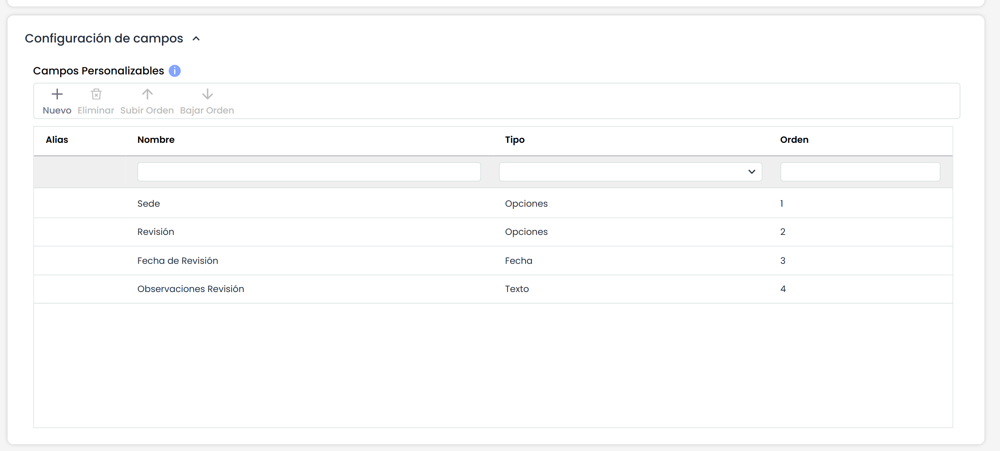

**Creación y Edición**

Para crear un nuevo campo personalizable, se deberá pulsar el botón Nuevo, y para editarlo, se deberá hacer doble click en en el campo Nombre.

* **Campo Tipo Opciones:**

  * Para editar un campo de este tipo, se deberá hacer doble click en e campo “Tipo”, a continuación en “Opciones”, y se abrirá una ventana para poder configurarlo.

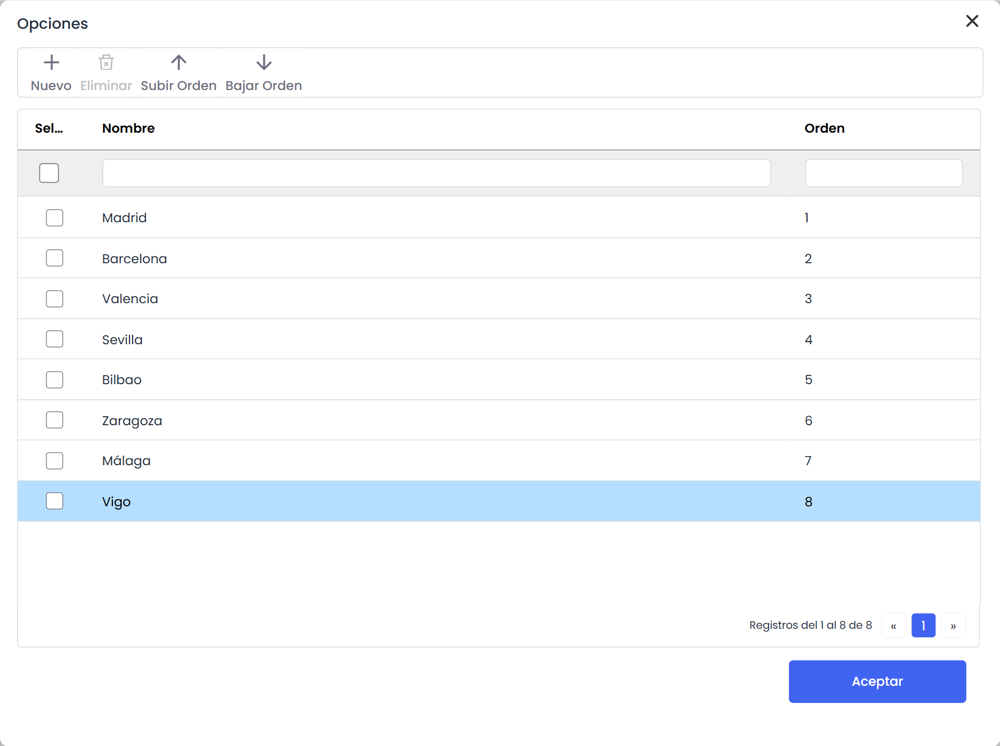


\*\*Nota\*\*
Por defecto, las opciones para este tipo de campo se visualizarán en el formulario con un selector. Sin embargo, si se configuran más de 15 opciones , se habilitará automáticamente la opción \*Mostrar todas\*, la cual además, permitirá visualizar las opciones configuradas mediante una ventana, la cual facilitará la búsqueda y selección.


## Metodologías

Este apartado permite definir diferentes metodologías con las que evaluar y priorizar los elementos de la organización, así como realizar una planificación de los trabajos de auditoría, a partir de los Análisis de Riesgos definidos en otras áreas de la organización.

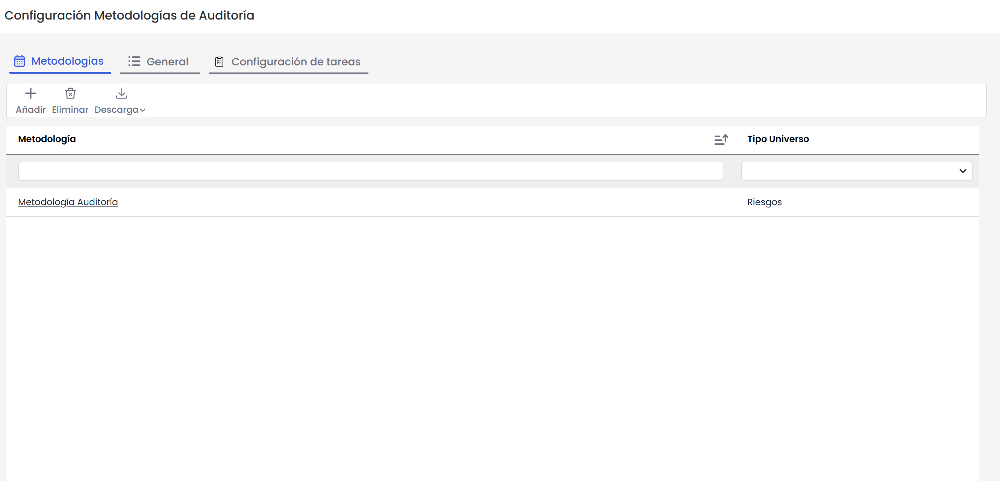

La opción de metodologías, permite al usuario parametrizar el cálculo de los controles existentes los criterios para evaluar los elementos en la organización, desde el área de auditoría. La herramienta permite realizar las siguientes acciones iniciales:

* **Añadir:** Permite insertar una nueva fila en las metodologías, esto ocurre al pulsar el botón 'Añadir' y se puede configurar pinchando en la misma.
* **Eliminar:** Ofrece la posibilidad de eliminar una metodología del listado. Para ello se ha de seleccionar la fila deseada y pulsar sobre el botón 'Eliminar'.
* **Descarga:** Ofrece la posibilidad de descargar el listado de metodologías en un formato editable (.xlsx)

Al pulsar sobre una de las metodologías se facilitan las siguientes opciones de parametrización:

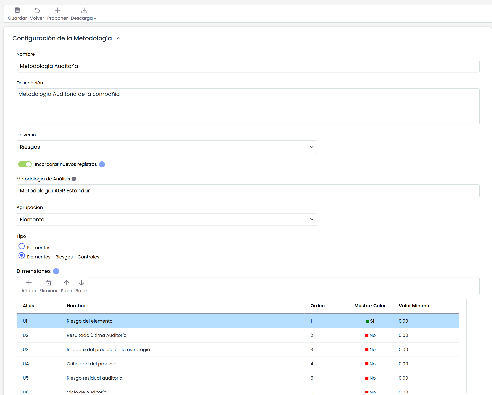

#### Configuración de la Metodología

* **Botón Proponer:** Añade automáticamente una lista propuesta de dimensiones básicas dentro de la metodología. Se puede modificar y modelar como se requiera.
* **Botón Descarga:** Permite generar un informe con la metodología de planificación configurada.
* **Nombre:** Identifica el nombre de la metodología. Este nombre se muestra en el listado de metodologías.
* **Descripción:** Permite definir con más profundidad la metodología que se está definiendo.
* **Universo:** Permite identificar el entorno en el que va a estar enfocada la metodología de auditoría. Actualmente el enfoque se realiza en base al Análisis de Riesgos.
* **Incorporar Nuevos Registros:** al habilitar esta opción, se permite la inclusión de nuevos registros de elementos, riesgos y controles independientes a los contemplados en los análisis de riesgos existentes.
* **Metodología de Análisis:** Despliega un seleccionable para elegir la metodología de Análisis en la que se basa la planificación. Una vez que esta insertada, las dimensiones que se toman estarán basadas en esta metodología. Por tanto, si más adelante se modifica, afectara a las dimensiones que se hayan metido. Avisará con un mensaje de Alerta cuando se intente cambiar para prevenir de posibles pérdidas de información. También será posible seleccionar Metodología de Ejecución de riesgos y Metodología de Ejecución de controles.
* **Agrupación:** Permite identificar el foco o la base sobre la que se realizará la planificación de auditoría. Podrá ser Elemento o Control.
* **Tipo:** Permite definir el alcance de la auditoría.

  * Elementos: el alcance de la auditoría será específicamente de elementos. Será posible incluir elementos del inventario, independientemente de que éstos estén incluidos o no en un análisis de riesgos.
  * Elementos - Riesgos - Controles: el alcance de la auditoría será elementos, riesgos y controles. Se podrán incluir elementos que pertenezcan a un análisis de riesgos.


\*\*Nota\*\*
Ambos tipos de auditorías se podrán combinar con la funcionalidad [Incorporar nuevos registros](https://changelog.globalsuitesolutions.com/changelog/v6-82-diciembre-2023#v6.82(Diciembre2023)-NuevasfuncionalidadesymejorasGlobalSuite%C2%AEAuditManagement)


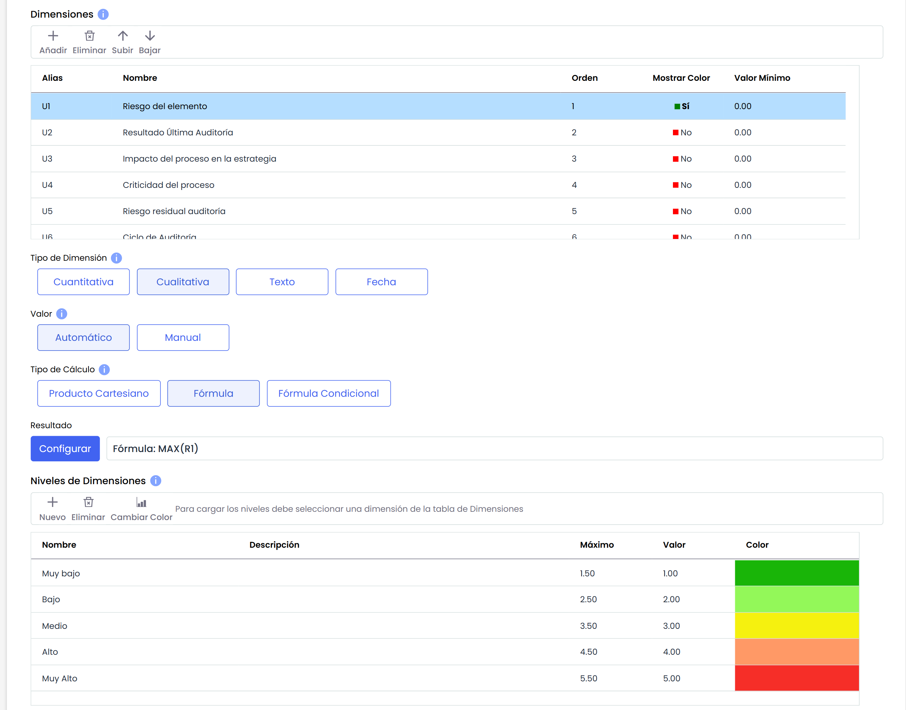

* **Dimensiones:** Permite la configuración de las dimensiones a valorar en los Planes de Auditoría para cada uno de los procesos para auditar. Se pueden crear y eliminar dimensiones, además de configurar el orden de aparición en la tabla correspondiente con los botones ‘Subir Dimensión’ y ‘Bajar Dimensión’.

  * **Alias:** Identificador que genera la herramienta de manera automática.
  * **Nombre:** Muestra el nombre de la dimensión. Pulsando 2 veces sobre la celda permite cambiar al nombre de la misma.
  * **Orden:** Identifica el orden en el que la dimensión aparecerá en el Plan de Auditoría.
  * **Mostrar Color:** Permite definir si queremos resaltar la dimensión en un color.
  * **Valor mínimo:** Identifica el número mínimo sobre el cual se calcula la fórmula de la dimensión seleccionada.
  * **Tipo:** Identifica si la dimensión es de tipo Texto o no.
* **Tipo de dimensión:** Ofrece la posibilidad de establecer el método de cálculo de las dimensiones, pudiendo optar entre las siguientes:

  * **Cuantitativa:** Permite definir que el cálculo de la dimensión seleccionada sea cuantitativo, pudiendo establecer un valor numérico en la dimensión.
  * **Cualitativa:** Permite definir que el cálculo de la dimensión seleccionada sea cualitativo, pudiendo establecer un rango de valores determinado (ejemplo: Alto, Medio, Bajo).
* **Valor:** Permite definir como queremos que se realice el cálculo (Manual o Automático) de la dimensión seleccionada en la tabla superior.
* **Tipo de cálculo:** En el caso de haber seleccionado en la opción anterior un cálculo automático, la herramienta no ofrece las siguientes opciones:

  * **Producto Cartesiano:** Permite establecer el cálculo de la dimensión seleccionada, en base a una matriz de dos dimensiones definidas en la opción 'Dimensiones'. Para ello se ha de seleccionar una dimensión en el 'Eje X' y otra dimensión en el 'Eje Y' y dar valores en función de los niveles establecidos.


\*\*Nota\*\*
El producto cartesiano no se puede generar en base a dimensiones cuyo cálculo sea cuantitativo.


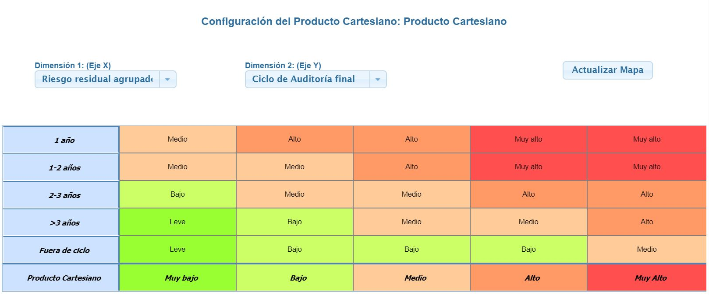

* **Fórmula:** La opción permite definir como se obtendrá el cálculo de la dimensión seleccionada, en base a una fórmula matemática. Para ello la herramienta muestra las siguientes opciones:

  * **Dimensiones Inventario de elementos:** Son las dimensiones que aparecen por defecto para introducir en la fórmulas.
  * **Dimensiones Análisis de Riesgos:** Éstas dimensiones se pueden configurar con Cuantificadores para configurar con valores globales los resultados de las fórmulas. Se pueden aplicar a través de estos cuantificadores Valor Acumulado, Máximo, Mínimo o Media.
  * **Dimensiones Evaluación Controles:** Éstas dimensiones se pueden configurar con Cuantificadores para configurar con valores globales los resultados de las fórmulas. Se pueden aplicar a través de estos cuantificadores Valor Acumulado, Máximo, Mínimo o Media.
  * **Dimensiones Auditorías:** En éstas dimensiones de auditorias, GlobalSUITE proporciona por defecto una serie de Dimensiones pero éstas son configurables. También permite añadir nuevas dimensiones.

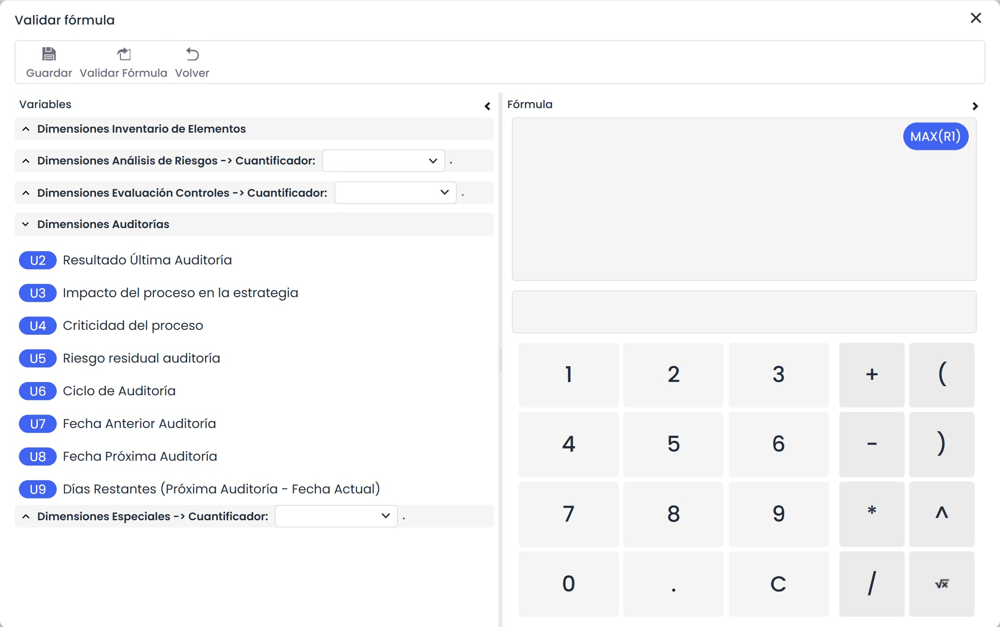

* **Dimensiones Especiales:** Son unas dimensiones que se han añadido para la parte de auditoría, que paso a explicar en detalle.

  * **RGE Riesgo global por elemento:** Para el cálculo de riesgo global, que sirve para calcular el riesgo residual agrupado por ejemplo. Se pueden usar cuantificadores, Contador, Máximo, Mínimo, Sumatorio.
  * **RRGE Riesgo Repercutido Global por Elemento:** Para el cálculo de riesgo global,
  * **Fecha de última auditoría:** Permiten comparar fechas y así poder indicar automáticamente si supera la fecha e indicar si es necesario hacer la auditoría.
  * **Fecha actual:** La comparativa de la fecha de la última auditoría se hace con este valor de la fecha actual.


\*\*NOTA:\*\* El cálculo de dimensiones automáticas con Fórmula se realiza siempre que se tenga algún parámetro de la fórmula con valor (un parámetro puede ser otra dimensión manual o automática, o un dígito numérico).
En caso de que se evalúe la fórmula, los parámetros que no tengan valor (dimensiones vacías) se sustituirán por un valor cero.


* **Fórmula Condicional:** La opción permite establecer un cálculo condicional entre diferentes dimensiones establecidas en la metodología de auditorías.

Para configurar esta apartado, se ha de pulsar sobre el botón 'Configurar' accediendo a la siguiente pantalla:

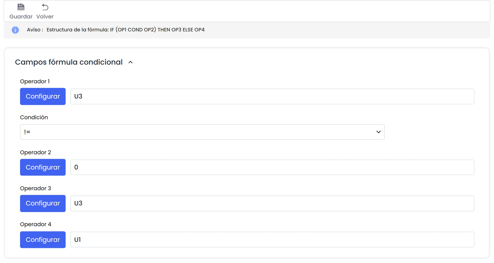

La configuración de la fórmula condicional se establece en base a los operadores, donde los operadores 1 y 2 sirven para establecer la condición, siendo necesario fijar el mismo en el desplegable. Las opciones que permite la herramienta son:

* **==:** Igual a
* **!=:** Distinto a
* **<:** Menor que
* **>:** Mayor que
* **<=:** Menor o igual que
* **>=:** Mayor o igual que

Una vez se establece la fórmula de la condición, se han de fijar los resultados que se quieren obtener, para ello, en el caso de cumplirse la condición los resultados mostrados se corresponden con el operador 3 y en caso contrario con el operador 4.

El usuario podrá optar entre las diferentes dimensiones y opciones de cálculo para generar la fórmula en base a la cual se obtendrá el resultado de la dimensión seleccionada.

**NOTA**: Es necesario validar la fórmula antes de guardar la misma pulsando sobre el botón 'Validar Fórmula'

* **Resultado:** Posibilita definir los valores de la opción de cálculo seleccionada en el punto superior (Producto Cartesiano, Fórmula o Fórmula Condicional)
* **Niveles de dimensiones:** Permite definir los niveles de valoración de la dimensión seleccionada. Al igual que el resto de opciones, se podrán crear y eliminar niveles, además de parametrizar el color deseado para que resalten los niveles a la hora de la valoración, seleccionando el nivel a modificar y pulsando el botón ‘Cambiar color’.

**NOTA**: Si los niveles se definen para una dimensión cualitativa, las opciones que permite la herramienta es definir el rango de cálculo del nivel seleccionado y el valor sobre el cual se va a calcular la misma. Si los niveles se definen para una dimensión cuantitativa, permite definir el color en el cual se van a resaltar los valores numéricos en el inventario de activos.

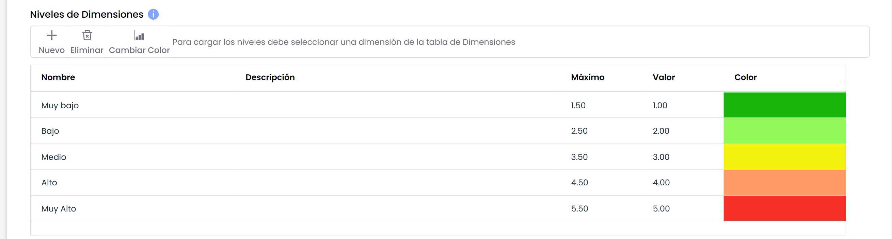

**Metodologías de Ejecución**

En este apartado, es posible definir metodologías que se utilizarán para ejecutar los [Trabajos de Auditoria](../../auditoria/programa-auditorias/plan-de-trabajo-auditoria.md), y auditar los elementos, riesgos y controles incluidos en los mismos.

* **Metodología de Ejecución de Elementos:** Permite definir dimensiones para evaluar los elementos incluidos en el alcance del trabajo. Estas dimensiones pueden hacer referencia a las configuradas en la configuración de [Metodologías de Elementos](metodologia-elementos.md).
* **Metodología de Ejecución de Riesgos:** Es posible definir qué dimensiones se van a evaluar para cada riesgo a auditar.
* **Metodología de Ejecución de Controles:** En la metodología de ejecución, se configurarán las dimensiones a auditar sobre los controles.

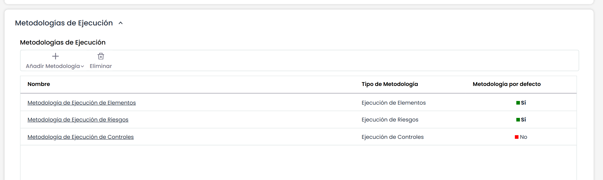

Es posible crear más de una metodología de ejecución de cada tipo, definiendo una por defecto. Los trabajos de auditoria que se creen, se les asignará la metodología por defecto, aunque se podrá modificar antes de comenzar la ejecución del mismo.
