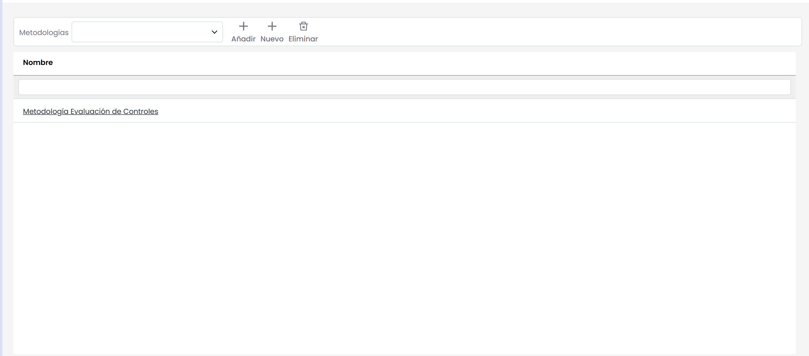
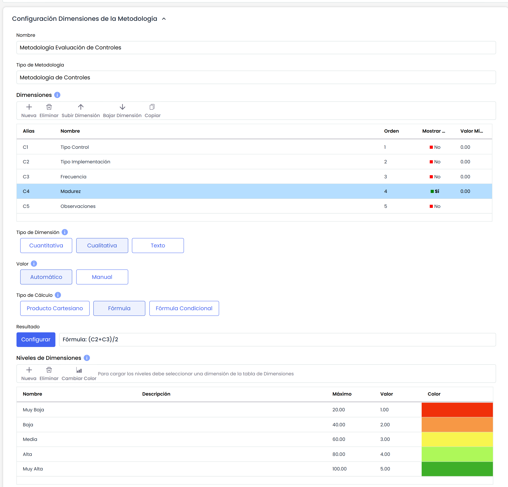
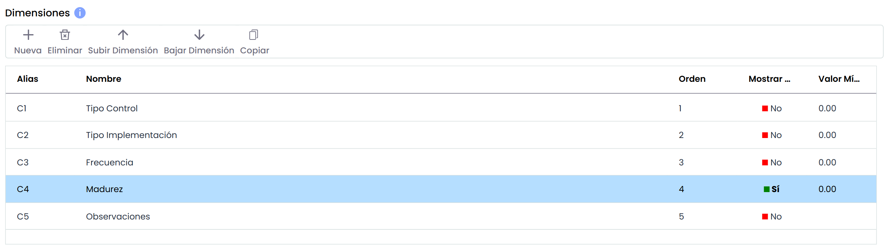
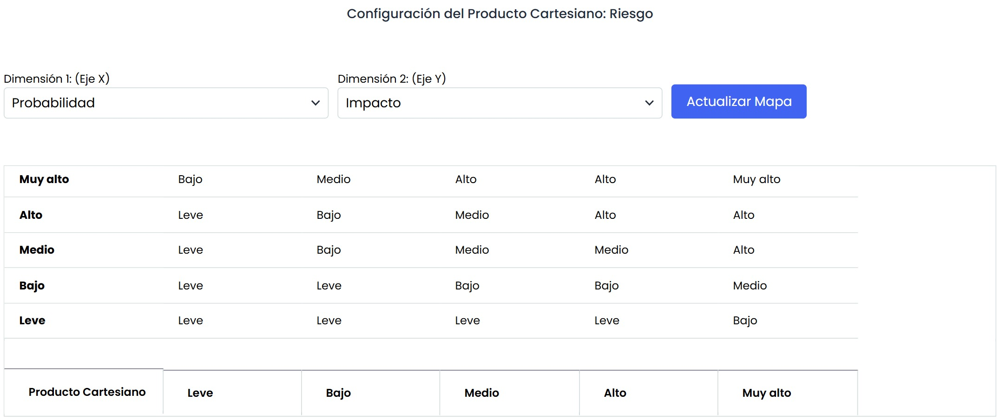
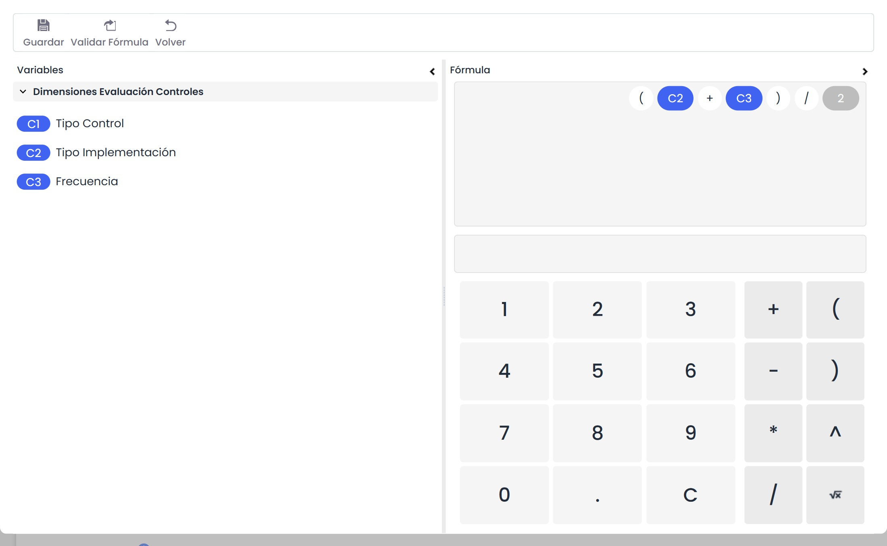
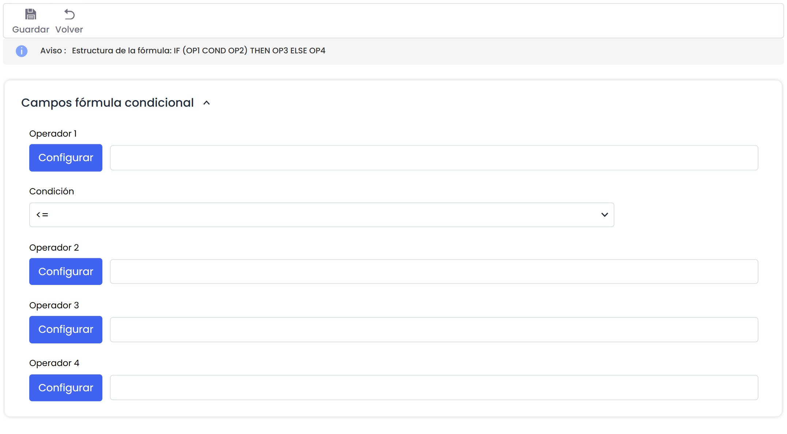
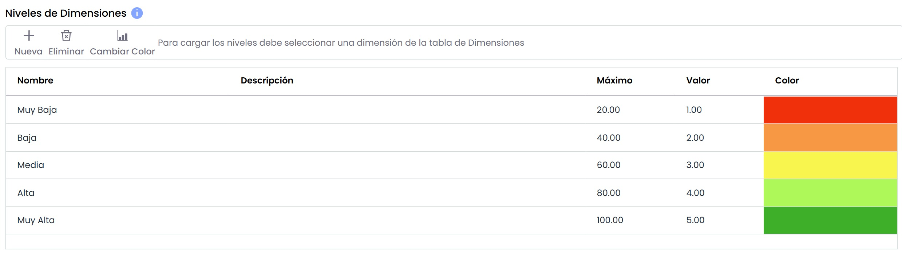
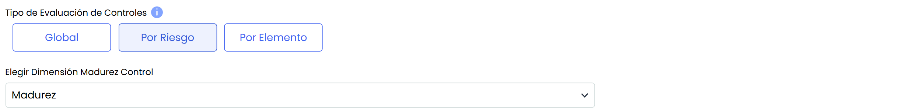

# Metodologías Controles

Este apartado permite establecer y parametrizar diferentes metodologías con las que evaluar los controles o salvaguardas implantados en la organización con el fin de mitigar los riesgos existentes.

La herramienta permite realizar las siguientes acciones iniciales:

* **Añadir:** Permite seleccionar una de las metodologías creadas. Para ello se selecciona la metodología en el desplegable y se pulsa sobre el botón 'Añadir'
* **Nuevo:** Posibilita insertar una nueva entrada en la tabla.
* **Eliminar:** Ofrece la posibilidad de eliminar una metodología del listado. Para ello se ha de seleccionar la fila deseada y pulsar sobre el botón 'Eliminar'.

Al pulsar sobre alguna de las metodologías, se facilitan las siguientes opciones de parametrización.

## Configuración Dimensiones de la Metodología

* **Nombre:** Identifica el nombre de la metodología. Este nombre se muestra en el listado de metodologías.
* **Tipo metodología:** Informa sobre el tipo de metodología que se esta gestionando, en este caso de controles.
* **Dimensiones:** Permite la configuración de las dimensiones a valorar en el análisis de riesgos para cada uno de los controles implantados. Se pueden crear y eliminar dimensiones, además de configurar el orden de aparición en la tabla correspondiente con los botones ‘Subir Dimensión’ y ‘Bajar Dimensión’.

Para facilitar el modelado, mediante el botón "**Copiar**" es posible copiar una dimensión de la metodología de Controles con toda su información (niveles, fórmulas, visibilidad, grupos).

La información que nos ofrece la tabla es la siguiente:

* **Alias:** Identificador que genera la herramienta de manera automática
* **Nombre:** Muestra el nombre de la dimensión. Pulsando 2 veces sobre la celda permite cambiar al nombre de la misma.
* **Orden:** Identifica el orden en el que la dimensión aparecerá en el análisis de riesgos.
* **Mostrar Color:** Permite definir si queremos resaltar la dimensión en un color.
* **Valor mínimo:** Identifica el número mínimo sobre el cual se calcula la fórmula de la dimensión seleccionada.
* **Tipo:** Identifica si la dimensión es de tipo Texto o no.
* **Visible:** Identifica si la dimensión va a estar visible en:

  * **Tablas:** En las tablas de Gestión de Controles, Análisis de Riesgos, etc.
  * **Ficha de Control:** En la propia ficha de control.
  * **Todos:** Tanto en las tablas, como en la ficha de control.
* **Modificable:** Identifica si la dimensión puede ser modificada en:

  * **Tablas:** En las tablas de Gestión de Controles, Análisis de Riesgos, etc.
  * **Ficha de Control:** En la propia ficha de control.
  * **Todos:** Tanto en las tablas, como en la ficha de control.

* **Tipo de dimensión:** Ofrece la posibilidad de establecer el método de cálculo de las dimensiones, pudiendo optar entre las siguientes:

  * **Cuantitativa:** Permite definir que el cálculo de la dimensión seleccionada sea cuantitativo, pudiendo establecer un valor numérico en la dimensión.
  * **Cualitativa:** Permite definir que el cálculo de la dimensión seleccionada sea cualitativo, pudiendo establecer un rango de valores determinado (ejemplo: Alto, Medio, Bajo).
* **Valor:** Permite definir como queremos que se realice el cálculo (Manual o Automático) de la dimensión seleccionada en la tabla superior.

### Tipo de cálculo

 En el caso de haber seleccionado en la opción anterior un cálculo automático, la herramienta no ofrece las siguientes opciones:

* **Producto Cartesiano:** Permite establecer el cálculo de la dimensión seleccionada, en base a una matriz de dos dimensiones definidas en la opción 'Dimensiones'. Para ello se ha de seleccionar una dimensión en el 'Eje X' y otra dimensión en el 'Eje Y' y dar valores en función de los niveles establecidos.


\*\*NOTA:\*\* El producto cartesiano no se puede generar en base a dimensiones cuyo cálculo sea cuantitativo.


* **Fórmula:** La opción permite definir como se obtendrá el cálculo de la dimensión seleccionada, en base a una fórmula matemática. Para ello la herramienta muestra la siguiente opción:


\*\*NOTA:\*\* El cálculo de dimensiones automáticas con Fórmula se realiza siempre que se tenga algún parámetro de la fórmula con valor (un parámetro puede ser otra dimensión manual o automática, o un dígito numérico).
En caso de que se evalúe la fórmula, los parámetros que no tengan valor (dimensiones vacías) se sustituirán por un valor cero.


* **Fórmula Condicional:** La opción permite establecer un cálculo condicional entre diferentes dimensiones establecidas en la metodología de controles.

Para configurar esta apartado, se ha de pulsar sobre el botón 'Configurar' accediendo a la siguiente pantalla:

La configuración de la fórmula condicional se establece en base a los operadores, donde los operadores 1 y 2 sirven para establecer la condición, siendo necesario fijar el mismo en el desplegable. Las opciones que permite la herramienta son:

* **==:** Igual a
* **!=:** Distinto a
* **<:** Menor que
* **>:** Mayor que
* **<=:** Menor o igual que
* **>=:** Mayor o igual que

Una vez se establece la fórmula de la condición, se han de fijar los resultados que se quieren obtener, para ello, en el caso de cumplirse la condición los resultados mostrados se corresponden con el operador 3 y en caso contrario con el operador 4.

El usuario podrá optar entre las diferentes dimensiones y opciones de cálculo para generar la fórmula en base a la cual se obtendrá el resultado de la dimensión seleccionada.


\*\*Nota\*\*: Es necesario validar la fórmula antes de guardar la misma pulsando sobre el botón 'Validar Fórmula'


* **Resultado:** Posibilita definir los valores de la opción de cálculo seleccionada en el punto superior (Producto Cartesiano, Fórmula o Fórmula Condicional)

### Niveles de dimensiones

Permite definir los niveles de valoración de la dimensión seleccionada. Al igual que el resto de opciones, se podrán crear y eliminar niveles, además de parametrizar el color deseado para que resalten los niveles a la hora de la valoración, seleccionando el nivel a modificar y pulsando el botón ‘Cambiar color’.


\*\*Nota\*\*: Si los niveles se definen para una dimensión cualitativa, las opciones que permite la herramienta es definir el rango de cálculo del nivel seleccionado y el valor sobre el cual se va a calcular la misma. Si los niveles se definen para una dimensión cuantitativa, permite definir el color en el cual se van a resaltar los valores numéricos en el inventario de activos.


* **Tipo evaluación de controles:** Permite establecer la evaluación de los controles pudiendo optar entre un cálculo Global (permitirá valorar un control una vez y de manera global para todos los Riesgos) o Por Riesgo, (pudiendo modificar las valoraciones por cada una de los riesgos evaluados en el análisis de riesgos)
* **Elegir dimensión madurez control:** Permite definir en base a que dimensión, de las definidas en el apartado superior, queremos obtener los valores globales de la madurez de los controles en la organización.

