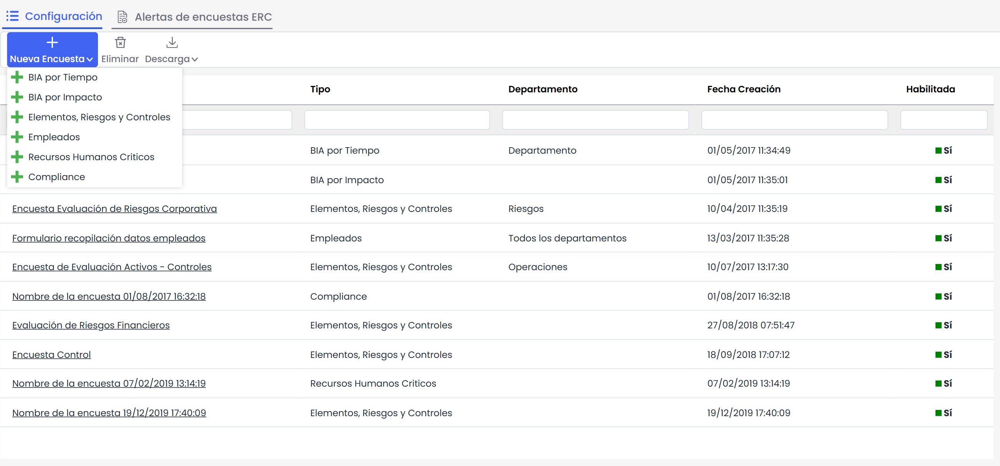

# Modelos de Encuestas

El apartado de modelos de encuestas permite al usuario crear un patrón para la realización de diferentes encuestas en función de los productos de GlobalSUITE®. Los tipos de encuestas son:

* BIA por Tiempo.
* BIA por Impacto.
* Activos, Riesgos y Controles.
* Empleados.
* Recursos Humanos Críticos.
* Compliance.

Nada más acceder a la opción la herramienta muestra una tabla sobre la que se pueden realizar las siguientes acciones:

* **Nueva Encuesta:** Permite al usuario establecer la tipología de encuesta a crear, entre los tipos anteriormente indicados.
* **Eliminar:** Posibilita al usuario eliminar una entrada definida en la tabla. Para ello se ha de seleccionar la fila o filas deseadas y pulsar sobre el botón ‘Eliminar’.
* **Descarga:** Permite descargar el listado de encuestas en formato editable (.xlsx) o en formato .PDF

* [Modelo Encuesta Empleados](modelo-encuesta-empleados.md)
* [Modelo Encuesta Recursos Humanos Críticos](modelo-encuesta-recursos-humanos-criticos.md)
* [Modelo Encuesta Compliance](modelo-encuesta-compliance.md)
* [Modelo Encuesta BIA por Impacto](modelo-encuesta-bia-por-impacto.md)
* [Modelo Encuesta Elementos, Riesgos y Controles](modelo-encuesta-elementos-riesgos-y-controles.md)
* [Modelo Encuesta BIA por Tiempo](modelo-encuesta-bia-por-tiempo.md)
* [Alertas de encuestas ERC](alertas-de-encuestas-erc.md)
