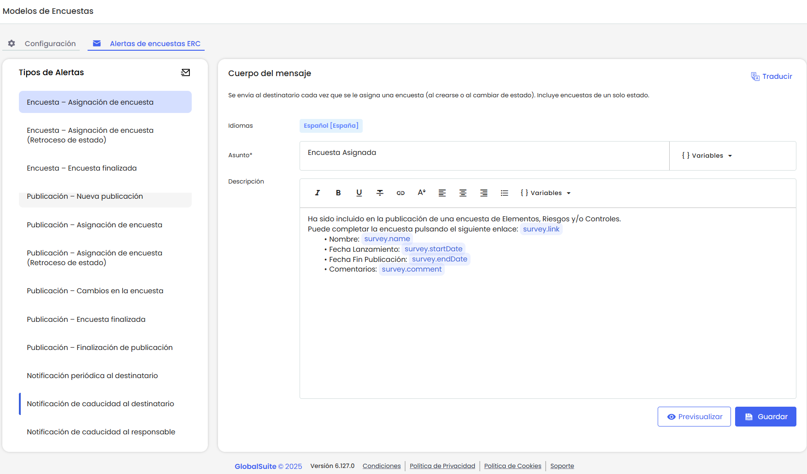
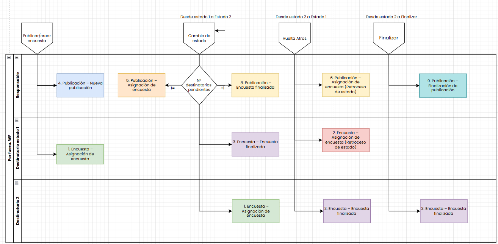
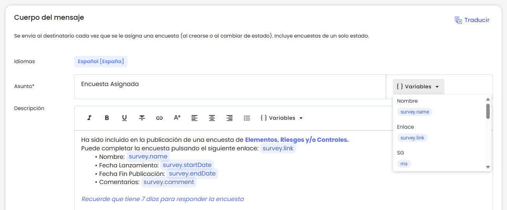
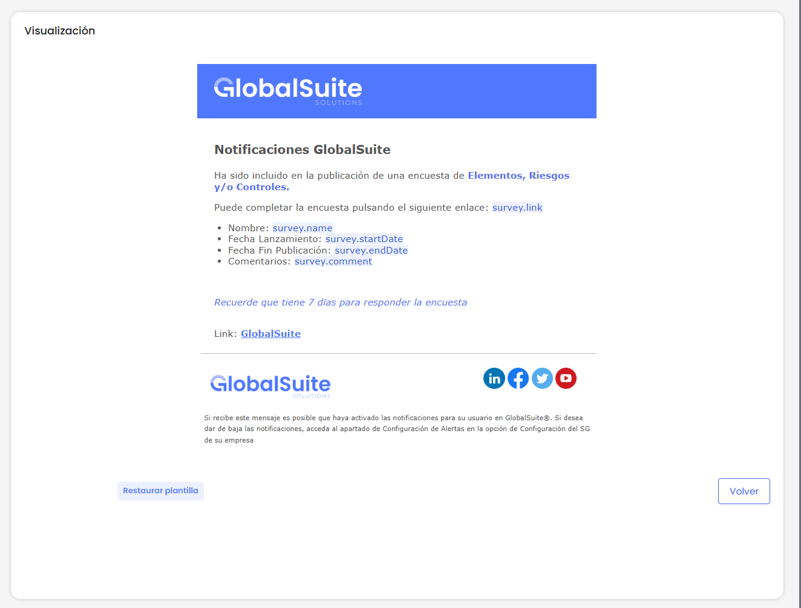
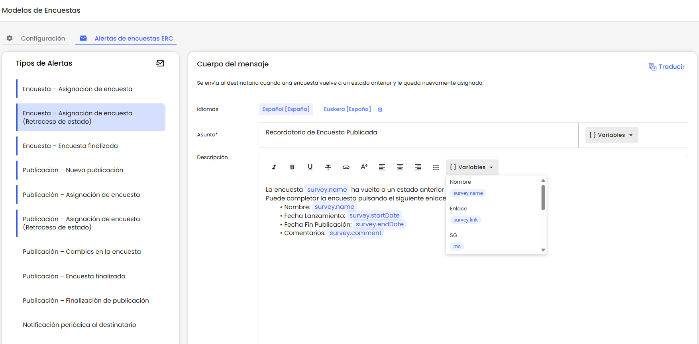
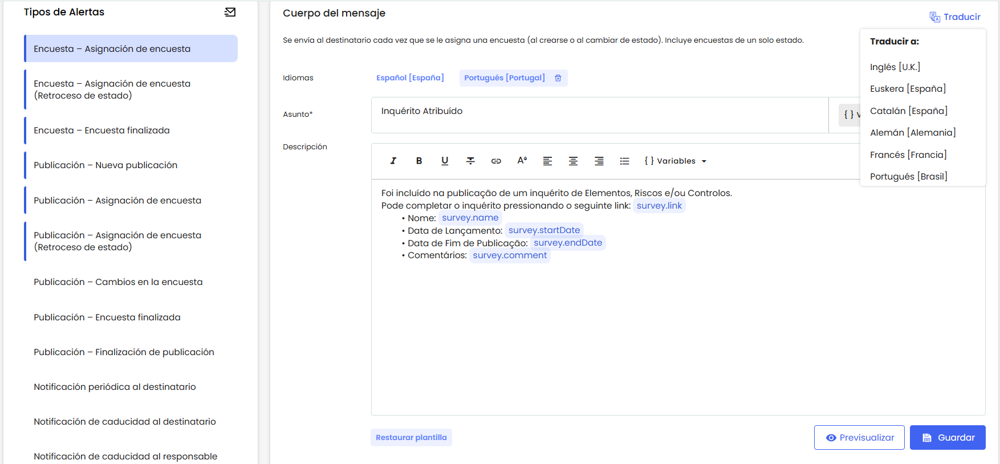

# Alertas de encuestas ERC

En esta pestaña se configura el contenido de las notificaciones que se envían durante el ciclo de vida de las encuestas ERC.

La funcionalidad permite personalizar el asunto y el cuerpo de cada correo, incorporando variables dinámicas y versiones traducidas en los idiomas configurados en la empresa.

## Panel de alertas disponibles

En el panel izquierdo se muestran todas las alertas que pueden configurarse.  
Aquellas que ya tienen plantilla definida aparecen resaltadas con un borde lateral.

Si una alerta no tiene plantilla configurada, no significa que el correo se enviará vacío. En ese caso, se utilizará el correo por defecto de GlobalSUITE®, manteniendo la lógica de notificación actual.

## Listado de alertas disponibles

**Encuesta – Asignación de encuesta**  
Se envía al destinatario cada vez que se le asigna una encuesta.

**Encuesta – Asignación de encuesta (Retroceso de estado)**  
Se envía al destinatario cuando una encuesta vuelve a un estado anterior y él vuelve a estar asignado como destinatario.

**Encuesta – Encuesta finalizada**  
Se envía al usuario que ha finalizado su participación en la encuesta, ya sea porque la finalizó, avanzó o retrocedió de estado y dejó de estar asignado a la encuesta.

**Publicación – Nueva publicación**  
Se notifica al responsable de la publicación cuando se crea una nueva publicación. Esta alerta es nueva, ya que previamente no estábamos notificando al Responsable de la Publicación.

**Publicación – Asignación de encuesta**  
Se notifica al responsable de la publicación cuando se asignan encuestas a los destinatarios, ya sea en el momento de la publicación o al avanzar de estado. Si hay múltiples destinatarios, se agrupa la información en un solo correo.

**Publicación – Asignación de encuesta (Retroceso de estado)**  
Se notifica al responsable cuando una encuesta, perteneciente a una publicación de la que es responsable, retrocede a un estado anterior en el workflow.

**Publicación – Encuesta finalizada**  
Se notifica al responsable cuando un destinatario de la publicación finaliza su encuesta (ya sea por avanzar o retroceder de estado).

**Publicación – Cambios en la encuesta**  
Se notifica al responsable cuando se realizan cambios en la encuesta publicada (nombre, fechas, destinatarios, etc.).Esta alerta se activa en la publicación->Activar

**Publicación – Finalización de publicación**  
Se notifica al responsable cuando todas las encuestas vinculadas a una publicación han sido completadas y han alcanzado el último estado del flujo de trabajo.  
Esta alerta es nueva, ya que hasta el momento no se enviaba ninguna notificación en este caso.

**Notificación periódica al destinatario**  
Se envía de forma automática a los destinatarios de encuestas que aún no han sido completadas, según el intervalo definido en la configuración.

**Notificación de caducidad al destinatario**  
Se envía al destinatario cuando la fecha de finalización de su encuesta se aproxima o ha vencido.

**Notificación de caducidad al responsable**  
Se notifica al responsable de la publicación que existen encuestas asignadas que no han sido completadas en la fecha prevista.

Cada una de ellas puede personalizarse de manera independiente en todos los idiomas configurados en la empresa.

### Alertas de estados:

## Configuración de plantillas

### Asunto de la notificación

* Se puede personalizar el asunto utilizando texto libre y variables dinámicas (ejemplo: nombre de la encuesta, fecha de publicación).
* Las variables deben insertarse mediante la opción del toolbar “Variable” y son solo las básicas. Se insertan completas y no pueden editarse parcialmente, para evitar errores de escritura o envíos incorrectos.
* El asunto tiene un límite técnico de caracteres definido por los servidores de correo, por lo que se recomienda mantener un texto breve y claro.

### Mensaje de la notificación

* El cuerpo del mensaje admite formato enriquecido (colores, negritas, enlaces, listas, etc.).
* Se pueden incluir variables para personalizar la comunicación
* El encabezado y pie de página se añaden automáticamente:

  * Se utilizará el diseño por defecto de GlobalSUITE®, o bien el configurado en **Ajustes > Configuración General** de la empresa.
* Se puede **previsualizar** el contenido del mensaje antes de guardarlo.

### Variables

Las variables deben insertarse mediante la opción llamada “Variable”. Estas se añaden completas y con un formato especial, que las resalta del texto e impide editarlas parcialmente. De esta forma se evita que se escriban de manera incorrecta o que, al borrarlas solo en parte, el correo quede con errores.

Las variables basicar, que están en todas las plantillas y asuntos son:

| Variable | Descripción |
| --- | --- |
| `survey.name` | Nombre de la encuesta |
| `survey.link` | Enlace directo a la encuesta |
| `sg` | Nombre de la SG (entidad) |
| `sg.environmentLink` | Enlace al entorno de GlobalSUITE |
| `survey.startDate` | Fecha de inicio de la encuesta |
| `survey.endDate` | Fecha de fin de la encuesta |
| `survey.comment` | Texto del campo “Comentario” de la configuración de la encuesta. |
| `survey.type` | Tipo de encuesta (Elementos, Riesgos, etc.) |
| `survey.configuration` | Configuración de la encuesta |
| `survey.publicationName` | Nombre de la publicación que contiene la encuesta |
| `survey.state` | Estado actual de la encuesta |
| `survey.department` | Departamento asociado a la encuesta o al destinatario |

#### Variables especiales

A continuación, listamos las variables que solo se encuentran en algunas plantillas:

| Variable | Descripción | Plantilla |
| --- | --- | --- |
| `survey.changeDate` | Fecha de cambio de estado la encuesta | **Encuesta – Asignación de encuesta.**  **Encuesta – Asignación de encuesta (Retroceso de estado)**  **Publicación – Asignación de encuesta (Retroceso de estado)** |
| `surveyPublication.list {}` | Permite recorrer todas las encuestas de una publicación que avanzaron, para cambiar de estado.  Al utilizar esta variable, su contenido debe ir entre llaves `{ }`, definiendo qué datos se mostrarán por cada encuesta  El contenido del bloque podrá editarse por plantilla. Esta configuración no se hereda entre diferentes plantillas, por lo que siempre se debe inicializar con la estructura por defecto al insertar la variable surveyPublication.list en una nueva plantilla. | **Publicación – Asignación de encuesta** |
| `survey.daysToExpiration` | Cantidad de días restantes hasta la fecha de fin | **Notificación de caducidad al destinatario**. |
| `survey.pendingRecipientsList` | Permite recorrer todas las encuestas incluidas en una publicación que estén pendientes y próximas a vencer. Al utilizar esta variable, su contenido debe ir entre llaves `{ }`, definiendo qué datos se mostrarán por cada encuesta.  El contenido del bloque podrá editarse por plantilla. Esta configuración no se hereda entre diferentes plantillas, por lo que siempre se debe inicializar con la estructura por defecto al insertar la variable `survey.pendingRecipientsList` en una nueva plantilla. | **Notificación de caducidad al responsable** |
| `survey.token` | token interno que identifica a la encuesta modificada | **Publicación – Cambios en la encuesta** |

### Restaurar plantillas

El sistema permite restaurar el contenido de cualquier plantilla a su versión **por defecto.**

* Esta opción, restablece tanto el asunto como para el mensaje de la notificación.
* Al restaurar, se elimina el contenido personalizado y se recupera la plantilla original definida por GlobalSUITE®.
* La restauración tambien quita los idiomas ingresado puede aplicarse de forma independiente en cada idioma configurado.
* Una vez restaurada, es posible volver a personalizar la plantilla en cualquier momento.

### Traducciones

* Tanto el asunto como el mensaje pueden configurarse en varios idiomas.

* Al seleccionar un idioma, se añade al listado de versiones disponibles de la plantilla y se carga automáticamente la versión por defecto en ese idioma (no se traducen automáticamente las plantillas personalizadas).
* Al enviar la notificación, el sistema:

  * Si el destinatario tiene usuario, utiliza el idioma configurado en su perfil.
  * Si no tiene usuario, utiliza el idioma configurado en la encuesta.
  * Si existe plantilla para ese idioma, se envía su contenido.
  * Si no existe, se envía el contenido por defecto.
