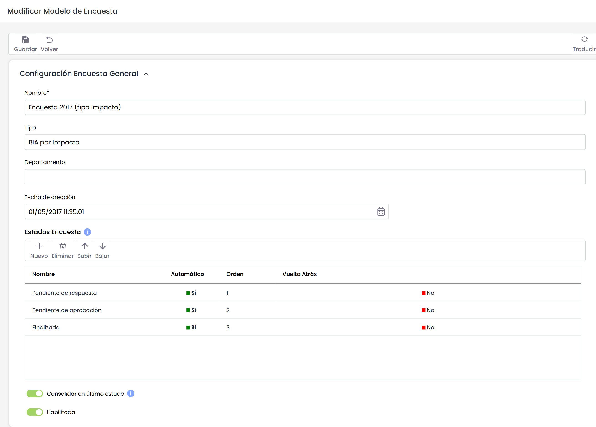
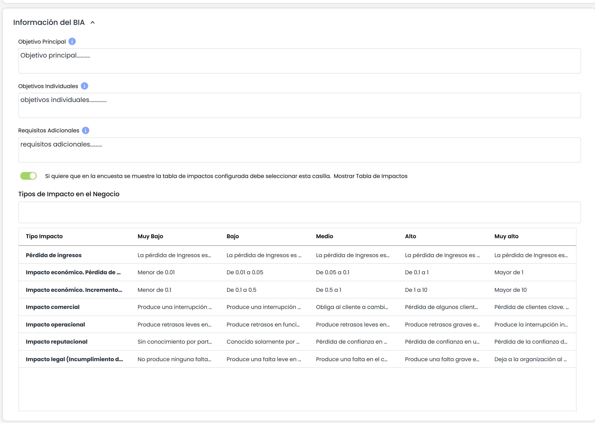
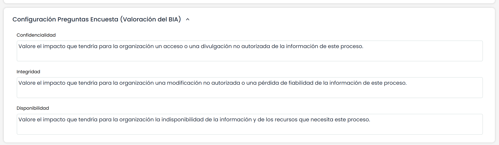
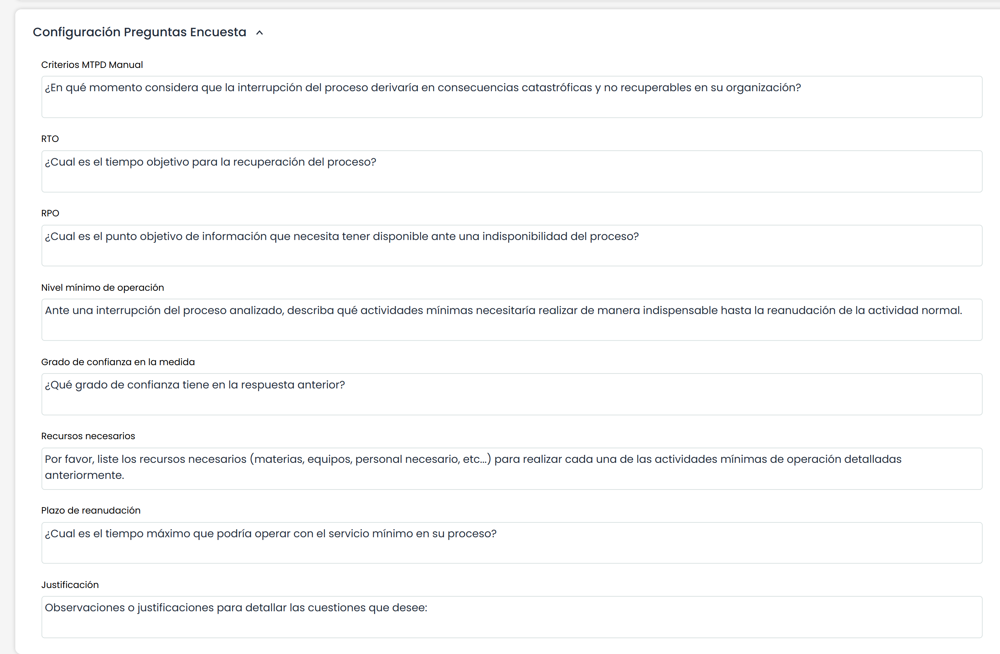
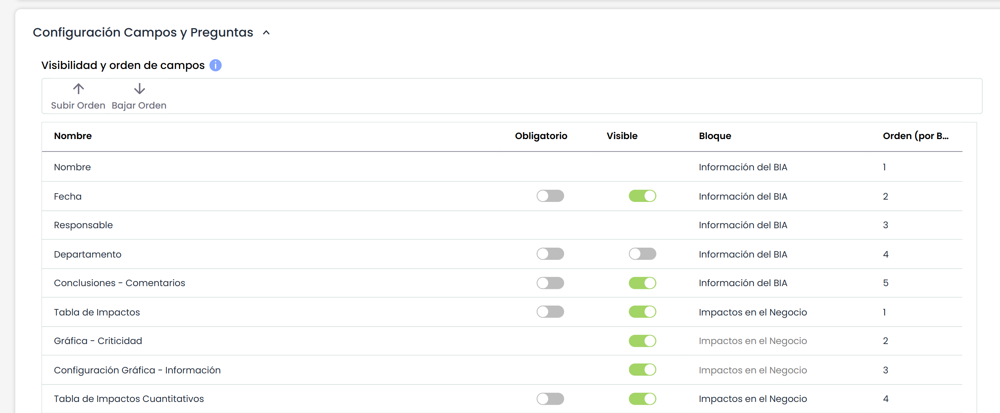
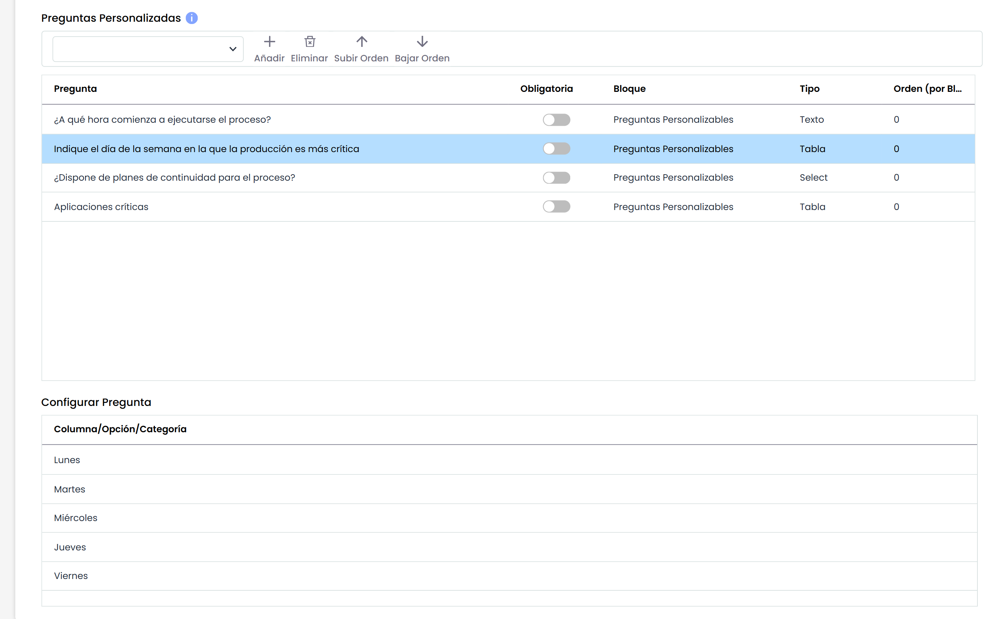
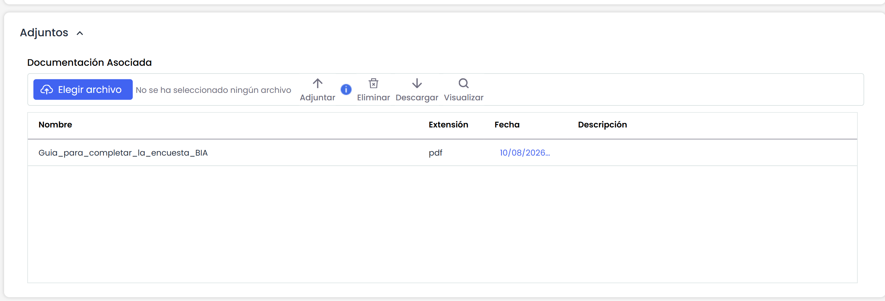

# Modelo Encuesta BIA por Impacto

## Configuración Encuesta General

* **Nombre:** Permite identificar el nombre de la encuesta. Este nombre se mostrará en el listado inicial de encuestas.
* **Tipo:** Permite visualizar la tipología de la encuesta.
* **Departamento:** Posibilita identificar el departamento encargado de gestionar la encuesta.
* **Fecha de creación:** Identifica la fecha de creación de la encuesta.
* **Estados Encuesta:** Esta tabla permite definir un conjunto de estados para la encuesta. Estos estados podrán ser asignados a empleados cuando se configure la encuesta, de forma que serán responsables de la encuesta en función del estado en el que se encuentre. Para cada estado se permite definir:

  * El nombre del estado.
  * Si es el estado Automático o no, de forma que si un estado es automático, las encuestas pasarán al siguiente estado una vez estén completadas sin intervención de ningún usuario. Si el estado no es automático, será necesario que se cambie el estado de una encuesta de manera manual.
  * El orden de los estados a través de los botones "Subir" y "Bajar".
  * Si el estado permite que vuelva al estado anterior. Al marcar Sí, el responsable de completar la encuesta podrá devolverla al estado previo.
* **Habilitada:** Permite indicar que la encuesta esté habilitada para su utilización en GlobalSUITE.

Es posible traducir los campos del modelo de encuestas al resto de idiomas disponibles, a través del botón "Traducir" de la parte superior derecha. Este botón nos permitirá seleccionar otro idioma, y poder definir el nombre de los campos configurables en ese idioma. Actualmente, los estados de la encuesta.

### Información BIA

Permite definir las preguntas necesarias para ejecutar la encuesta del BIA. Los campos que se pueden definir son los siguientes:

* **Objetivo Principal:** Permite informar al usuario sobre el objetivo de la encuesta.
* **Objetivos individuales:** Permite informar al usuario sobre el objetivo más especificos de la encuesta.
* **Requisitos Adicionales:** Ofrece la posibilidad de informar sobre necesidades adicionales a la hora de completar la encuesta.
* **Mostrar tabla de impactos:** Ofrece la posibilidad de mostrar la tabla de impacto y criterios a la hora de completar la encuesta.

### Configuración Preguntas Encuesta (Valoración BIA)

Las dimensiones que se muestran, son las que fueron configuradas como **Visibles = Sí** en la columna **BIA** del apartado **Ajustes>Elementos >** [**Visibilidad de Dimensiones** (**Formularios)**](https://help.globalsuitesolutions.com/es/globalsuite/v1/metodologia-elementos)

El texto que acompaña a cada dimensión, permite definir las preguntas o enunciados que orientan la valoración de cada dimensión establecida.

### Configuración Preguntas Encuesta

Ofrece la posibilidad de definir las preguntas necesarias para el cálculo de los siguientes conceptos:

* **Criterios MTPD:** Permite definir una pregunta para establecer el criterio del tiempo máximo de parada del servicio.
* **RTO:** Ofrece la posibilidad de definir una pregunta para establecer el criterio del tiempo máximo de recuperación.
* **RPO:** Permite definir una pregunta para establecer el criterio del punto objetivo de recuperación de información.
* **Nivel Mínimo de operación:** Ofrece la posibilidad de definir una pregunta para establecer los niveles minimos para operar el servicios
* **Grado de confianza en la medida:** Permite definir una pregunta para establcer el grado de confianza de los valores definidos
* **Recursos necesarios:** Permite preguntar por los recursos necesarios para la recuperación del servicio
* **Plazo de reanudación:** Ofrece la posibilidad de definir una pregunta para completar el plazo de recuperación de los servicios optimo.
* **Justificación:** Permite preguntar sobre los criterios que justifiquen los valores definidos.

### Visibilidad y orden de campos

En esta tabla se define la **visibilidad** y el **orden** de los campos y tablas fijas que pueden utilizarse en la encuesta BIA.

* **Nombre:** Muestra el identificador del campo.
* **Obligatorio**: determina si el campo debe ser completado para poder avanzar en la encuesta.  
  Los campos “Nombre de la encuesta” y “Responsable” siempre serán obligatorios.  
  Por otro lado, los campos “Gráfica - Criticidad” y “Configuración Gráfica - Información”, al ser solo informativos, no pueden marcarse como obligatorios.
* **Visible:** Check que permite mostrar u ocultar un campo.
* **Bloque:** Al hacer doble click en esta celda, se despliega el listado de bloques disponible, para poder seleccionar en qué bloque se mostrará el campo dentro del formulario.
* **Orden (por bloque):** Esta columna indica el orden de cada campo dentro de cada bloque. Al cambiar un campo de bloque se añadirá al final del mismo. También es posible ordenar manualmente los campos seleccionando uno y pulsando los botones "Subir Orden" ó "Bajar Orden".


\*\*NOTA:\*\* Un campo que no esté habilitado en la configuración de "Continuidad de Negocio", no se podrá poner como visible en el modelo de encuesta.



\*\*NOTA 2\*\*: En el momento de pulsar el botón "Modificar BIAs" en la opción >[Encuestas BIA Tiempo](https://help.globalsuite.es/display/GlobalSUITEes/.Encuestas+BIA+Tiempo+vv6.64),  en las encuestas sólo se consolidarán los campos que hayan sido marcados como visibles.


### Preguntas Personalizables

Este apartado permite incluir en la encuesta BIA preguntas adicionales configuradas previamente en **Ajustes >** [Configuración BIA](https://help.globalsuitesolutions.com/es/globalsuite/v1/configuracion-bia)

La tabla permite seleccionar preguntas desde un desplegable mediante el botón **“Añadir”**. Cada pregunta añadida puede ser configurada mediante las siguientes columnas:

* **Pregunta**: texto de la pregunta que se incluirá en el formulario.
* **Obligatoria**: indica si la respuesta a la pregunta es obligatoria para completar la encuesta.
* **Bloque**: define la sección del formulario BIA en la que se mostrará la pregunta.
* **Tipo**: determina el formato de la pregunta (texto libre, tabla, selección, etc.).
* **Orden (por bloque)**: establece el orden en que se mostrarán las preguntas dentro de cada bloque. Es posible reordenarlas mediante los botones **“Subir Orden”** y **“Bajar Orden”**.

### Adjuntos

En los modelos de encuestas BIA, es posible cargar archivos y documentos con ayudas, guías o una explicación detallada, que se enviarán por correo a los destinatarios de las encuestas cuando se lancen, además de estar disponibles en la propia encuesta para su consulta.

* Desde este apartado es posible:
* **Seleccionar un archivo** desde el equipo local mediante el botón "Elegir archivo".

  * **Adjuntar** el archivo seleccionado utilizando el botón "Adjuntar".

    * Solo se podrán subir archivos cuyo tamaño no supere el límite configurado en Configuración General > Tamaño máximo por archivo (MB).
  * **Eliminar** documentos ya cargados, siempre que el usuario tenga permisos para hacerlo.
  * **Descargar** cualquier archivo disponible en la lista.
  * **Visualizar** directamente archivos compatibles, como documentos en formato PDF o imágenes (jpg, jpeg, bmp y png)
* Los archivos cargados se muestran en una tabla con las siguientes columnas:

  * **Nombre** del archivo. Es editable.
  * **Extensión**
  * **Fecha** de carga
  * **Descripción** (si aplica)
