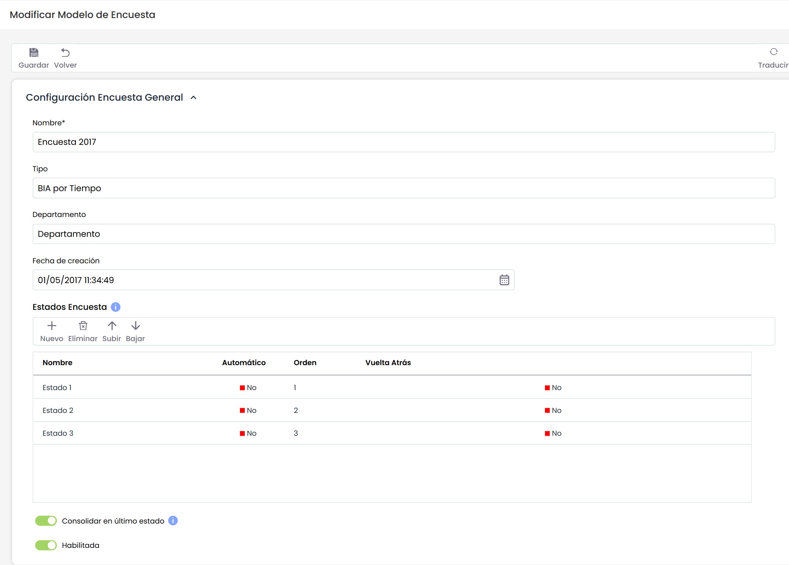
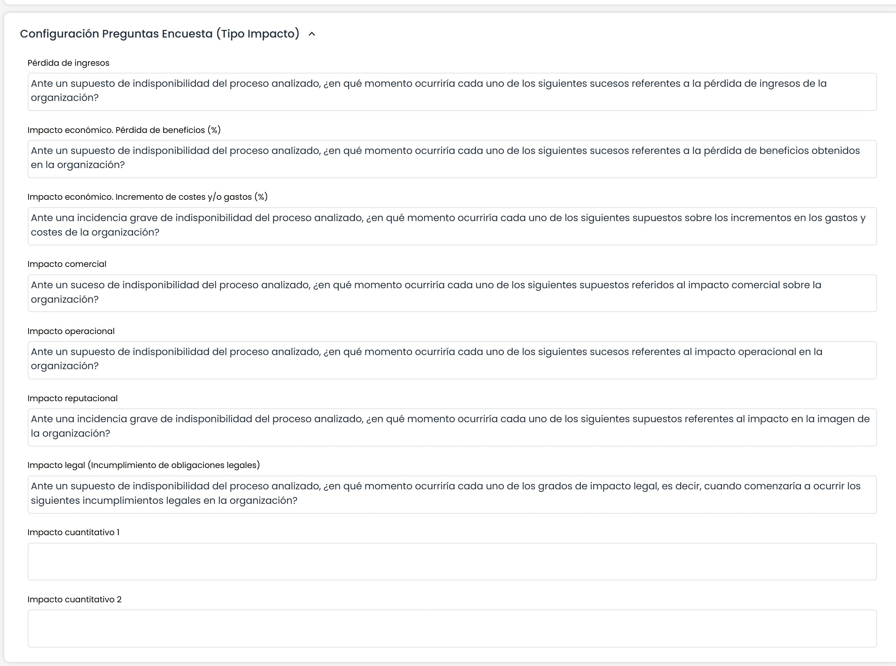
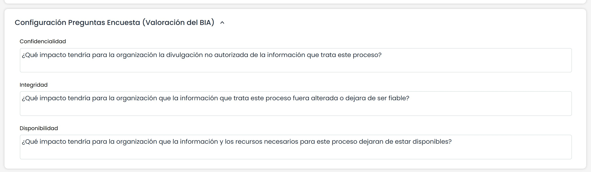
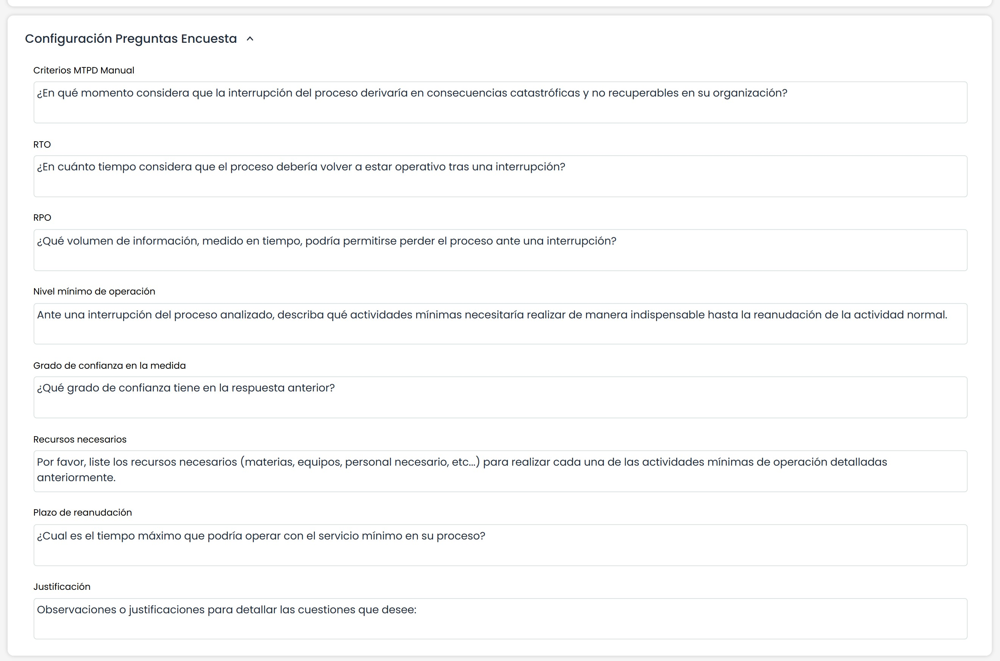
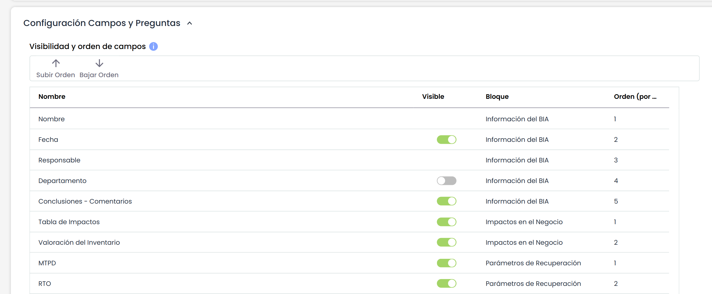
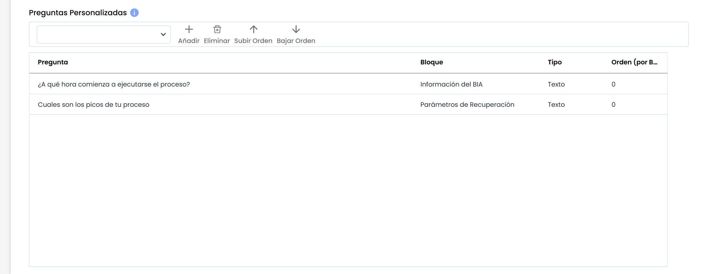

# Modelo Encuesta BIA por Tiempo

Al pulsar sobre el enlace de la encuesta por tiempo, la herramienta ofrece un formulario sobre el que se pueden definir los siguientes campos:

**Configuración Encuesta General**

* **Nombre:** Permite identificar el nombre de la encuesta. Este nombre se mostrará en el listado inicial de encuestas.
* **Tipo:** Permite visualizar la tipología de la encuesta.
* **Departamento:** Posibilita identificar el departamento encargado de gestionar la encuesta.
* **Fecha de creación:** Identifica la fecha de creación de la encuesta.
* **Estados Encuesta:** Esta tabla permite definir un conjunto de estados para la encuesta. Estos estados podrán ser asignados a empleados cuando se configure la encuesta, de forma que serán responsables de la encuesta en función del estado en el que se encuentre. Para cada estado se permite definir:

  * El nombre del estado.
  * Si es el estado Automático o no, de forma que si un estado es automático, las encuestas pasarán al siguiente estado una vez estén completadas sin intervención de ningún usuario. Si el estado no es automático, será necesario que se cambie el estado de una encuesta de manera manual.
  * El orden de los estados a través de los botones "Subir" y "Bajar".
  * Si el estado permite que vuelva al estado anterior. Al marcar Sí, el responsable de completar la encuesta podrá devolverla al estado previo.
* **Habilitada:** Permite indicar que la encuesta esté habilitada para su utilización en GlobalSUITE.

Es posible traducir los campos del modelo de encuestas al resto de idiomas disponibles, a través del botón "Traducir" de la parte superior derecha. Este botón nos permitirá seleccionar otro idioma, y poder definir el nombre de los campos configurables en ese idioma. Actualmente, los estados de la encuesta.

**Configuración Preguntas Encuesta (Tipo Impacto)**

El presente apartado permite definir las preguntas necesarias para poder generar adecuadamente el BIA de la organización.

**NOTA:** Los tipos de impacto se establecen en el apartado 'Ajustes /Continuidad de Negocio'

**Configuración Preguntas Encuesta (Valoración BIA)**

El apartado de permite establecer las preguntas necesarias para la valoración de las dimensiones establecidas.

**Configuración Preguntas Encuesta**

Ofrece la posibilidad de definir las preguntas necesarias para el cálculo de los siguientes conceptos:

* **Criterios MTPD:** Permite definir una pregunta para establecer el criterio del tiempo máximo de parada del servicio.
* **RTO:** Ofrece la posibilidad de definir una pregunta para establecer el criterio del tiempo máximo de recuperación.
* **RPO:** Permite definir una pregunta para establecer el criterio del punto objetivo de recuperación de información.
* **Nivel Mínimo de operación:** Ofrece la posibilidad de definir una pregunta para establecer los niveles mínimos para operar el servicios
* **Grado de confianza en la medida:** Permite definir una pregunta para establecer el grado de confianza de los valores definidos
* **Recursos necesarios:** Permite preguntar por los recursos necesarios para la recuperación del servicio
* **Plazo de reanudación:** Ofrece la posibilidad de definir una pregunta para completar el plazo de recuperación de los servicios optimo.
* **Justificación:** Permite preguntar sobre los criterios que justifiquen los valores definidos.

**Visibilidad y orden de campos**

En esta tabla se puede definir la visibilidad de los campos y tablas fijos que se pueden utilizar en la encuesta. El único campo obligatorio es "Nombre".

La información que aparece en la tabla es:

* **Nombre:** Muestra el identificador del campo.
* **Visible:** Check que permite mostrar u ocultar un campo.
* **Bloque:** Al hacer doble click en esta celda, se despliega el listado de bloques disponible, para poder seleccionar en qué bloque se mostrará el campo dentro del formulario.
* **Orden (por bloque):** Esta columna indica el orden de cada campo dentro de cada bloque. Al cambiar un campo de bloque se añadirá al final del mismo. También es posible ordenar manualmente los campos seleccionando uno y pulsando los botones "Subir Orden" ó "Bajar Orden".

**NOTA:** Un campo que no esté habilitado en la configuración de "Continuidad de Negocio", no se podrá poner como visible en el modelo de encuesta.

**NOTA 2**: En el momento de pulsar el botón "Modificar BIAs" en la opción >[Encuestas BIA Tiempo](https://help.globalsuite.es/display/GlobalSUITEes/.Encuestas+BIA+Tiempo+vv6.64),  en las encuestas sólo se consolidarán los campos que hayan sido marcados como visibles.

**Preguntas Personalizables**

Permite incluir en la encuesta del BIA, aquellas preguntas que se han establecido en la opción de configuración "Continuidad de Negocio" ubicada en el apartado de 'Ajustes'

La tabla permite añadir las preguntas que se encuentran en la lista desplegable a través del botón "Añadir". Cada pregunta que se añade a la tabla se puede asociar a uno de los bloques del formulario BIA (columna "Bloque"), de forma que la pregunta queda ubicada en una sección concreta. Además, las preguntas personalizables que se encuentran dentro del mismo bloque se pueden ordenar a través de los botones "Subir Orden" y "Bajar Orden".
