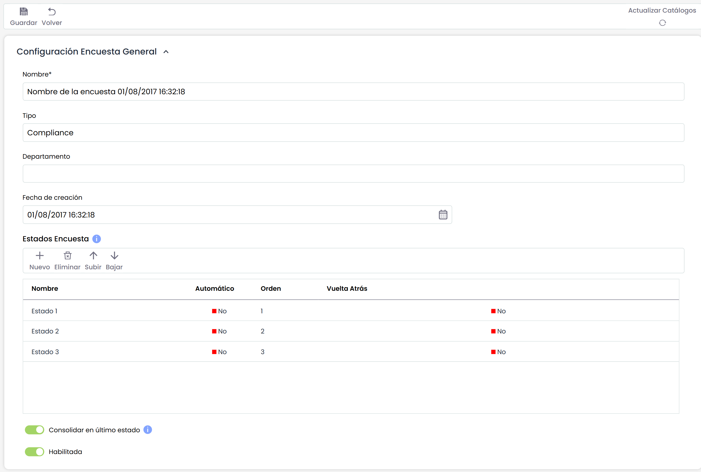
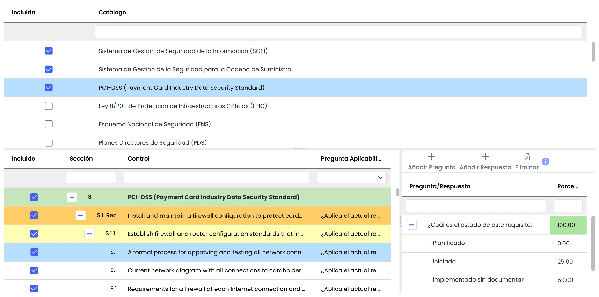

# Modelo Encuesta Compliance

**Configuración Encuesta General**

* **Nombre:** Permite indicar el nombre del modelo de la encuesta. Este nombre se mostrará en el listado inicial de encuestas.
* **Tipo:** Muestra el tipo de encuesta. Es un dato informativo.
* **Departamento:** Permite indicar el departamento encargado de gestionar la encuesta.
* **Fecha de creación:** Identifica la fecha de creación del modelo de encuesta.
* **Estados Encuesta:** Esta tabla permite definir un conjunto de estados para la encuesta. Estos estados podrán ser asignados a empleados cuando se configure la encuesta, de forma que serán responsables de la encuesta en función del estado en el que se encuentre. Para cada estado se permite definir:

  * El nombre del estado.
  * Si es el estado Automático o no, de forma que si un estado es automático, las encuestas pasarán al siguiente estado una vez estén completadas sin intervención de ningún usuario. Si el estado no es automático, será necesario que se cambie el estado de una encuesta de manera manual.
  * El orden de los estados a través de los botones "Subir" y "Bajar".
  * Si el estado permite que vuelva al estado anterior. Al marcar Sí, el responsable de completar la encuesta podrá devolverla al estado previo.
  * Si para el estado se permite que las encuestas pueden volver al estado anterior o no, a traveés del campo "Vuelta Atrás".
* **Habilitada:** Permite indicar que la encuesta esté habilitada para su utilización en GlobalSUITE.

Es posible traducir los campos del modelo de encuestas al resto de idiomas disponibles, a través del botón "Traducir" de la parte superior derecha. Este botón nos permitirá seleccionar otro idioma, y poder definir el nombre de los campos configurables en ese idioma. Actualmente, los estados de la encuesta.

**Encuesta Compliance**

* **Catálogo:** Permite seleccionar los catálogos sobre los que se realizará la encuesta de cumplimiento. Para ello se debe seleccionar sobre la columna "Incluido".

* **Preguntas:** Seleccionando la fila de uno de los catálogos se personaliza las preguntas para cada uno de los requisitos o controles del catálogo. Al pulsar sobre el catálogo, se despliega en la parte inferior el listado de controles o requisitos del catálogo junto con una columna en la parte derecha para indicar la pregunta sobre el control. Al pulsar sobre la pregunta, se despliega en la parte derecha una nueva tabla dónde poder indicar las preguntas que irán asociadas a ese control o requisito. La personalización de las preguntas se lleva a cabo con los botones siguientes:

  * **Añadir Pregunta:** Permite añadir una nueva pregunta sobre el control o requisito.
  * **Añadir Respuesta:** Permite asociar una respuesta a una pregunta previamente creada. Para ello, deberá seleccionar la pregunta sobre la que crear la respuesta.
  * **Eliminar:** Permite eliminar la respuesta a una pregunta o bien la pregunta, dependiendo de la fila que haya sido previamente seleccionada de la tabla.
  * **Porcentaje:** Permite indicar el peso que se da a cada una de las preguntas y a cada una de las respuestas para los cálculos tanto para las representaciones gráficas como para la consolidación de los resultados.

Mediante el botón "Actualizar Catálogos" se actualizará el modelo de encuesta con los requisitos existentes en los catálogos definidos en Ajustes> [Catálogos Compliance](../catalogos-compliance.md).
