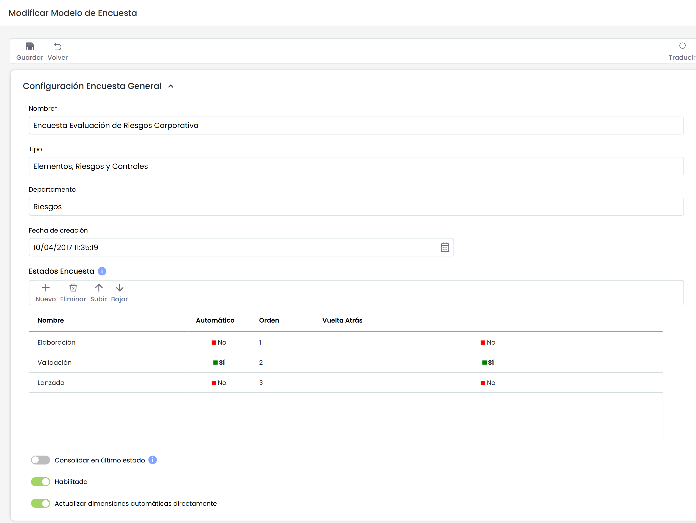
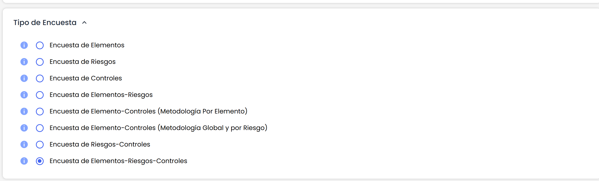
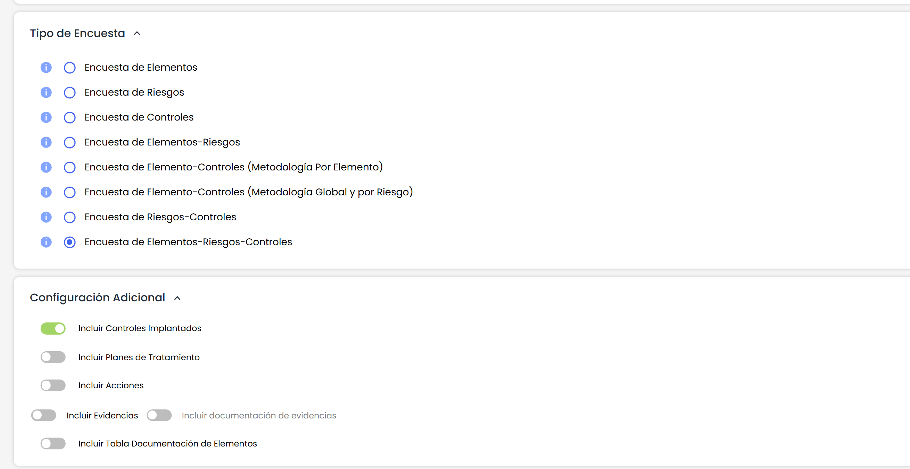
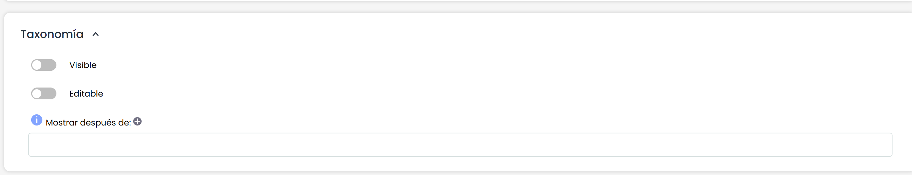
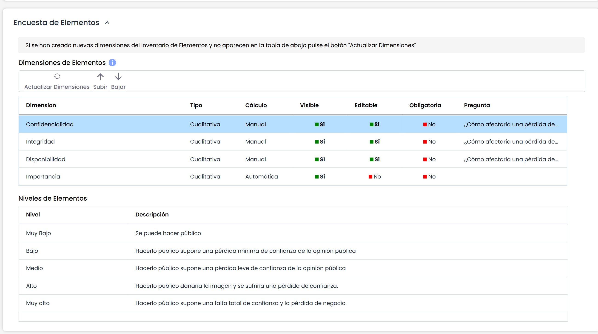
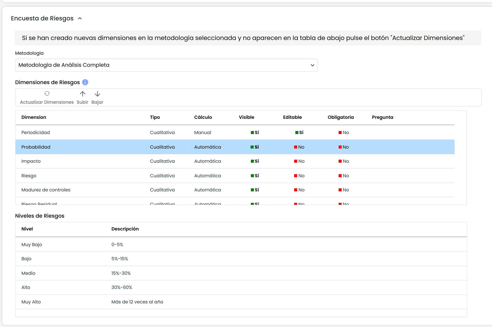
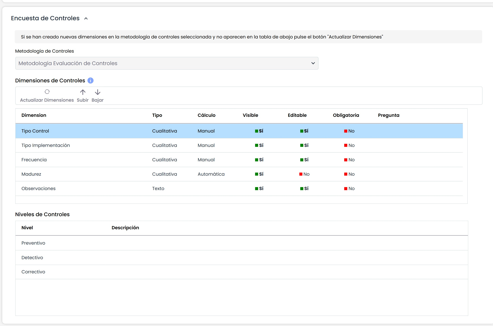

# Modelo Encuesta Elementos, Riesgos y Controles

## Configuración Encuesta General

* **Nombre:** Permite identificar el nombre de la encuesta. Este nombre se mostrará en el listado inicial de encuestas.
* **Tipo:** Permite visualizar la tipología de la encuesta.
* **Departamento:** Posibilita identificar el departamento encargado de gestionar la encuesta.
* **Fecha de creación:** Identifica la fecha de creación de la encuesta.
* **Estados Encuesta:** Esta tabla permite definir un conjunto de estados para la encuesta. Estos estados podrán ser asignados a empleados cuando se configure la encuesta, de forma que serán responsables de la encuesta en función del estado en el que se encuentre. Para cada estado se permite definir:

  * El nombre del estado.
  * Si es el estado Automático o no, de forma que si un estado es automático, las encuestas pasarán al siguiente estado una vez estén completadas sin intervención de ningún usuario. Si el estado no es automático, será necesario que se cambie el estado de una encuesta de manera manual.
  * El orden de los estados a través de los botones "Subir" y "Bajar".
  * Si el estado permite que vuelva al estado anterior. Al marcar Sí, el responsable de completar la encuesta podrá devolverla al estado previo.
  * Si para el estado se permite que las encuestas pueden volver al estado anterior o no, a través del campo "Vuelta Atrás".
* **Consolidar en último estado:** Permite habilitar la posibilidad de consolidar directamente los datos de la encuesta en el análisis definitivo. Ese botón estará disponible solamente en el último estado del flujo.
* **Habilitada:** Permite indicar que la encuesta esté habilitada para su utilización en GlobalSUITE.
* **Actualizar dimensiones automáticas directamente**: Si se activa este campo, en las encuestas las dimensiones automáticas de la metodología se calcularán cada vez que se modifique una dimensión manual. En caso de que esté desmarcado, aparecerá un botón que permitirá actualizarlas al pulsarlo.

Es posible traducir los campos del modelo de encuestas al resto de idiomas disponibles, a través del botón "Traducir" de la parte superior derecha. Este botón nos permitirá seleccionar otro idioma, y poder definir el nombre de los campos configurables en ese idioma. Actualmente, los estados de la encuesta.

## Tipo de Encuestas

* **Encuesta de Elementos:** Seleccionando esta opción se permite crear elementos nuevos para el Inventario, así como realizar la valoración tanto de los elementos nuevos como de los elementos ya existentes en el Inventario.
* **Encuesta de Riesgos:** Seleccionando esta opción se permite realizar una encuesta basada en los riesgos de los elementos definidos en el Inventario.
* **Encuesta de Controles:** Seleccionando esta opción se permite crear controles nuevos para el listado global de controles, así como realizar la evaluación tanto de los controles nuevos como de los controles ya existentes en el listado general.
* **Encuesta de Elementos-Riesgos:** Seleccionando esta opción se permite crear elementos nuevos para el Inventario así como crear riesgos nuevos asociados a los elementos añadidos en la encuesta. Adicionalmente, tanto los elementos como los riesgos existentes en la encuesta se pueden evaluar según la metodología configurada para cada caso.
* **Encuesta de Elementos-Controles (Metodología Por Elemento):** Seleccionando esta opción se permite crear elementos nuevos para el Inventario así como crear controles nuevos asociados a los elementos añadidos en la encuesta. Adicionalmente, tanto los elementos como los controles existentes en la encuesta se pueden evaluar según la metodología configurada para cada caso.
* **Encuesta de Elementos-Controles (Metodología Global y Por Riesgo):** Seleccionando esta opción se permite crear elementos nuevos para el Inventario así como crear controles nuevos para el listado global de controles y del listado por riesgo. Adicionalmente, tanto los elementos como los controles existentes en la encuesta se pueden evaluar según la metodología configurada para cada caso.
* **Encuesta de Riesgos-Controles:** Seleccionando esta opción se permite crear riesgos nuevos para cada elemento así como crear controles nuevos asociados a los riesgos añadidos en la encuesta. Adicionalmente, tanto los riesgos como los controles existentes en la encuesta se pueden evaluar según la metodología configurada para cada caso.
* **Encuesta de Elementos-Riesgos-Controles:** Seleccionando esta opción se permite crear elementos nuevos para el Inventario, crear riesgos nuevos para cada elemento así como crear controles nuevos asociados a los riesgos añadidos en la encuesta. Adicionalmente, los elementos, los riesgos y los controles existentes en la encuesta se pueden evaluar según la metodología configurada para cada caso.

## Configuración Adicional

En el caso de que el modelo de encuesta incluya controles, aparecerá un apartado de configuración adicional donde se podrá definir lo siguiente:

* **Incluir Controles Implantados**: Permite indicar si los controles ya implantados se incorporarán a las encuestas.
* **Incluir Planes de Tratamiento**: Al seleccionar este campo, los controles en proceso de implantación o mejora se incluirán en las encuestas.
* **Incluir Acciones**: Permite indicar si se quiere incluir Acciones para definir un Plan de tratamiento para los controles de la encuesta.
* **Incluir Evidencias**: En caso de seleccione este campo, se permitirá adjuntar ficheros y revisiones para cada control de la encuesta.

  * **Incluir documentación de evidencias**: Este campo se habilitará al seleccionar Incluir evidencias. Al habilitarlo, permitirá incluir la documentación asociada a las evidencias en las encuestas. En Encuestas > [Configuración](https://help.globalsuitesolutions.com/es/globalsuite/v1/encuestas-elementos-riesgos-y-controles-configurac) podrá configurarse y será posible limitar la documentación que se muestra.
* **Incluir Tabla Documentación de elementos:** Al activar la opción, se habilita la opción de adjuntar nueva documentación y visualizar documentación previa asociada que los elementos de la encuesta tienen en el [Inventario](https://help.globalsuitesolutions.com/es/globalsuite/v1/inventario).

## Taxonomía

Si el modelo de encuesta seleccionado permite evaluar riesgos, se podrá configurar en el apartado "Taxonomía" si queremos incluir los [Tipos de Riesgo](../catalogos-analisis.md), bien en modo consulta, o permitiendo configurarlos.

## Encuesta de Elementos

La información que facilita la herramienta son las dimensiones en base a las cuales se va a realizar la encuesta y valoración de los elementos, dimensiones que se han configurado en el apartado 'Ajustes/Metodologías de Análisis/Configuración General'.

La información que facilita la tabla es la siguiente:

* **Dimensión:** Identifica el nombre de la dimensión que figurara en la encuesta.
* **Tipo:** Informa del tipo de la dimensión, si su valoración es cualitativa o cuantitativa.
* **Cálculo:** Ofrece la información del cálculo de la dimensión, si se calcula de manera manual o automáticamente.
* **Visible:** Permite definir si la dimensión se incluirá en la encuesta o no, pulsando sobre la celda.
* **Editable:** Indica si la dimensión se podrá modificar en la encuesta, o sólo será visible en modo consulta. Este campo se puede poner a "Sí" en las dimensiones manuales.
* **Obligatoria:** Permite marcar como obligatoria una dimensión. Esto implica que esa dimensión deberá estar valorada para todos los elementos, antes de Guardar o Pasar de Estado la encuesta. Este campo se puede poner a "Sí" en las dimensiones manuales.
* **Pregunta:** Ofrece la posibilidad de establecer la pregunta necesaria para la valoración de la dimensión.

Las acciones que permite realizar la herramienta sobre la tabla son las siguientes:

* **Actualizar Dimensiones:** Permite actualizar el listado de dimensiones sobre las que realizar la evaluación de los activos, en el caso que el apartado de 'Ajustes/Metodologías Análisis/Configuración General' haya sido modificado posteriormente a la creación del modelo de encuesta.
* **Subir:** Ofrece la posibilidad de posicionar una dimensión, subiendo la misma a la posición requerida.
* **Bajar:** Ofrece la posibilidad de posicionar una dimensión, bajando la misma a la posición requerida.

**NOTA:** La presente opción solo se muestra si se ha seleccionado el checkbox de 'Encuesta de Elementos' del apartado anterior.

## Encuesta de Riesgos

La información que facilita la herramienta son las dimensiones en base a las cuales se va a realizar la encuesta y valoración de los riesgos de los elementos, dimensiones que se han configurado en el apartado 'Ajustes/Metodologías de Análisis/Metodologías Análisis'.

La información que facilita la tabla es la siguiente:

* **Dimensión:** Identifica el nombre de la dimensión que figurara en la encuesta.
* **Tipo:** Informa del tipo de la dimensión, si su valoración es cualitativa o cuantitativa.
* **Cálculo:** Ofrece la información del cálculo de la dimensión, si se calcula de manera manual o automáticamente.
* **Visible:** Permite definir si la dimensión se incluirá en la encuesta o no, pulsando sobre la celda.
* **Editable:** Indica si la dimensión se podrá modificar en la encuesta, o sólo será visible en modo consulta. Este campo se puede poner a "Sí" en las dimensiones manuales.
* **Obligatoria:** Permite marcar como obligatoria una dimensión. Esto implica que esa dimensión deberá estar valorada para todos los riesgos, antes de Guardar o Pasar de Estado la encuesta. Este campo se puede poner a "Sí" en las dimensiones manuales.
* **Pregunta:** Ofrece la posibilidad de establecer la pregunta necesaria para la valoración de la dimensión.

Las acciones que permite realizar la herramienta son las siguientes:

* **Metodología:** Ofrece la posibilidad de seleccionar la metodología de análisis sobre la que se quiere realizar la encuesta. En función de la selección, las siguientes opciones mostrarán las dimensiones específicas de la metodología seleccionada.
* **Actualizar Dimensiones:** Permite actualizar el listado de dimensiones sobre las que realizar la evaluación de los riesgos de los activos, en el caso que el apartado de 'Ajustes/Metodologías de Análisis/Metodologías Análisis' haya sido modificado posteriormente a la creación del modelo de encuesta.
* **Subir:** Ofrece la posibilidad de posicionar una dimensión, subiendo la misma a la posición requerida.
* **Bajar:** Ofrece la posibilidad de posicionar una dimensión, bajando la misma a la posición requerida.

**NOTA:** La presente opción solo se muestra si se ha seleccionado el checkbox de 'Encuesta de Riesgos' del apartado anterior.

## Encuesta de Controles

Las encuestas de controles permitirán evaluar los controles de manera distinta en función del tipo de encuesta que se ha elegido, y también mostrará el pueden configurar de dos formas, en función de si se requiere una identificación y evaluación global de los controles, o si los controles identificados se deben asociar a los riesgos analizados, o por último los controles se asociarán directamente a los activos.

1. Para realizar una identificación y evaluación de controles general, la encuesta se debe configurar con el tipo "Encuesta de Controles" o con el tipo "Encuesta de Activo-Controles (Metodología Global y por Amenaza)". De esta forma, la encuesta configurada sirve para identificar y/o evaluar controles de manera general, sin asociarse estos a riesgos de la organización (la asociación de controles y riesgos se puede realizar posteriormente). La única diferencia entre ambos tipos de encuesta es que la segunda permite identificar y evaluar también activos del Inventario. Para las encuestas de tipo "Encuesta de Controles" se podrá seleccionar cualquier metodología de controles, mientras que para el tipo "Encuesta de Activo-Controles (Metodología Global y por Amenaza)" solamente se podrá elegir metodologías de controles "Global" o "Por Amenaza".

2. Para realizar una identificación y evaluación de controles asociados a riesgos, la encuesta se debe seleccionar con alguno de los tipos siguientes: "Encuesta de Riesgos-Controles" o "Encuesta de Activos-Riesgos-Controles". De esta forma, en una misma encuesta se identifican y/o evalúan los riesgos, así como se identifican y/o evalúan los controles de cada riesgo. Para las encuestas de estos tipos solamente se podrá elegir metodologías de análisis que tengan asociada una metodología de controles "Por Amenaza".

3. Para realizar una identificación y evaluación de controles asociados a activos, la encuesta se debe seleccionar como tipo "Encuesta de Activo-Controles (Metodología Por Activo)". Esto permite realizar una asociación de controles a los activos, y la identificación y evaluación de los controles para cada activo. Para las encuestas de este tipo solamente se podrá elegir metodologías de controles "Por Activo".

La información que facilita la herramienta son las dimensiones en base a las cuales se va a realizar la encuesta y valoración de los controles, dimensiones que se han configurado en el apartado 'Ajustes/Metodologías de Análisis/Metodologías Controles'.

La información que facilita la tabla es la siguiente:

* **Dimensión:** Identifica el nombre de la dimensión que figurara en la encuesta.
* **Tipo:** Informa del tipo de la dimensión, si su valoración es cualitativa o cuantitativa.
* **Cálculo:** Ofrece la información del cálculo de la dimensión, si se calcula de manera manual o automáticamente.
* **Visible:** Permite definir si la dimensión se incluirá en la encuesta o no, pulsando sobre la celda.
* **Editable:** Indica si la dimensión se podrá modificar en la encuesta, o sólo será visible en modo consulta. Este campo se puede poner a "Sí" en las dimensiones manuales.
* **Obligatoria:** Permite marcar como obligatoria una dimensión. Esto implica que esa dimensión deberá estar valorada para todos los controles, antes de Guardar o Pasar de Estado la encuesta. Este campo se puede poner a "Sí" en las dimensiones manuales.
* **Pregunta:** Ofrece la posibilidad de establecer la pregunta necesaria para la valoración de la dimensión.

Las acciones que permite realizar la herramienta son las siguientes:

* **Metodología:** Ofrece la posibilidad de seleccionar la metodología de controles sobre la que se quiere realizar la encuesta. En función de la selección, las siguientes opciones mostrarán las dimensiones específicas de la metodología seleccionada.
* **Actualizar Dimensiones:** Permite actualizar el listado de dimensiones sobre las que realizar la evaluación de los controles, en el caso que el apartado de 'Ajustes/Metodologías de Análisis/Metodologías Controles' haya sido modificado posteriormente a la creación del modelo de encuesta.
* **Subir:** Ofrece la posibilidad de posicionar una dimensión, subiendo la misma a la posición requerida.
* **Bajar:** Ofrece la posibilidad de posicionar una dimensión, bajando la misma a la posición requerida.

**NOTA:** La presente opción solo se muestra si se ha seleccionado el checkbox de 'Encuesta de Controles' del apartado anterior.
