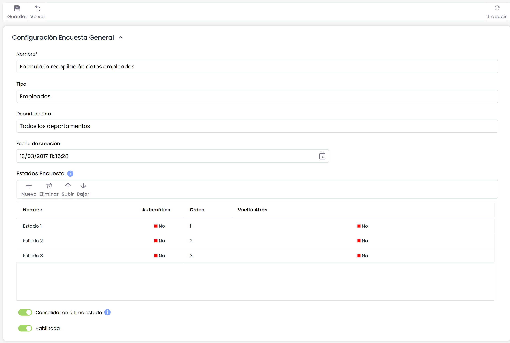
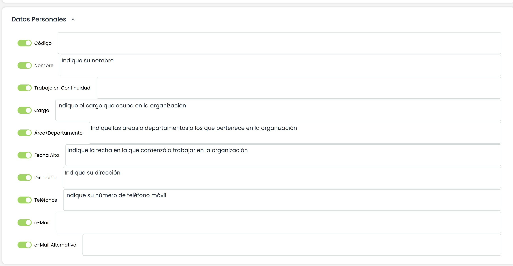

# Modelo Encuesta Empleados

**Configuración Encuesta General**

* **Nombre:** Permite identificar el nombre de la encuesta. Este nombre se mostrará en el listado inicial de encuestas.
* **Tipo:** Permite visualizar la tipología de la encuesta.
* **Departamento:** Posibilita identificar el departamento encargado de gestionar la encuesta.
* **Fecha de creación:** Identifica la fecha de creación de la encuesta.
* **Estados Encuesta:** Esta tabla permite definir un conjunto de estados para la encuesta. Estos estados podrán ser asignados a empleados cuando se configure la encuesta, de forma que serán responsables de la encuesta en función del estado en el que se encuentre. Para cada estado se permite definir:

  * El nombre del estado.
  * Si es el estado Automático o no, de forma que si un estado es automático, las encuestas pasarán al siguiente estado una vez estén completadas sin intervención de ningún usuario. Si el estado no es automático, será necesario que se cambie el estado de una encuesta de manera manual.
  * El orden de los estados a través de los botones "Subir" y "Bajar".
  * Si el estado permite que vuelva al estado anterior. Al marcar Sí, el responsable de completar la encuesta podrá devolverla al estado previo.
  * Si para el estado se permite que las encuestas pueden volver al estado anterior o no, a traveés del campo "Vuelta Atrás".
* **Habilitada:** Permite indicar que la encuesta esté habilitada para su utilización en GlobalSUITE.

Es posible traducir los campos del modelo de encuestas al resto de idiomas disponibles, a través del botón "Traducir" de la parte superior derecha. Este botón nos permitirá seleccionar otro idioma, y poder definir el nombre de los campos configurables en ese idioma. Actualmente, los estados de la encuesta.

**Datos personales; Roles y Permisos**

Los apartados de datos personales y roles permisos permiten seleccionar los datos o apartados que van a mostrarse en la encuesta de empleados. Para ello se ha de seleccionar los checkbox de los apartados que se quieran mostrar, definiendo la pregunta correspondiente para recabar la información necesaria por cada uno de ellos en al campo de texto que se facilita al usuario.
