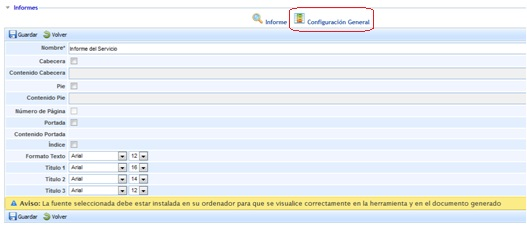
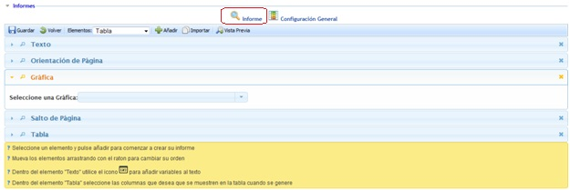
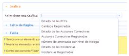

# Gestión Informes

La opción de informes permite generar modelos de informe a partir de la información almacenada en la herramienta. Estos modelos pueden ser generados por los usuarios de empresas Platinum, Gold o Consulting, y asociarlos a las empresas asociadas de tipo Enterprise.

Nada más acceder a la opción la herramienta muestra una tabla sobre la que se pueden realizar las siguientes acciones:

* **Nuevo:** Permite generar una nueva entrada en la tabla y poder generar un modelo de informe.
* **Eliminar:** Permite eliminar un modelo de informe ya creado. Para ello se ha de seleccionar la fila o filas deseadas y pulsar el botón ‘Eliminar’.

Al pulsar sobre el nombre del informe se accede a la configuración propia del mismo, ofreciendo dos opciones.

**Configuración General**

Ofrece la posibilidad al gestor de definir el formato general del informe, permitiendo modificar los siguientes parámetros:

* **Nombre:** Identifica el nombre del informe.
* **Cabecera:** Ofrece la posibilidad de mostrar una cabecera para el informe.
* **Contenido cabecera:** Permite definir la información que contendrá la cabecera del informe.
* **Pie:** Ofrece la posibilidad de mostrar un pie de página para el informe.
* **Contenido Pie:** Permite definir la información que contendrá el pie de página del informe.
* **Número de página:** permite identificar el número de página en los informes seleccionando el checkbox mostrado.

**NOTA:** Esta opción solo se habilita si la opción de pie de página está seleccionada.

* **Portada:** Permite habilitar la opción de incluir una portada en el informe
* **Contenido Portada:** Ofrece la posibilidad de establecer como será la portada, pudiendo definir tipo de letra, justificación, imagen, etc.
* **Índice:** Se puede generar un índice del contenido seleccionando el checkbox mostrado.
* **Formato de texto:** Ofrece la posibilidad de parametrizar el tipo de fuente y tamaño que tendrá el texto del informe.

**Informe**

La configuración de elementos permite definir la estructura e información que va a contener el informe.

Las opciones que permite la herramienta son las siguientes:

* **Guardar:** Permite almacenar todas las modificaciones realizadas sobre el informe.
* **Volver:** Al pulsar sobre el botón la herramienta devuelve al usuario al listado de informes definidos en la tabla.
* **Elementos:** Permite definir qué elementos va a contener el informe, pudiendo seleccionar los siguientes.

  * **Texto:** Campo de texto libre donde poder incorporar la información deseada por el usuario.
  * **Orientación de la página:** Permite definir la orientación en la que se creará el informe, pudiendo optar entre Vertical u Horizontal.
  * **Gráfica:** Permite incorporar diferentes gráficas generadas por la plataforma como se muestra en la imagen.

* **Salto de Página:** Permite insertar un salto de página en el informe.
* **Tabla:** Permite añadir tablas al informe, pudiendo optar entre diferentes modelos de tabla (Continuidad, Disponibilidad, etc.) y diferentes columnas de información.

* **Añadir:** Una vez seleccionado el/los elementos deseados, permite añadirlos a la estructura del informe pulsando sobre el botón ‘Añadir’.

**NOTA:** Se pueden incorporar tantos elementos como se desee. Los elementos mostrados se generan en el orden añadido. Para modificar el orden de los elementos se ha de arrastrar a la posición deseada.

* **Importar:** Permite importar datos de un informe.
* **Vista previa:** Ofrece la posibilidad al usuario de generar una vista previa del informe antes de la descarga del mismo.
