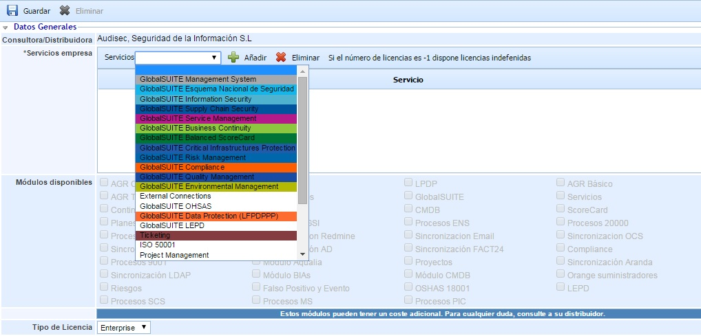

# Nueva Empresa

Esta opción permite a las empresas consultoras y a las empresas distribuidoras crear empresas en GlobalSuite® asignando los servicios que tengan contratados.

**Datos Generales**

En primer lugar hay que seleccionar el/los servicio/s deseado/s a través de la lista desplegable, añadiéndose el servicio seleccionado con el botón "Añadir".

Los servicios disponibles para la creación de empresas dependerán de los productos que haya contratado para GlobalSuite®.   
El apartado "Módulos disponibles" indica los módulos específicos asociados a los productos seleccionados. En caso de necesitar algún módulo adicional, debe ponerse en contacto con la empresa distribuidora.

Por último se identifica el tipo de licencia que se desea asociar a la empresa. Para las empresas que se desea tener un sistema de gestión, hay que seleccionar el tipo de licencia "Enterprise".

**Datos empresa**

En la parte inferior de este formulario se permite indicar los datos identificados de la empresa. Entre todos los datos que aparecen, los campos "CIF" y "Razón social" son obligatorios para poder crear la empresa en GlobalSuite®.
