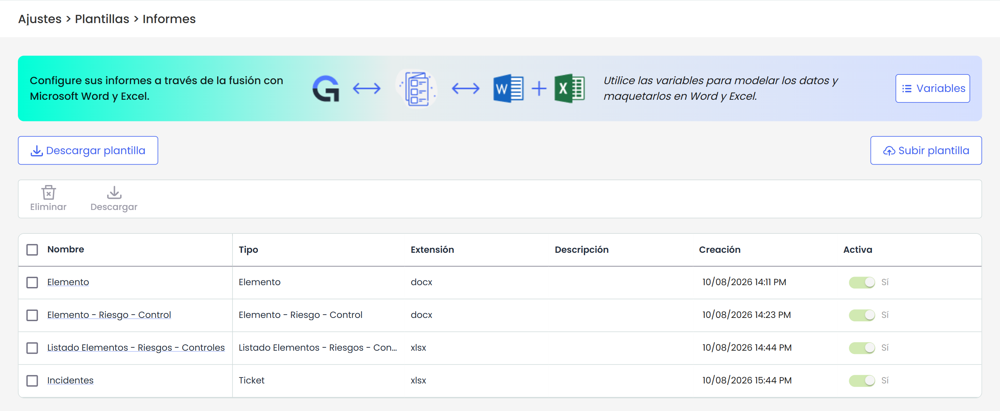
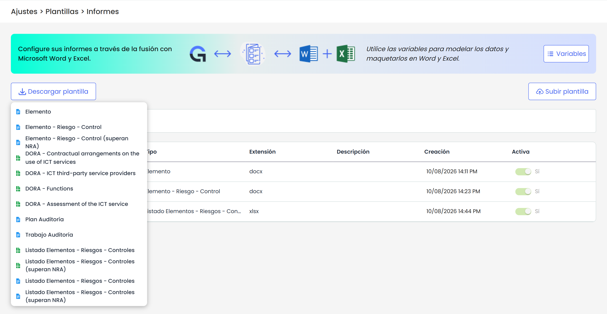
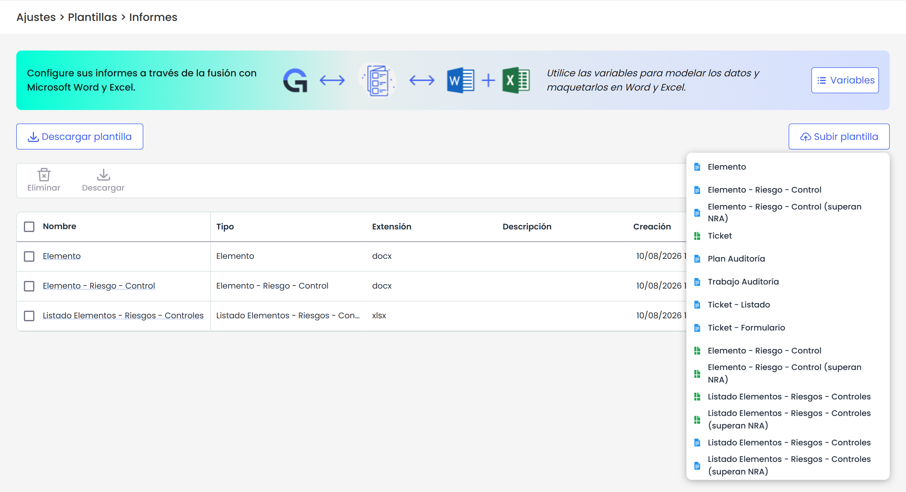
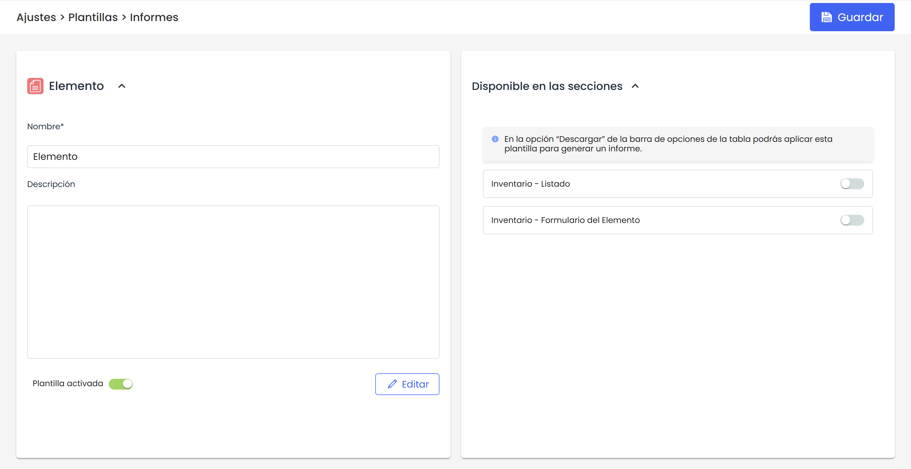

# Plantillas Informes ERC


En este apartado se podrán configurar \*\*informes dinámicos de Elementos, riesgos y controles\*\* tanto en formato Word como Excel mediante el uso de plantillas personalizadas. Esta funcionalidad permite definir un documento base en Microsoft Word o Microsoft Excel con variables que se sustituirán automáticamente al generar el documento final.
Las plantillas creadas pueden reutilizarse en distintos procesos sin necesidad de modificar su estructura, facilitando la estandarización y automatización de documentos.


**Se ofrece más información sobre este módulo en estos artículos:**

[Personaliza y descarga informes con nuestras plantillas dinámicas en Word](https://help.globalsuitesolutions.com/es/globalsuite/v1/personaliza-plantillas-informes-riesgos)

[Personaliza y descarga informes con nuestras plantillas dinámicas en Excel](https://help.globalsuitesolutions.com/es/globalsuite/v1/personaliza-plantillas-informes-excel)

Al acceder a la opción, nos encontramos con las siguientes opciones:

## Descargar plantilla

GlobalSuite pone disposición una serie de plantillas base para comenzar con la configuración. Actualmente se pueden descargar:

* **Elemento**: Plantilla que permite descargar el detalle de un elemento específico evaluado, incluyendo sus dimensiones físicas o digitales, su importancia dentro de la organización y su rol en los procesos de negocio.
* Elemento - Riesgo - Control**: Similar a la plantilla anterior, pero añadiendo los riesgos identificados y valorados, así como los controles implementados para mitigar dichos riesgos.**
* **Elemento - Riesgo - Control (superan NRA)**: Plantilla que muestra los riesgos de un elemento que superan el Nivel de Riesgo Aceptable (NRA) y los controles aplicados para mitigarlos.
* **Listado Elementos - Riesgos - Controles**: Plantilla que permite descargar en un único documento la información de elementos, riesgos y controles de todos los elementos incluidos en el listado, en lugar de un único elemento.
* **Listado Elementos - Riesgos - Controles (superan NRA)**: Equivalente a la anterior, incluyendo únicamente los riesgos que superan el Nivel de Riesgo Aceptable (NRA) y los controles aplicados para mitigarlos.
* **EIPD:** Plantilla para generar el informe de Evaluación de Impacto en la Protección de Datos, detallando los tratamientos de información, los activos relacionados y los controles aplicados.

## Subir Plantilla

Se pueden subir plantillas personalizadas de los usuarios en formato .docx y xlsx. Antes de hacerlo, es necesario asignarles un tipo. Los tipos posibles son:

* Elemento
* Elemento - Riesgo - Control
* Elemento - Riesgo - Control (superan NRA)
* Listado Elementos
* Listado Elementos - Riesgos - Controles
* Listado Elementos - Riesgos - Controles (superan NRA)
* EIPD

El tipo de plantilla es determinante para luego configurar el sitio donde estará disponible para su descarga.

## Listado de Plantillas

Al acceder a la opción, se muestran todas las plantillas existentes junto con su información: nombre, tipo, extensión, descripción, fecha y hora de creación, y si están activas o no.

Las acciones disponibles en esta tabla son:

* **Eliminar**: seleccionando la plantilla a eliminar mediante el check.
* **Descargar**: permite descargar la plantilla seleccionada.

## Detalle de Plantilla

En esta sección, podrás realizar las siguientes acciones sobre la plantilla:

* Editar el nombre de la plantilla.
* Activar o desactivar la plantilla según sea necesario.
* Configurar la visibilidad: Según el tipo de plantilla, se mostrará el módulo desde el cual podrá ser descargada con los datos correspondientes.

  * Plantilla Elemento y Plantilla Elemento y Elementos inferiores

    * Inventario - [Tabla de elementos](https://help.globalsuitesolutions.com/es/globalsuite/v1/tabla-de-elementos)
    * Inventario - Formulario del Elemento.
  * Plantilla de tipo Elemento - Riesgo - Control

    * Inventario - [Tabla de elementos](https://help.globalsuitesolutions.com/es/globalsuite/v1/tabla-de-elementos)
    * Inventario - Formulario del Elemento.
    * Análisis de Riesgos - [Listado de Elementos.](https://help.globalsuitesolutions.com/es/globalsuite/v1/analisis-de-riesgos)
    * Análisis de Riesgos - [Listado de Riesgos.](https://help.globalsuitesolutions.com/es/globalsuite/v1/analisis-de-riesgos#An%C3%A1lisisdeRiesgos-An%C3%A1lisis)
  * Plantilla Elemento - Riesgo - Control (superan NRA)

    * Inventario - [Tabla de elementos](https://help.globalsuitesolutions.com/es/globalsuite/v1/tabla-de-elementos)
    * Inventario - Formulario del Elemento.
    * Análisis de Riesgos -[Listado de Elementos.](https://help.globalsuitesolutions.com/es/globalsuite/v1/analisis-de-riesgos)
    * Análisis de Riesgos - [Listado de Riesgos.](https://help.globalsuitesolutions.com/es/globalsuite/v1/analisis-de-riesgos#An%C3%A1lisisdeRiesgos-An%C3%A1lisis)
  * Plantilla Listado Elementos

    * Inventario - [Tabla de elementos](https://help.globalsuitesolutions.com/es/globalsuite/v1/tabla-de-elementos)
  * Plantilla Listado Elementos - Riesgos - Controles

    * Inventario - [Tabla de Elementos](https://help.globalsuitesolutions.com/es/globalsuite/v1/tabla-de-elementos)
    * Análisis de Riesgos - [Listado de Elementos](https://help.globalsuitesolutions.com/es/globalsuite/v1/analisis-de-riesgos)
  * Plantilla Listado Elementos - Riesgos - Controles (superan NRA)

    * Inventario - [Tabla de Elementos](https://help.globalsuitesolutions.com/es/globalsuite/v1/tabla-de-elementos)
    * Análisis de Riesgos - [Listado de Elementos](https://help.globalsuitesolutions.com/es/globalsuite/v1/analisis-de-riesgos)
  * Plantilla EIPD.

    * Tratamientos - [Listado](https://help.globalsuitesolutions.com/es/globalsuite/v1/tratamientos)
    * Tratamientos - Formulario del Elemento.

## Variables

Las variables disponibles para realizar las plantillas son las siguientes:

### Variables de Elementos.

Abre tabla en pantalla completa

|  |  |
| --- | --- |
| **Variable** | **Descripción** |
| {element.name} | Nombre del Elemento |
| {element.units} | Unidades del Elemento |
| {element.category} | Categoría del Elemento |
| {element.category\_path} | Ruta Categoría del Elemento |
| {element.supervisor} | Responsable del Elemento |
| {element.other\_supervisor} | Otros Responsables del Elemento |
| {element.owner} | Propietario del Elemento |
| {element.dim\_IX.dimension\_name} | Nombre de la Dimensión con alias IX. Sustituir la X por el número del alias. |
| {element.dim\_IX.dimension\_alias} | Alias de la dimensión del elemento.  Sustituir la X por el número del alias. (I1, I2, …, IN) |
| {element.dim\_IX.dimension\_value} | Valor específico de la dimensión IX en el elemento.  Sustituir la X por el número del alias. |
| {element.element\_customAttr\_Atributo\_N} | Atributos Configurables siendo N el número de atributo configurable |
| {#element.custom\_attrs} {custom\_attr\_name}: {custom\_attr\_value} {/} | Listado de atributos configurables. etiqueta de inicio y otra de fin (inicio con '#' y fin con '/'), y el bloque de texto que hay dentro se repite tantas veces como elementos de ese tipo existan |
| {#element.dimensions} {dimension\_name} ({dimension\_alias}): {dimension\_value} {/} | Bucle de todas las dimensiones donde se pueden añadir todos los valores de la dimensión del elemento, sus alias y sus nombres. |
| {#element.descendants} {descendant.name}  {descendant.category}  {descendant.supervisor}  {descendant.dim\_I1.dimension\_value} {/} | Bucle que recorre todos los hijos del elemento según el árbol de dependencias. Esto listaría todos los elementos que cuelguen del elemento  seleccionado como una lista plana, mostrando su nombre. También estarían disponibles los mismos requisitos que para el elemento, los que aparecen en el anterior comentario, solo que no habría que poner ‘descendant.’ delante al estar dentro del bucle.  Importante resaltar que dentro de esta información también se pueden obtener riesgos y controles como se verán en el apartado siguiente. |
| {#element.descendants | categoryType: ‘PROCESSES’}  {descendant.name}  {descendant.category}  {descendant.supervisor}  {descendant.dim\_I1.dimension\_value} {/} | Bucle para obtener los elementos configurados en el árbol de dependencias con una categoría especial.  SERVICES PROCESSES INFORMATION INFRASTRUCTURES APPLICATIONS AREAS PERSONAL SUPPLIERS TREATMENT BUSINESS\_RELATIONS |
| {element.analysis.AA1.rge} | Cálculo de Riesgo Global por Elemento (RGE) del Análisis de Riesgos donde AA1 es el alias del análisis |
| {element.analysis.AA1.rrge} | Cálculo de Riesgo Repercutido Global por Elemento (RRGE) del Análisis de Riesgos donde AA1 es el alias del análisis |

**Variables específicas para informes de múltiples elementos**

Las plantillas de tipo Listado utilizan las mismas variables de Elementos, Riesgos y Controles que las plantillas de un único elemento. En esta tabla se recogen únicamente las variables y estructuras cuya sintaxis es diferente para procesar múltiples elementos.

| Variable | Descripción |
| --- | --- |
| {#elements}{/} | Bucle principal que recorre todos los elementos incluidos en el listado desde el que se descarga el informe. El contenido situado dentro del bloque se repite para cada elemento. |
| {#dimensions} {dimension\_name}: {dimension\_value} {/} | Bucle que recorre las dimensiones para cada elemento dentro de `{#elements}`, para obtener su nombre y valor. |
| {#analysis.AA1}{/} | Accede al análisis de riesgos asociado a cada elemento. `AA1` debe sustituirse por el alias del análisis configurado. |
| {#threats}{/} | Recorre los riesgos de cada elemento dentro de `{#analysis.AA1}`. |
| {#threat\_controls.length}{/} | Bloque condicional que solo se muestra si el riesgo tiene controles asociados. Evita que aparezcan apartados vacíos en informes con muchos elementos. |
| {#descendants | categoryType: 'PROCESSES'}{/} | Recorre los elementos descendientes del elemento actual cuya categoría sea de tipo `PROCESSES`. |
| {#descendant.dimensions}{/} | Recorre las dimensiones del elemento descendiente actual. |
| {#descendant.analysis.AA1} {#threats} {threat\_column\_amenaza} {/} {/} | Accede al análisis de riesgos asociado al elemento descendiente, recorre todos sus riesgos y muestra el valor de la columna **Amenaza** de cada uno. `AA1` debe sustituirse por el alias configurado para el análisis de riesgos. |

### **Variables de Amenazas/Riesgos. Opción de GlobalSuite Análisis de Riesgos.**

La información de esta tabla representan toda la información que se puede conseguir desde la opción de Análisis de Riesgos. Esta información vendrá asociada a un elemento que será el elemento del informe descargado.

Para obtener la información del Análisis de Riesgos, se necesita añadir su alias que es un campo que se puede configurar en GlobalSuite en la configuración general del análisis de riesgos (Análisis - Análisis de Riesgos - Información General)

Abre tabla en pantalla completa

| **Variable** | **Descripción** |
| --- | --- |
| {#element.analysis.AA1.threats} {threat\_column\_amenaza} {threat\_column\_vulnerabilidad} {/} | Valor de las Columnas principales de los riesgos (son los campos de texto). Ejemplo con Amenaza y Vulnerabilidad. El alias AA1, se corresponde con el alias del análisis donde están los riesgos y controles que se quieren obtener en el informe. |
| {#element.analysis.AA1.threats} {threat\_dim\_A1}  {threat\_dim\_A2}  ….  {threat\_dim\_AXX} {/} | Dentro del bucle de amenazas/riesgos también se puede obtener las dimensiones específicas una a una a través del alias de la dimensión. El resultado será el valor de esa dimensión por cada una de las amenazas. Este bucle se utilizará cuando se quiere un valor concreto del riesgo/amenaza. El alias AA1, se corresponde con el alias del análisis donde están los riesgos y controles que se quieren obtener en el informe. |
| {#element.analysis.AA1.threats | where: ‘threat\_dim\_A2 == “Alto”‘ && threat\_dim\_A2 == “Muy Alto”’} {threat\_dim\_A1} {threat\_dim\_AXX} {/} | Bucle anterior con la posibilidad de recorrer solo los riesgos/amenazas que cumplan con la condición. En el ejemplo se puede ver que la dimensión con alias A2 = Alto y Muy Alto. El alias AA1, se corresponde con el alias del análisis donde están los riesgos y controles que se quieren obtener en el informe. |
| {#element.analysis.AA1.threats} Riesgo: {threat\_column\_riesgo}  {#threat\_dimensions}  {dimension\_name} {dimension\_alias} {dimension\_value} {/} {/} | Dentro del bucle de amenazas también se puede obtener otro bucle con todas las dimensiones, para obtener su nombre, alias y valor. Este bucle sirve para representar toda la información de los riesgos/amenazas. El alias AA1, se corresponde con el alias del análisis donde están los riesgos y controles que se quieren obtener en el informe. Aquí también se podría añadir un where al bucle de threats. |

### **Listado de Controles**

Las filas de esta tabla representan toda la información que se puede conseguir desde la opción de GlobalSuite de Gestión de Controles. Esta información se podrá obtener dentro del bucle de riesgos/amenazas.

Abre tabla en pantalla completa

| **Variable** | **Descripción** |
| --- | --- |
| {#element.analysis.AA1.threats} Amenaza: {threat\_column\_amenaza} {#threat\_controls} {control\_name} {control\_soa\_control} {control\_supervisor} {control\_another\_supervisor} {control\_resources} {control\_deadline} {control\_observations} {control\_adequacy} {control\_action} {control\_budget} {control\_comments} {/} {/} | Si se quiere obtener los controles de una amenaza para tener toda la estructura jerarquizada, dentro del bucle de riesgos/amenazas, se puede generar un bucle de controles para obtener toda la información. En el ejemplo se pueden ver los campos Core de Controles. El alias AA1, se corresponde con el alias del análisis donde están los riesgos y controles que se quieren obtener en el informe. |
| {#element.analysis.AA1.threats} Amenaza: {threat\_column\_amenaza} {#threat\_controls} {control\_dim\_C1} {control\_dim\_C2} {/} {/} | Siguiendo el mismo bucle que el anterior, además de los campos core se puede obtener las dimensiones específicas identificándolas por el número de Alias: CX |
| {#element.analysis.AA1.threats} Amenaza: {threat\_column\_amenaza} {#threat\_controls} {control\_name}  {control\_dim\_C1} {control\_dim\_C2} {#control\_dimensions} {dimension\_name} {dimension\_alias} {dimension\_value} {/} {/} | Además de obtener las dimensiones por el número de alias se puede realizar un bucle para obtener toda la información de las dimensiones de todos los controles. En el ejemplo se ven las dos formas de obtener las dimensiones de controles:  Identificando el alias concreto  Añadiendo un bucle que recorre las dimensiones para obtener un valor. |
| {#element.analysis.AA1.threats} Amenaza: {threat\_column\_amenaza} {#threat\_controls | where : 'control\_dim\_C1=="Muy Efectivo"'} {control\_name}  {control\_dim\_CX} {#control\_dimensions } {dimension\_name} {dimension\_alias} {dimension\_value} {/} {/}  {/} | Ejemplo de filtrado de controles por una dimensión del control. En este caso solo traería los controles que cumplen con esta condición. |

### **Listado de variables de Análisis de Riesgos y Metodologías**

Abre tabla en pantalla completa

|  |  |  |
| --- | --- | --- |
| Análisis | {analysis.AliasAnálisis.name} | Nombre del Análisis, siendo AliasAnálisis el valor configurado en GlobalSuite. |
| Análisis | {analysis.AliasAnálisis.start\_date} | Fecha de Inicio del Análisis, siendo AliasAnálisis el valor configurado en GlobalSuite. |
| Análisis | {analysis.AliasAnálisis.supervisor} | Responsable del Análisis, siendo AliasAnálisis el valor configurado en GlobalSuite. |
| Análisis | {analysis.AliasAnálisis.department} | Departamento del análisis, siendo AliasAnálisis el valor configurado en GlobalSuite. |
| Análisis | {analysis.AliasAnálisis.nra} | Nivel de Riesgo Aceptable del análisis, siendo AliasAnálisis el valor configurado en GlobalSuite. |
| Análisis | {analysis.AliasAnálisis.nro} | Nivel de Riesgo Objetivo del análisis, siendo AliasAnálisis el valor configurado en GlobalSuite. |
| Análisis | {analysis.AliasAnálisis.vgan} | Valor general del Análisis de Riesgos, siendo AliasAnálisis el valor configurado en GlobalSuite. |
| Análisis | {analysis.AliasAnálisis.grouping\_risk\_calculation} | Cálculo de la agrupación de riesgos, siendo AliasAnálisis el valor configurado en GlobalSuite. |
| Análisis | {analysis.AliasAnálisis.risk\_appetite} | Apetito de riesgo del análisis, siendo AliasAnálisis el valor configurado en GlobalSuite. |
| Metodología | {analysis.AliasAnálisis.methodology.name} | Nombre de la metodología asociada al análisis de riesgos, siendo AliasAnálisis el valor configurado en GlobalSuite. |
| Metodología | {analysis.AliasAnálisis.methodology.acceptable\_percentage} | % Aceptable para el cálculo de riesgos críticos del análisis de riesgos, siendo AliasAnálisis el valor configurado en GlobalSuite. |
| Metodología | {analysis.AliasAnálisis.methodology.risk\_dimension} | Dimensión principal del análisis de riesgos de la metodología asociada, siendo AliasAnálisis el valor configurado en GlobalSuite. |
| Metodología | {analysis.AliasAnálisis.methodology.cost\_dimension} | Dimensión del coste del análisis de riesgos de la metodología asociada, siendo AliasAnálisis el valor configurado en GlobalSuite. |
| Metodología | {analysis.AliasAnálisis.methodology.controls\_methodology\_name} | Nombre de la metodología de controles del análisis de riesgos, siendo AliasAnálisis el valor configurado en GlobalSuite. |
| Metodología | {analysis.AliasAnálisis.methodology.controls\_evaluation\_type} | Tipo de evaluación de la metodología de controles, siendo AliasAnálisis el valor configurado en GlobalSuite. |
