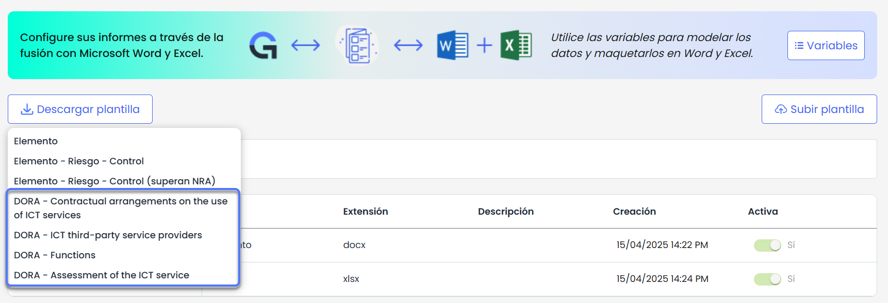
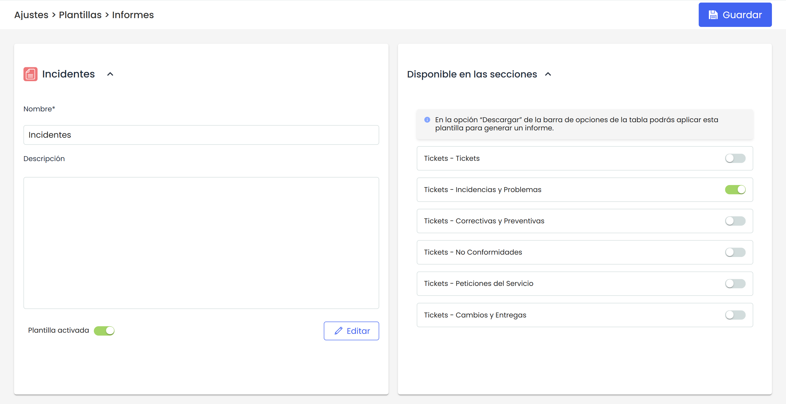

# Plantillas Informes Ticketing


En esta funcionalidad se incorpora la posibilidad de generar informes personalizables en formato Excel, permitiendo a los usuarios adaptar la estructura y el contenido del informe utilizando variables del sistema. Esta opción estará disponible inicialmente para los informes de ticket.


Al acceder a la opción, nos encontramos con las siguientes opciones:

## Descargar plantilla

GlobalSuite pone disposición una serie de plantillas base para comenzar con la configuración. Actualmente se pueden descargar:

* DORA - Contractual arrangements on the use of ICT services
* DORA - ICT third-party service providers
* DORA - Functions
* DORA - Assessment of the ICT service


Para descargar las plantillas DORA, será necesario disponer de la licencia correspondiente al módulo.


## Subir Plantilla

Es posible subir plantillas personalizadas en formato `.xlsx`. Antes de realizar la carga, es necesario asignar un **tipo de plantilla**, ya que este determinará en qué parte del sistema estará disponible para su descarga.

Actualmente, se puede seleccionar entre:

* **Ticket**: para informes vinculados a listados por tipo tickets.
* **Normativa DORA**: para informes específicos relacionados con los tickets predefinidos de dicha normativa.

## Listado de Plantillas

Al acceder a la opción, se muestran todas las plantillas existentes junto con su información: nombre, tipo, extensión, descripción, fecha y hora de creación, y si están activas o no.

Las acciones disponibles en esta tabla son:

* **Eliminar**: seleccionando la plantilla a eliminar mediante el check.
* **Descargar**: permite descargar la plantilla seleccionada.

## Detalle de Plantilla

En esta sección, podrás realizar las siguientes acciones sobre la plantilla:

* Editar el nombre de la plantilla.
* Activar o desactivar la plantilla según sea necesario.
* Configurar la visibilidad: Según el tipo de plantilla, se mostrará el módulo desde el cual podrá ser descargada con los datos correspondientes.

## Informes de Tickets

Los informes en Excel pueden configurarse y descargarse por **tipo de ticket**, permitiendo adaptar la información y el formato a las características específicas de cada uno.

Para ello, se ha incorporado en la configuración del tipo de ticket el nuevo campo **Alias reportes**, que permite definir el nombre de variable que se utilizará en la plantilla de Excel. Este alias es el que se insertará en el documento para que el sistema lo reemplace por el valor correspondiente durante la generación del informe.

Este campo debe configurarse desde Ajustes > Tickets > [Campos](https://help.globalsuitesolutions.com/es/globalsuite/v1/campos).

## Campos y Variables

Las plantillas de informes admiten distintos tipos de campos. En la siguiente tabla se muestran las variables disponibles para cada tipo de campo y la información que permite mostrar cada una.

Las variables utilizadas en las plantillas de Excel se definen a partir del campo **Alias reportes** de cada campo del ticket. Esto permite personalizar qué información se mostrará y cómo se nombrará en el informe.

Es importante destacar que los **alias deben ser valores únicos y alfanuméricos**, con una longitud máxima de **5 caracteres**.

|  |  |  |
| --- | --- | --- |
| **Campo** | **Variable** | **Descripción** |
| TXT | {Alias} | Valor del Campo |
| INPUT | {Alias} | Valor del Campo |
| SELECT | {Alias.name} | Valor del Campo |
| SELECT | {Alias.description} | Descripción del Campo |
| SELECT | {Alias.abbreviation} | Abreviatura del Campo |
| SELECT | {Alias.value} | Valor del Campo |
| NUM | {Alias} | Valor del campo. El formato se aplica directamente en excel |
| DATE | {Alias} | Valor del campo. El formato se aplica directamente en excel |
| SUPPLIER | {Alias.CIF} | Valores campo CIF |
| SUPPLIER | {Alias.business\_name} | Valores campo Razón Social |
| EMPLOYEES | {Alias.name} | Valor del campo Nombre |
| EMPLOYEES | {Alias.email} | Valor del campo Email |
| EMPLOYEES | {Alias.role} | Valor del campo  Rol |
| EMPLOYEES | {Alias.position} | Valor del campo Cargo |
| EMPLOYEES | {Alias.status} | Valor del campo Estado |
| SUPERVISOR | {Alias.name} | Valor del campo Nombre |
| SUPERVISOR | {Alias.email} | Valor del campo Email |
| SUPERVISOR | {Alias.role} | Valor del campo  Rol |
| SUPERVISOR | {Alias.position} | Valor del campo Cargo |
| SUPERVISOR | {Alias.status} | Valor del campo Estado |
| OWNER | {Alias.name} | Valor del campo Nombre |
| OWNER | {Alias.email} | Valor del campo Email |
| OWNER | {Alias.role} | Valor del campo  Rol |
| OWNER | {Alias.position} | Valor del campo Cargo |
| OWNER | {Alias.status} | Valor del campo Estado |
| TICKET-INPUTS | {Alias1.Alias2} | Se deberá indicar el alias correspondiente al campo de la entrada y posteriormente, el alias del campo de la entrada que se quiera mostrar. |
| TICKET-OUTPUTS | {Alias1.Alias2} | Se deberá indicar el alias correspondiente al campo de la salida y posteriormente, el alias del campo de la salida que se quiera mostrar. |
| SELECT-NESTED | {Alias.option.name}  {Alias.suboption.name} | Nombre de la opción/subopción seleccionada |
| SELECT-NESTED | {Alias.option.description}  {Alias.suboption.description} | Descripción de la opción/subopción seleccionada |
| SELECT-NESTED | {Alias.option.abbreviation}  {Alias.suboption.abbreviation} | Abreviatura de la opción/subopción seleccionada |
| SELECT-NESTED | {Alias.option.value}  {Alias.suboption.value} | Valor de la opción/subopción seleccionada |
| SERVICES | *Opción 1*:  *{Alias.name}*  *Opción 2: {#Alias}*   * *{name}*   *{/}*  Opción 3: *{#Alias*|join:' - ' }{/} | Valores campo Nombre del Servicios:   * Opción 1: Listado de servicios * Opción 2: Listado con bullets * Opción 3: Con separador. En este ejemplo se utiliza ' - ' |
| PROCESSES | *Opción 1*:  *{Alias.name}*  *Opción 2: {#Alias}*   * *{name}*   *{/}*  Opción 3: *{#Alias*|join:' - ' }{/} | Valores campo Nombre del procesos:   * Opción 1: Listado de servicios * Opción 2: Listado con bullets. * Opción 3: Con separador. En este ejemplo se utiliza ' - ' |
| STATUS | {Alias.name} | Nombre del Campo |
| STATUS | {Alias.description} | Descripción del Campo |
| STATUS | {Alias.type} | Tipo del Campo |
| ID | {Alias} | Valor del Campo |
| FOLLOWS UP | {Alias.user} | Usuario del Campo |
| FOLLOWS UP | {Alias.date} | Fecha del Campo |
| FOLLOWS UP | {Alias.description} | Descripción del Campo |
| DELIVERABLES | {Alias.name} | Nombre del Campo |
| DELIVERABLES | {Alias.description} | Descripción del Campo |
| DELIVERABLES | {Alias.extension} | Extensión del Campo |
| DELIVERABLES | {Alias.date} | Fecha del Campo |
| EVIDENCES | {Alias.name} | Nombre del Campo |
| EVIDENCES | {Alias.description} | Descripción del Campo |
| EVIDENCES | {Alias.extension} | Extensión del Campo |
| EVIDENCES | {Alias.date} | Fecha del Campo |
| LINKED-EVENT | {Alias} | Valor del Campo |
| ROOT-EVENT | {Alias} | Valor del Campo |
| SEQUENCE | {Alias} | Valor del Campo |
| QUANTIFICATIONS - Tabla cuantificaciones | {Alias.Account.quantificationId} | ID Cuantificación |
| QUANTIFICATIONS - Tabla cuantificaciones | {Alias.Account.accountingAccount} | ID Cuenta Contable |
| QUANTIFICATIONS - Tabla cuantificaciones | {Alias.Account.accountingDate} | Fecha Contable |
| QUANTIFICATIONS - Tabla cuantificaciones | {Alias.Account.description} | Descripción |
| QUANTIFICATIONS - Tabla cuantificaciones | {Alias.Account.AliasCampoSelectNested} | Línea de Negocio |
| QUANTIFICATIONS - Tabla cuantificaciones | {Alias.Account.amount} | Monto |
| QUANTIFICATIONS - Tabla cuantificaciones | {Alias.Account.AliasColumnaAdicional} | Valor columnas adicionales cuantificaciones(campos configurables) |
| QUANTIFICATIONS - Tabla cuantificaciones y recuperos | {Alias.Account.AliasCampoCuentaContable} | Valor del campo de opciones de campos de cuenta contable (campos configurables) |
| QUANTIFICATIONS - Tabla Recuperos | {Alias.Account.Recoveries.recoveryId} | ID Recupero |
| QUANTIFICATIONS - Tabla Recuperos | {Alias.Account.Recoveries.accountingAccount} | ID Cuenta Contable |
| QUANTIFICATIONS - Tabla Recuperos | {Alias.Account.Recoveries.accountingDate} | Fecha Contable |
| QUANTIFICATIONS - Tabla Recuperos | {Alias.Account.Recoveries.Form} | Forma Recupero |
| QUANTIFICATIONS - Tabla Recuperos | {Alias.Account.Recoveries.amount} | Monto. |
| QUANTIFICATIONS - Tabla Recuperos | {Alias.Account.Recoveries.AliasColumnaAdicional} | Valor columnas adicionales recuperos(campos configurables) |
| AUDIT-WORK | {Alias.name} | Valor del campo Nombre |
| AUDIT-WORK | {Alias.auditPlan} | Valor del campo Plan Auditoría |
| WORKFLOW | {AliasWorkflow.name} | Valor del campo Nombre |
| WORKFLOW | {AliasWorkflow.role} | Valor del campo Rol |
| WORKFLOW | {AliasWorkflow.employee} | Valor del campo Empleado |
| ORGANIZATIONAL STRUCTURE | {Alias.name} | Valor del campo Nombre |
| ORGANIZATIONAL STRUCTURE | {Alias.Responsible} | Valor del campo Responsables |
| ORGANIZATIONAL STRUCTURE | {Alias.description} | Valor del campo Descripción |
| URGENCY | {Alias.name} | Valor del campo Nombre |
| URGENCY | {Alias.description} | Valor del campo Descripción |
| URGENCY | {Alias.value} | Valor del campo |
| PRIORITY | {Alias.name} | Valor del campo Nombre |
| PRIORITY | {Alias.description} | Valor del campo Descripción |
| PRIORITY | {Alias.value} | Valor del campo |
| IMPACT | {Alias.name} | Valor del campo Nombre |
| IMPACT | {Alias.description} | Valor del campo Descripción |
| IMPACT | {Alias.value} | Valor del campo |
| EVENTS-ID | {Alias} | Valor del campo |
| CHECK | {Alias} | Valor del campo: mostrará valor 1 cuando esté marcado y valor 0 cuando esté desmarcado. |
| CLIENT | {Alias.code} | Código del Cliente/contacto |
| CLIENT | {Alias.cif} | CIF del Cliente/contacto |
| CLIENT | {Alias.business\_name} | Razón Social del Cliente/contacto |
| CLIENT | {Alias.type} | Tipo Contacto/Grupo |
| CLIENT | {Alias.other\_contact} | Otro Contacto |
| CLIENT | {Alias.email}{Alias} | Email |
| INVOLVED AREAS | {Alias} | Valor del campo |

## Recursos relacionados


Para mas información sobre esta funcionalidad, puedes consultar el tutorial [Personaliza y descarga informes con nuestras plantillas dinámicas en Excel](https://help.globalsuitesolutions.com/es/globalsuite/v1/personaliza-plantillas-informes-excel)

