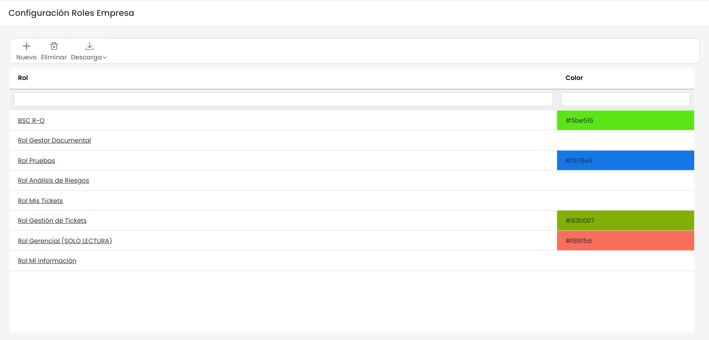
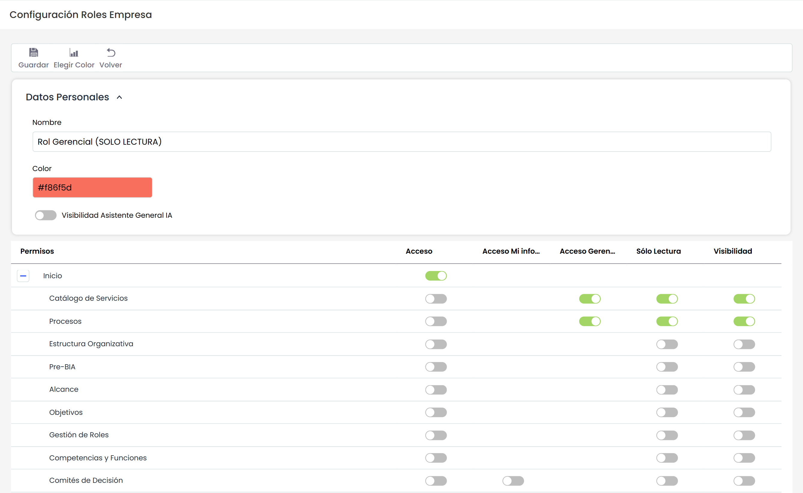
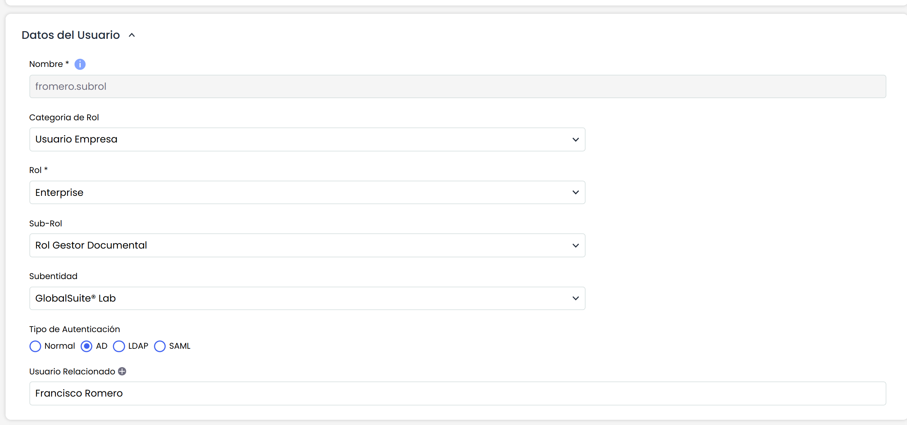

# Roles de Empresa

La opción de Roles ofrece la posibilidad al usuario de gestionar el acceso por perfiles a los diferentes módulos de la plataforma.

Al acceder a la opción se muestra una tabla sobre la que se pueden realizar las siguientes tareas:

* **Nueva:** Permite insertar una nuevo Rol en la tabla pulsando sobre el botón.
* **Eliminar:** Posibilita eliminar roles definidos en la tabla. Para ello se ha de seleccionar la fila o filas deseadas y pulsar el botón ‘Eliminar’.
* **Descarga:** Ofrece la posibilidad de descargar el listado de roles en un formato editable (.xlsx) o en formato .PDF

Una vez se pulsa sobre el enlace de roles definidos en la tabla, se accede a la configuración del mismo. Se permite parametrizar las siguientes características:

* **Nombre:** Permite indicar el nombre asignado al Rol.
* **Color:** Permite asignar un color determinado al Rol. Para ello se debe pulsar el botón ‘Elegir color’ y elegir el color deseado.
* **Permisos:** La tabla de permisos muestra cada una de las opciones correspondientes a los módulos contratados por la empresa. El usuario dispone de varios permisos para asignar a cada opción. El significado de cada permiso es el siguiente:

  * **Acceso Total:** Al seleccionar un checkbox de este tipo, otorga al Rol el privilegio de acceder y modificar toda la información de la opción correspondiente.
  * **Acceso Mi Información:** Al seleccionar un checkbox de este tipo, otorga al Rol el privilegio de acceder y modificar únicamente aquella información que tiene asignada, no pudiendo acceder al resto de información. Este privilegio está disponible en algunas opciones.
  * **Acceso Gerencial:** Al seleccionar un checkbox de este tipo, otorga al Rol el privilegio de acceder y modificar únicamente aquella información relacionada con los servicios a los que pertenece. En la opción "Catálogo de Servicios" se permite seleccionar los roles y empleados asignados al servicio; aquellos empleados que dispongan del privilegio "Acceso Gerencial", tendrán acceso a aquella información que esté relacionada con los servicios a los que pertenece. Este privilegio está disponible en las opciones de Catálogo de Servicios, Procesos, BIA, Inventario, Análisis de Riesgos, Plan de Continuidad, Plan de Recuperación, Programa de Pruebas, Indicadores y Métricas.
  * **Sólo Lectura:** Al seleccionar un checkbox de este tipo, otorga al Rol el privilegio de sólo lectura a toda la información de la opción correspondiente.

Una vez se ha creado el Rol, el usuario puede utilizar este rol a la hora de crear los usuarios. Para ello, en la opción "Usuarios" podrá asignar el rol creado a los usuarios de tipo "Usuario Empresa".

