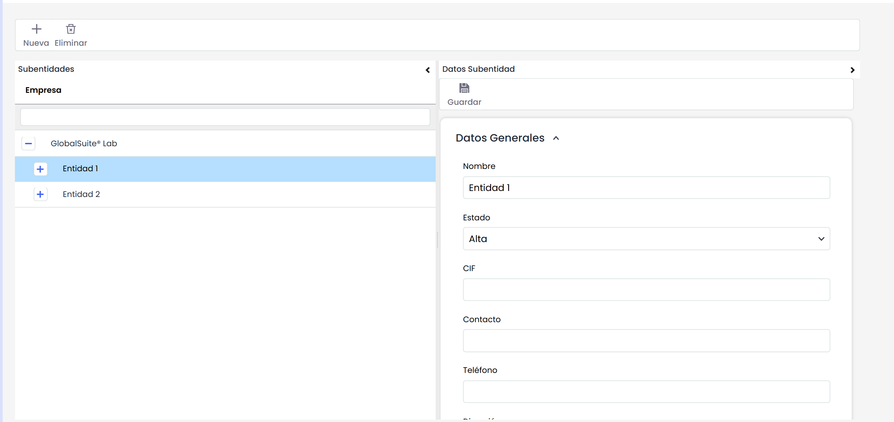

# Subentidades

La opción de subentidades permite a los usuarios con perfil Administrador Enterprise y Administrador Entidad generar entidades pendientes de su entorno de empresa.

Las opciones que permite la tabla son las siguientes:

* **Nueva:** Permite crear una nueva entidad. Para ello se ha de seleccionar la fila deseada y pulsar sobre el botón 'Nueva'. La herramienta disponer de un límite a la hora de crear subentidades marcado en la opción 'Datos empresa'.
* **Eliminar:** Posibilita eliminar una entidad creada en la tabla.

Una vez creada la entidad, al seleccionar la misma en la tabla la herramienta permite definir los siguientes apartados:

* **Datos Generales:** Permite definir los datos de la entidad como el Nombre, CIF, Contacto, etc...y guardar los mismos al pulsar sobre el botón 'Guardar'.


\*\*NOTA:\*\* La opción 'Padre' permite al usuario asignar a la subentidad la entidad padre requerida en caso de necesidad. Para ello, la subentidad debe tener las mismas opciones (catálogos análisis, catálogos compliance, etc...) que la entidad padre.


* **Catálogos Análisis:** Permite definir que catálogos de análisis estarán disponibles para el trabajo en las subentidades
* **Catálogos Compliance:** Permite definir que catálogos compliance estarán disponibles para el trabajo en las subentidades
* **Metodologías Análisis:** Ofrece la posibilidad de definir que metodologías de análisis se van a poder utilizar para el trabajo en las subentidades.
* **Modelo de proyectos:** Permite seleccionar los modelos de proyecto que se van a poder utilizar en las subentidades
* **Encuestas:** Ofrece la posibilidad de seleccionar los modelos de encuesta con los que poder trabajar en las subentidades.
* **Etiquetas:** Permite asignar etiquetas a las subentidades para consolidar la información de manera mas especifica. Para ello se ha de seleccionar la etiqueta requerida y pulsar sobre el botón 'Añadir'. En caso querer eliminar una etiqueta se ha de seleccionar la misma y pulsar sobre el botón 'Eliminar'.


\*\*NOTA:\*\* Las etiquetas se establecen en el apartado 'Ajustes/general'


* **Certificados:** Permite definir los certificados asociados a la subentidad. Para ello se ha de seleccionar los certificados requeridos y pulsar sobre el botón 'Añadir'. Una vez generada la entrada, la herramienta permite definir el número del certificado y cualquier comentario adicional.
* **Conexiones FACT24:** Permite generar conexiones entre GlobalSUITE y herramientas externas.
* **Preguntas BIA:** Permite personalizar qué preguntas de la configuración del BIA serán visibles en las entidades inferiores, para poder personalizar esa evaluación de impacto en cada una.


\*\*NOTA:\*\* Las preguntas que no se habiliten para una subentidad, no estarán disponibles en BIAs, BIAs Consolidados, Informes, Históricos de BIA.


* **Gestor Documental:** Permite activar o desactivar selectivamente el Workflow de aprobación del gestor para cada subentidad.


\*\*NOTA\*\*: En caso de que se desactive el uso de Workflows para una subentidad se eliminarán las restricciones y flujos de aprobación: se podrán subir nuevos documentos y versiones, cambiar de estado manualmente, así como tener visibilidad de todos los archivos y carpetas (por parte de los usuarios que tengan acceso a la opción)

