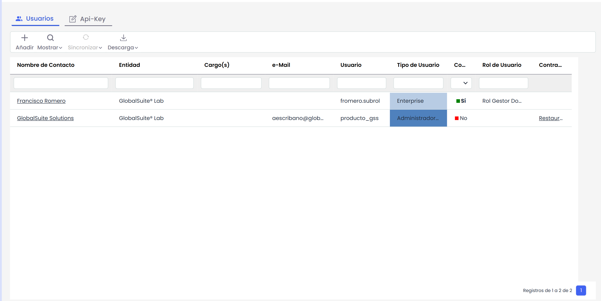

# Usuarios

Este apartado muestra al gestor una tabla con los distintos usuarios que hay dados de alta para la gestión de la empresa seleccionada.

La tabla de usuarios muestra campos como el nombre del contacto, el cargo, e-Mail, Usuario de acceso a la plataforma, el tipo de perfil asignado, el Rol de Usuario o la posibilidad de restaurar la contraseña.

Todos estos campos se pueden modificar pulsando sobre el nombre del contacto que desea modificar y que se encuentra en la primera columna de la tabla. El formulario de modificación de datos es el mismo que se abre al ir a [Mi Perfil](https://help.globalsuitesolutions.com/es/globalsuite/v1/mi-perfil), excepto que permite asignar un específico al usuario. Esto se define en la siguiente sección.

Al acceder a la opción se muestra una tabla sobre la que se pueden realizar las siguientes opciones:

* **Mostrar: Esta opción es un filtro rápido para ver en la tabla usuarios según su tipo de conexión.**

  * **AD Todos**: Muestra a todos los usuarios conectados a través de Active Directory.
  * **AD relacionados**: Muestra a los usuarios conectados con Active Directory que están relacionados a uno.
  * **Locales**: Muestra a los usuarios con conexión local.
* **Nuevo**: permite crear nuevos usuarios, dirigiendo al formulario donde se completan los datos necesarios para el registro.
* **Contador de usuarios**: muestra un texto con el número de usuarios creados y el límite máximo de usuarios permitidos.
* **Sincronizar** El botón sincronizar permite establecer una conexión con el Active Directory de la organización.
* **Descargar**: Permite realizar la descarga de los usuarios que se muestran en la tabla.

* [Tipos de Usuario](tipos-de-usuario.md)
* [Tipo de Autenticación](tipo-de-autenticacion.md)
