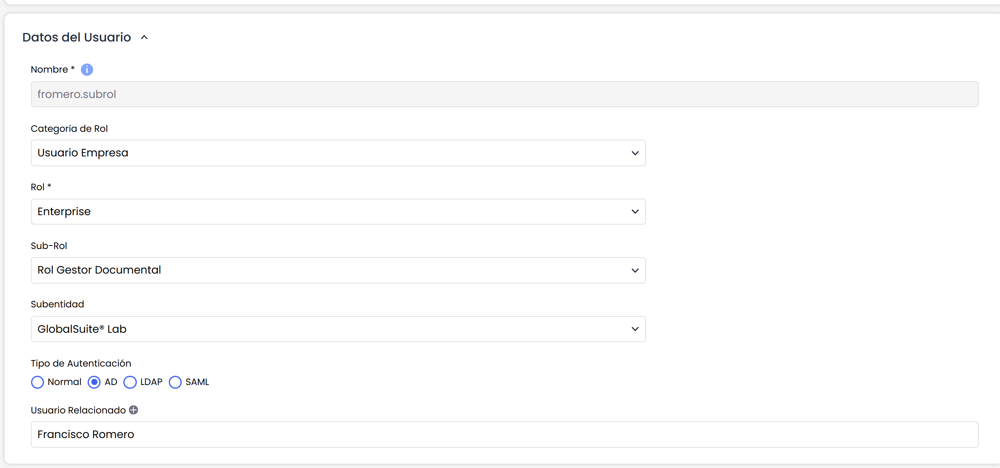

# Tipo de Autenticación

En los Datos del Usuario existen unos campos que permiten personalizar la autenticación del acceso a GlobalSUITE®. A continuación se detalla cada uno de los campos:

* **Tipo de Autenticación:** Permite indicar como se va a realizar la autenticación del usuario para acceder a GlobalSUITE®. Dispone de 3 opciones:

  * **Normal:** La autenticación se realiza contra GlobalSUITE®.
  * **AD:** La autenticación se realiza contra el Active Directory de Windows. Previamente deberá haberse configurado la conexión de GlobalSUITE® con el AD de la organización.
  * **LDAP:** La autenticación se realiza contra un LDAP estándar. Previamente deberá haberse configurado la conexión de GlobalSUITE® con el LDAP de la organización.

* **Usuario Relacionado:** Permite asociar el usuario ya existente de la propia organización o de un nivel superior con la finalidad de no tener que contar con usuarios diferentes para cada una de las entidades o empresas a las que tiene que tener acceso ese usuario. Para ello deberá contar con licencias con entidades o licencia consulting con licencias Enterprise asociadas. Para asociar el usuario relacionado, deberá pulsar en el icono rojo de la admiración y se mostrará una ventana emergente con el listado de usuarios para que pueda ser asociado.

* **Usuarios Dependientes:**Permite visualizar los usuarios a los que tendrá acceso el propio usuario que está siendo creado. Esto permite que organizaciones con entidades, pueda facilitar un único usuario con acceso a varias entidades, sin necesidad de tener que crear un usuario por cada una de las entidades o empresa con licencia Enterprise. Para asignar usuarios dependientes, deberá acceder al propio usuario dependiente y marcar al usuario actual como "Usuario Relacionado".

* **Acceso Empresa Propia:**Permite marcar si se permite el acceso del usuario a su propia empresa, o por el contrario, solo tendrá acceso a las entidades con las que se ha realizado y que se visualizan en el apartado anterior de "Usuarios Dependientes".
