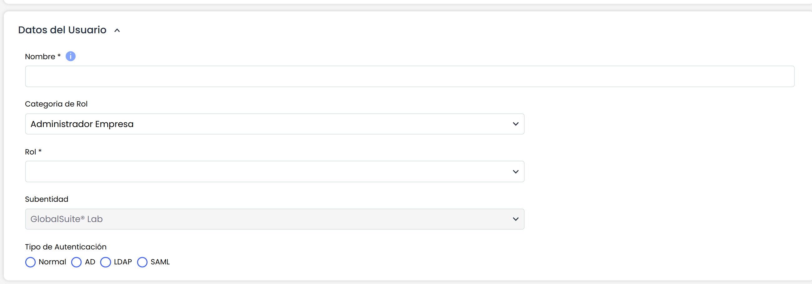
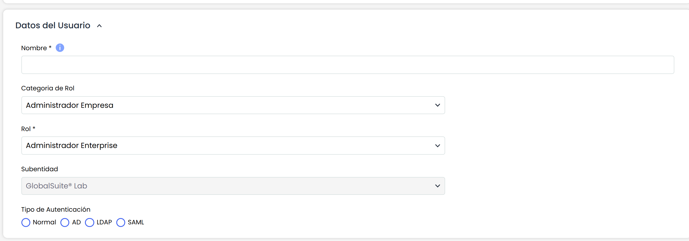
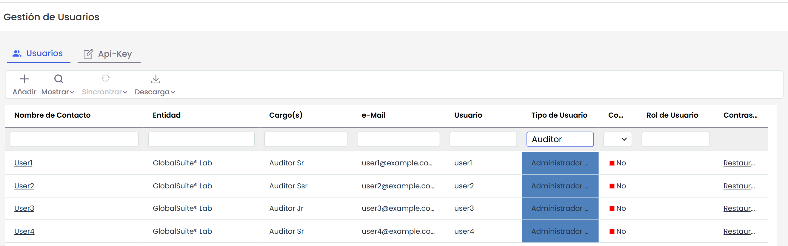
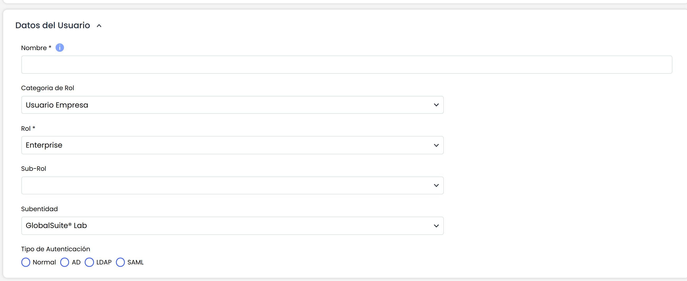
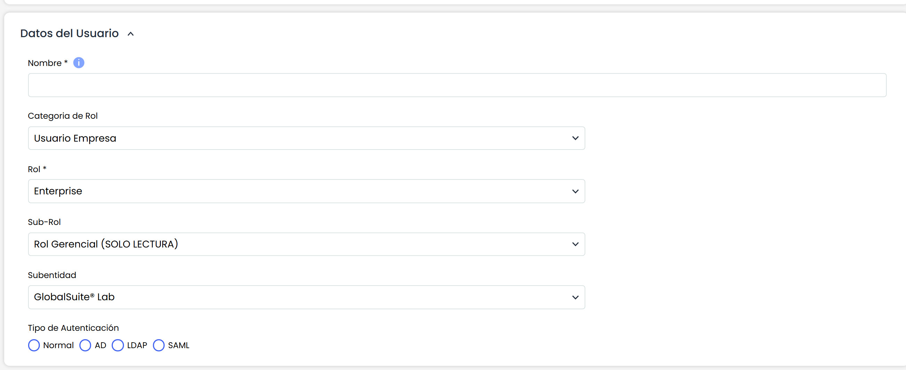

# Tipos de Usuario

# Datos del Usuario

## Categoría Rol

El apartado de datos del usuario permite definir el nombre con el cual se accede a la plataforma, además del rol asignado al usuario. Los roles disponibles se dividen en dos categorías principales (Administrador Empresa y Usuario Empresa):

## **Rol**

### **Administrador empresa**

En caso de seleccionar en el desplegable Categoría del Rol la opción **Administrador empresa**, los roles disponibles serán los siguientes:

* **Administrador Plataforma:** El usuario puede acceder al entorno asignado, gestionar todas las opciones del apartado de Ajustes y gestionar a los usuarios Administrador Enterprise.
* **Administrador Enterprise:** El usuario puede acceder al entorno asignado y gestionar todas las opciones del apartado de Ajustes. Este usuario podrá crear y visualizar usuarios con rol inferior.
* **Administrador Configuración:** El usuario puede gestionar las opciones del apartado de Ajustes del entorno asignado, a excepción de los apartados de "Roles Empresa", "Usuarios", "Logs de Acceso" y "Logs de Acciones".
* **Administrador Entidad:** El usuario puede acceder al entorno asignado y administrar las opciones de subentidades, perfil y usuarios.
* **Administrador Accesos:** El usuario únicamente podrá acceder al entorno de Ajustes, limitado a las opciones de "Roles Empresa", "Usuarios", "Logs de Acceso" y "Logs de Acciones".

#### **Roles específicos disponibles con la licencia Audit Management:**

* **Administrador Auditor:** El usuario tiene privilegios y acceso exclusivo a las funcionalidades relacionadas con la auditoría y podrá crear usuarios empresa con acceso únicamente a dichas funcionalidades.

  * Sólo podrá crear y gestionar usuarios con acceso únicamente a Auditoría.
  * En la opción [Roles Empresa](https://help.globalsuite.es/display/GlobalSUITEes/.Roles+de+Empresa+vv5.1) sólo podrá asignar y desasignar nuevos roles relacionados con las funcionalidades de Auditoría.
  * No podrá visualizar los usuarios con acceso al resto de opciones.
  * Solo tendrá acceso a las funcionalidades del módulo de Audit.
  * No puede acceder ni administrar funcionalidades fuera del ámbito de Auditoría.

* **Administrador Sistema de Gestión:** Se encarga de administrar las funcionalidades generales del sistema de gestión, pero no tendrá acceso directo a las funcionalidades específicas de la auditoría.

  * Podrá crear y gestionar usuarios con acceso a todas las opciones, excepto a las que correspondan a Auditoría.
  * En la opción [Roles Empresa](https://help.globalsuite.es/display/GlobalSUITEes/.Roles+de+Empresa+vv5.1) no podrá asignar y desasignar nuevos roles relacionados con las funcionalidades de Auditoría.
  * No podrá visualizar los usuarios con acceso a Auditoría.
  * No puede acceder ni administrar funcionalidades dentro del ámbito de Auditoría.

Los roles que tendrán la capacidad de crearlos son los siguientes:

* Administradores Enterprise
* Administradores de Plataforma
* Administradores de Accesos y
* Los usuarios organizativos (Administrator, Platinum, Gold, Ad. Consulting, Consulting)


El limite de usuarios Administradores Auditor y Sistema de Gestión por defecto será de 5 respectivamente. Además, este límite no podrá ser mayor a límite total de usuarios.


### **Usuario Empresa**

En caso de seleccionar en el desplegable Categoría del Rol la opción **Usuario empresa**, los roles disponibles serán los siguientes:

* **Enterprise:** El usuario puede acceder a la entidad asignada (en el desplegable 'Subentidad' se selecciona la entidad) y no dispone de permisos de administración sobre la misma.
* **Entidad:** El usuario puede acceder a la entidad asignada (en el desplegable 'Subentidad' se selecciona la entidad) y consolidar información de las entidades que dependan de la entidad (en caso de existir). El usuario no dispone de permisos de administración.

Para ambos usuarios de empresa, se permite asignar un sub-rol específico. Los sub-roles que se muestran se crean en la opción 'Roles Empresa'

