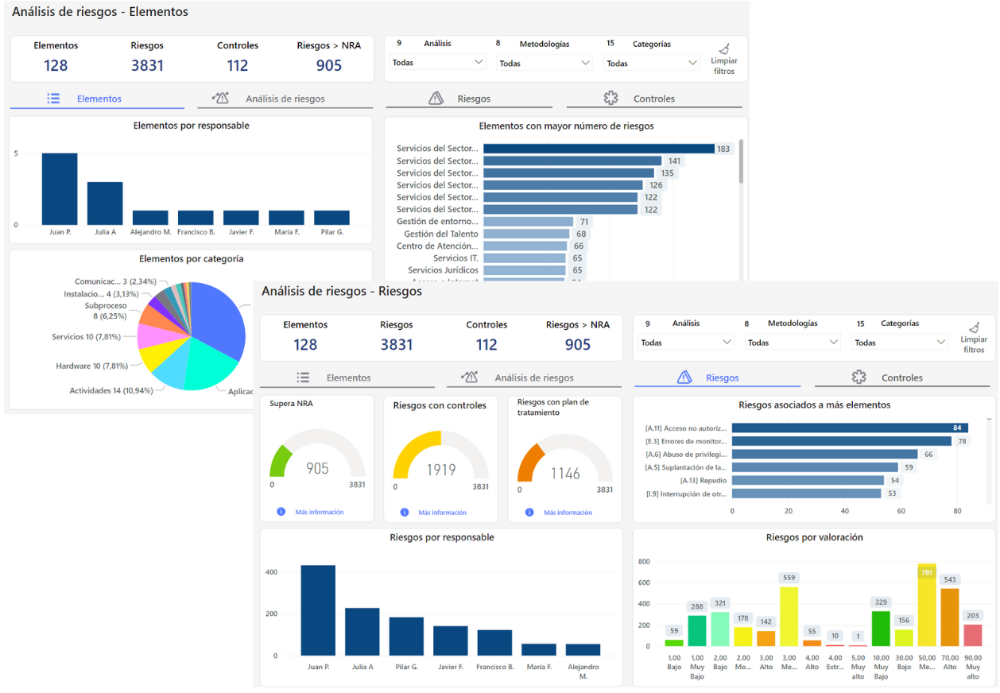

# Análisis BI (Reportes e Informes)


Esta solución integra las capacidades analíticas de nuestro software y permite a los usuarios realizar análisis detallados sin abandonar la aplicación.
Este módulo de análisis empresarial permite integrar las capacidades de visualización y ayuda a la toma de decisiones directamente en GlobalSuite®.
Se podrá integrar informes interactivos, gráficas y tablas dentro de la solución.
Esto permitirá a los usuarios ver y explorar sus datos, así como monitorizar y evaluar fácilmente la efectividad de los sistemas.
Además, cuenta con \*\*seguridad integrada\*\* al contar con las políticas de acceso y control de nuestra plataforma\*\*.\*\*


Actualmente a través de nuestro software se puede contar con diferentes dashboards predefinidos:

* [Dashboard Análisis de Riesgos](dashboard-analisis-de-riesgos/README.md)
* [Dashboard Encuestas](dashboard-encuestas.md)
* [Dashboard Gestor Documental](dashboard-gestor-documental.md)
* [Dashboard BIAs](dashboard-bias.md)
* [Dashboard Evaluación de Riesgos](dashboard-evaluacion-de-riesgos.md)
* [Dashboard Encuestas ERC](dashboard-encuestas-erc.md)
* [Dashboard Compliance](dashboard-compliance.md)
* [Dashboard TPRM](dashboard-tprm.md)


También existe la opción de \*\*dashboards personalizados\*\* con orígenes de datos adicionales y que no solo provengan de la plataforma.
Solicitar información adicional al respecto en [comercial@globalsuitesolutions.com](mailto:comercial@globalsuitesolutions.com)


## Actualización de dashboards bajo demanda


Esta funcionalidad permite a los usuarios con \*\*licencia BI Plus\*\* actualizar manualmente los dashboards, con el objetivo de ofrecer información actualizada bajo demanda, sin tener que esperar la actualización automática diaria.


### ¿Qué es la actualización bajo demanda?

La actualización bajo demanda es un proceso que permite al usuario solicitar la actualización inmediata de **todos los dashboards habilitados** en el entorno, pulsando el botón **"Actualizar"**.  
Esta acción actualiza los datos que muestran los dashboards para reflejar la información más reciente disponible en el sistema.

### ¿Quién puede usar esta funcionalidad?

* Usuarios con licencia **GlobalSuite® BI Plus**.

### ¿Cómo funciona?

* Al pulsar el botón Actualizar, disponible en todos los dashboards, se lanza el proceso de actualización en **todos los dashboards habilitados** del entorno.
* El proceso puede tardar aproximadamente 10 minutos.
* El sistema registra cada actualización manual en un log del sistema.

### ¿Cuál es el límite de actualizaciones que puedo realizar?

* Los usuarios pueden realizar hasta **60 actualizaciones manuales por entorno al mes**.
* Al pulsar actualizar en cualquier dashboard, se actualizarán todos los dashboards habilitados del entorno, tanto los predefinidos como los personalizados.
* Además, los dashboards continuarán actualizándose automáticamente **una vez al día**.
* Para consultar las actualizaciones restantes, puedes pasar el ratón o hacer click sobre el icono de información.
