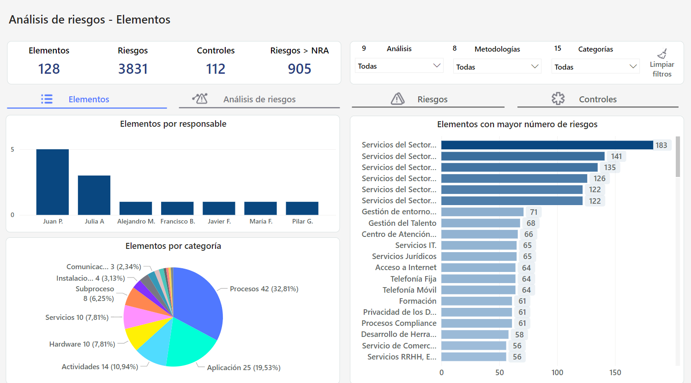

# Dashboard Análisis de Riesgos


En el núcleo de una gestión eficaz, el Análisis de Riesgos emerge como una herramienta clave, ofreciéndonos una visión completa y dinámica de los desafíos que enfrenta nuestra organización


* [Pestaña Elementos](pestana-elementos.md)
* [Pestaña Análisis de Riesgos](pestana-analisis-de-riesgos.md)
* [Pestaña Riesgos](pestana-riesgos.md)
* [Pestaña Controles](pestana-controles.md)

### Características principales

* **Situación global**: Obtén una perspectiva general de los análisis de riesgos presentes en nuestro sistema de gestión, permitiéndote visualizar el panorama completo.
* **Estadísticas de volumetría**: Analiza la cantidad y la naturaleza de los riesgos, proporcionando una base cuantitativa para la toma de decisiones.
* **Riesgos por niveles:** Identifica cómo se distribuyen los riesgos a través de los diferentes niveles de la organización, facilitando una gestión y mitigación focalizada.
* **Top 10 Riesgos Críticos**: Prioriza tus acciones centrándote en los riesgos más críticos que podrían impactar de manera significativa a la organización.
* **Riesgos pendientes y controlados**: Diferencia rápidamente entre los riesgos pendientes de tratamiento y aquellos con controles ya aplicados, evaluando la eficacia y madurez de nuestras estrategias de mitigación.

### Funcionalidades generales

#### Filtros

* **Filtros panel superior** El tablero proporcionará la capacidad de filtrar las gráficas según diferentes criterios, como Análisis, Metodología y Categoría de elementos. Esto permitirá una mayor flexibilidad y personalización al visualizar los datos.

Si, una vez aplicados filtros, se quiere volver a mostrar toda la información, se podrá hacer pulsando el botón “Limpiar”.

* **Filtros Dinámicos:**Al hacer click en algún elemento de un gráfico específico del dashboard, se activará automáticamente la funcionalidad de filtrado en el resto de las visualizaciones presentes en el tablero.

En este caso, al seleccionar un responsable, todas las visualizaciones estarán segmentadas por el responsable seleccionado. 

Para dejar de ver los datos segmentados y volver a la vista original, se deberá hacer click nuevamente sobre el elemento seleccionado.

#### Descarga

Será posible descargar el tablero, el cual respeta los filtros aplicados, en tres formatos:

* PDF
* PPT
* PNG
