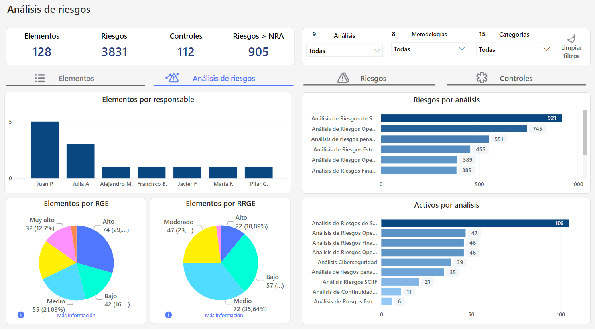
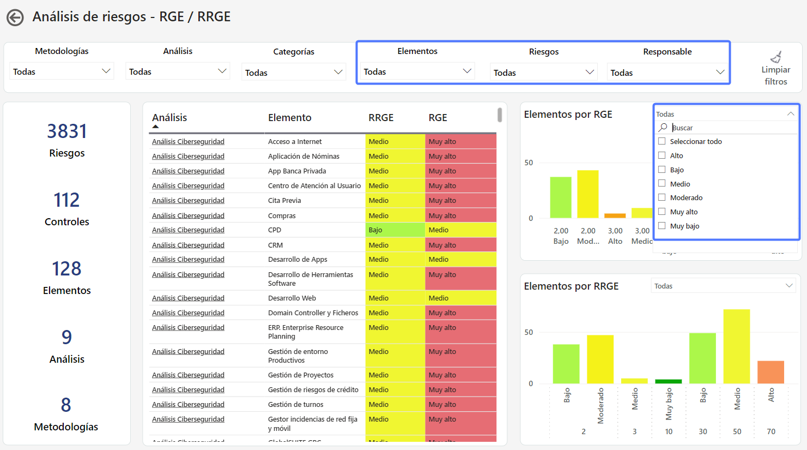

# Pestaña Análisis de Riesgos


Este tablero proporciona una visión completa de los riesgos, facilitando la toma de decisiones informadas y la gestión efectiva de los riesgos en la organización.


## Visualizaciones

### Elementos por Responsable

Se muestra la cantidad de elementos asignados a cada responsable, limitados a aquellos que estén incluidos en un análisis de riesgo.

### Elementos por RGE y RRGE

En estos gráficos se representa como se distribuyen los elementos de acuerdo su valoración respecto del RGE (Riesgo Global del Elemento) y RRGE (Riesgo Repercutido Global del Elemento). 

**Más Información:**

Al seleccionar esta opción, se podrá realizar un análisis más detallado sobre los elementos que conforman el gráfico y sus valoraciones en relación con el RGE y RRGE. 

**Filtros Adicionales**

* Además de los filtros por metodología, análisis y Categoría, se podrá filtrar también por Elemento, Riesgos y Responsable.
* Se añaden filtros a los gráficos para poder visualizar los datos de acuerdo a la valoración de los elementos respecto del RGE y RRGE.

## Explorando el Tablero **🔍**

## Vídeos


Tablero AR - Pestaña AR (1).mp4



Tablero AR - Pestaña Riesgos.mp4



Tablero AR - Pestaña AR.mp4

