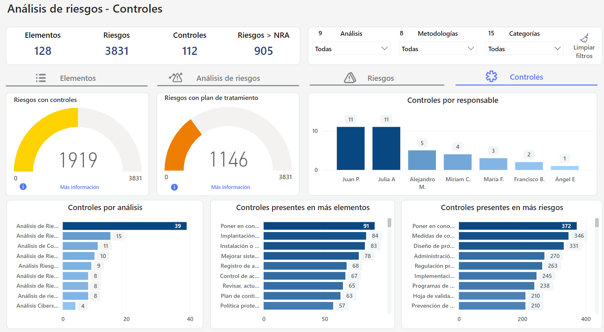
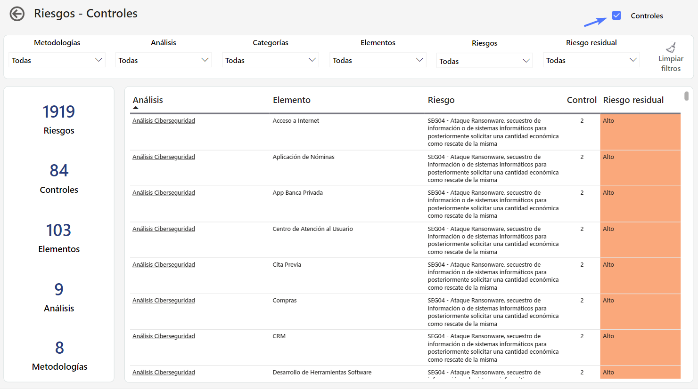
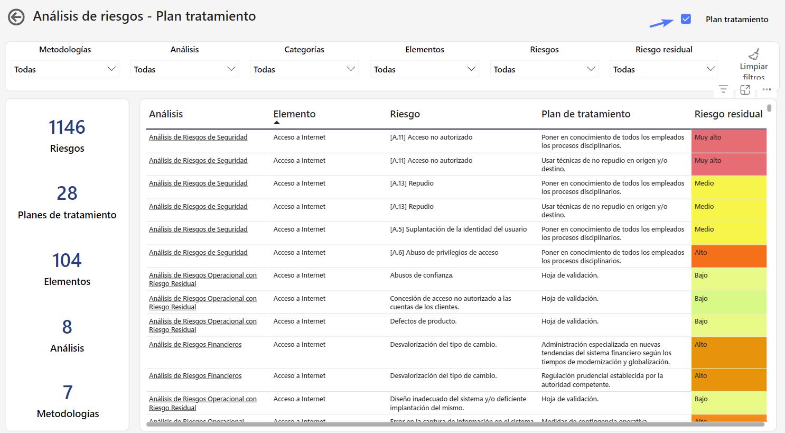
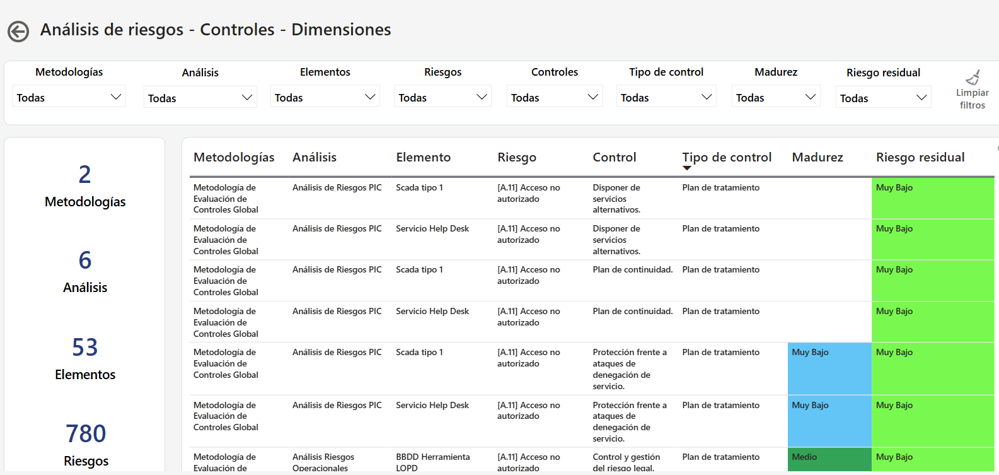

# Pestaña Controles


Este tablero facilita el análisis de los riesgos y los controles asociados, lo que ayuda a guiar decisiones estratégicas para mejorar la gestión de riesgos y la seguridad.


## Vista principal Controles

### Visualizaciones

**Controles presentes en más elementos**

Se representa como se distribuyen los controles implementados en los diferentes elementos que forman parte de un análisis, y proporciona información sobre qué controles están más extendidos y cuáles pueden estar menos representados. Además, se incluye un tooltip que muestra cómo se distribuyen los elementos por categoría. 

**Controles presentes en más riesgos**

Permite analizar la relación entre los controles implementados y los riesgos identificados. Puede mostrar gráficamente cuántos riesgos están cubiertos por diferentes controles y proporcionar información sobre qué controles son más efectivos en la mitigación de riesgos. 

**Riesgos con Controles**

Muestra la cantidad de riesgos que están cubiertos por controles. Cuando más alto, mayor será el nivel de seguridad y control.

**Más Información: Riesgos - Controles**

Este gráfico es útil para proporcionar una instantánea visual del grado de protección contra riesgos y puede ayudar a guiar decisiones estratégicas sobre la asignación de recursos y la implementación de medidas adicionales de mitigación.

* Check Controles

Permite una visualización detallada de qué riesgos específicos están siendo abordados con controles y cuáles podrían requerir más atención en términos de mitigación.

**Riesgos con Plan de Tratamiento**

Muestra la cantidad de riesgos que están cubiertos por planes de tratamiento.

**Más Información : Análisis de Riesgos - Plan de tratamiento**

Este gráfico proporciona una visión rápida y clara del estado de preparación para hacer frente a los riesgos identificados, lo que puede ayudar a dirigir los esfuerzos hacia la elaboración de planes de tratamiento adicionales y la implementación de medidas preventivas.

* Check Plan tratamiento

Permite una visualización detallada de qué riesgos específicos están siendo abordados con planes de tratamiento y cuáles podrían requerir más atención en términos de mitigación.

## Evidencias

Esta vista incorpora gráficas relacionadas con la gestión de evidencias, con el objetivo de proporcionar una visión más detallada de las evidencias asociadas a los controles.

### Controles con evidencias

Esta visualización cuenta con la opción **"Más información"**, que permite acceder al detalle de los datos en formato de tabla.

## Dimensiones y Evaluaciones

Esta vista incluye gráficas que facilitan el análisis de la efectividad de los controles y su distribución según dimensiones cualitativas configuradas. Estas visualizaciones apoyan una evaluación más profunda del desempeño de los controles.

**Más Información**

Esta opción proporciona un desglose detallado de los datos, permitiendo una comprensión más profunda y específica de cada control y su contexto en la gestión de riesgos.

Facilita el análisis en profundidad sin necesidad de navegar fuera del tablero.

## Explorando el Tablero **🔍**

## Vídeos


Tablero AR- Pestaña Controles.mp4

