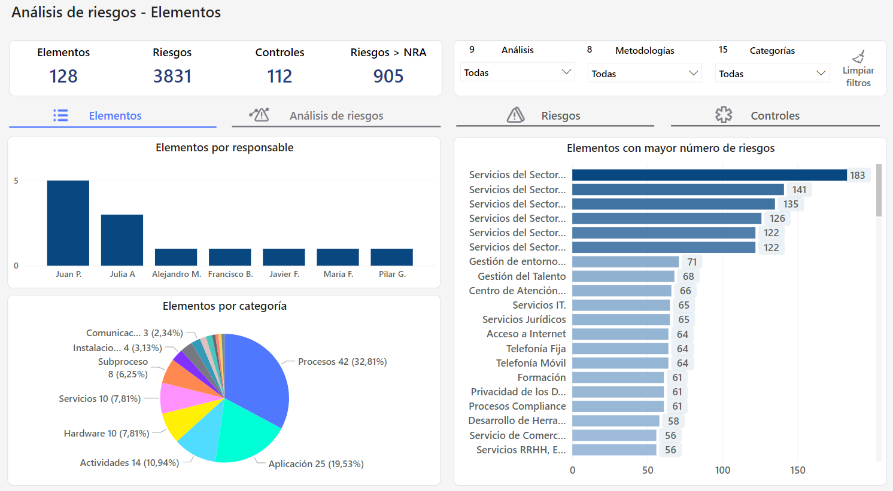

# Pestaña Elementos


En esta pestaña se analiza el comportamiento de los elementos en función a distintos parámetros, como los análisis de riesgos, metodologías empleadas, la categoría a las que pertenecen y los responsables de cada uno.


## Visualizaciones

### Indicadores

Se incluyen indicadores que muestran la cantidad de elementos, riesgos y controles presentes en un análisis de riesgos. También se muestra la cantidad de riesgos que superan el nivel de riesgo aceptable (NRA). Además, los valores de estos indicadores se ajustan automáticamente según los filtros aplicados.

### Elementos por Responsable

Se muestra la cantidad de elementos asignados a cada responsable, limitados a aquellos que estén incluidos en un análisis de riesgo.

### Elementos por Categoría

Permite analizar la distribución de los elementos en diferentes categorías y estén incluidos en un análisis de riesgos. Además, cuenta con un tooltip que muestra la cantidad de elementos representados por cada porcentaje.

### Elementos con mayor número de riesgos

Representa la relación entre los elementos y los riesgos identificados. Esta gráfica permite identificar rápidamente los elementos que presentan un mayor número de riesgos en comparación con otros.

## Explorando el Tablero **🔍**

## Vídeos


Tablero AR - Elementos.mp4

