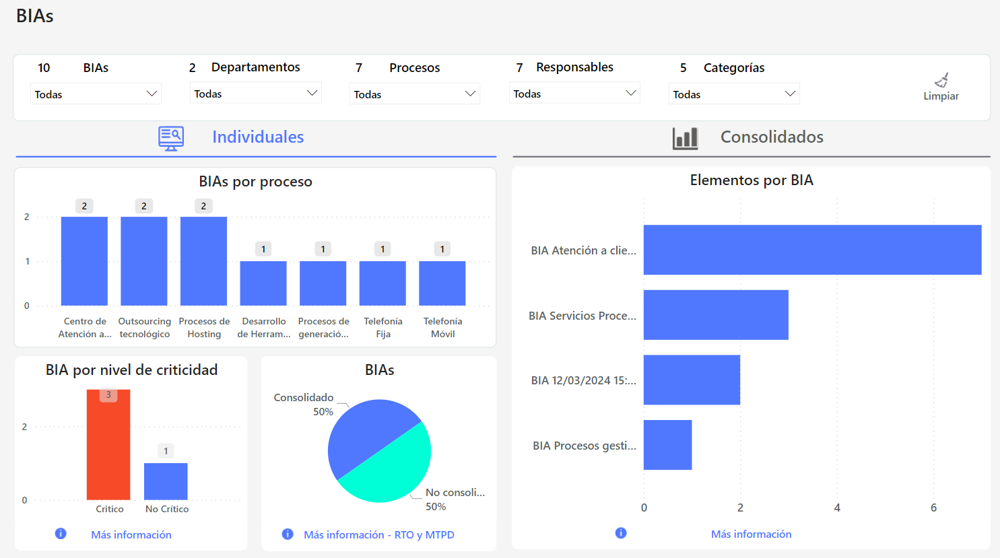

# Dashboard BIAs


Herramienta indispensable para los responsables de la continuidad del negocio y la gestión de riesgos para priorizar acciones y fortalecer la resiliencia organizacional frente a posibles interrupciones.


### Características Principales

* **Estado de la Evaluación de Impacto**: Ofrece una panorámica general sobre el estado actual de la evaluación de impacto de los procesos, permitiendo identificar rápidamente áreas que requieren atención o mejora.
* **Criticidad de procesos, subprocesos y actividades**: Destaca la importancia y criticidad de los distintos procesos, subprocesos y actividades dentro de la organización, ayudando a priorizar esfuerzos en aquellos de mayor relevancia para la continuidad del negocio.
* **Procesos de negocio críticos en el tiempo**: Identifica cuáles son los procesos de negocio más críticos a lo largo del tiempo, permitiendo una planificación y preparación adecuadas para posibles interrupciones o contingencias.
* **MTPD (Máximo Período Tolerable de Desviación)**: Analiza el MTPD de los procesos, ofreciendo insights valiosos sobre el tiempo máximo de interrupción que la organización puede tolerar sin sufrir impactos significativos.
* **RTO (Objetivo de Tiempo de Recuperación)**: Presenta el RTO de los procesos, esencial para la planificación de la recuperación y la minimización de las interrupciones en las operaciones críticas del negocio.
* **Elementos o activos críticos para los procesos**: Muestra los elementos o activos críticos identificados para cada proceso de negocio como resultado del BIA, lo que es crucial para la gestión de riesgos y la asignación de recursos adecuada.

## Explorando el Tablero **🔍**

## Vídeos


Tablero BIAs.mp4

