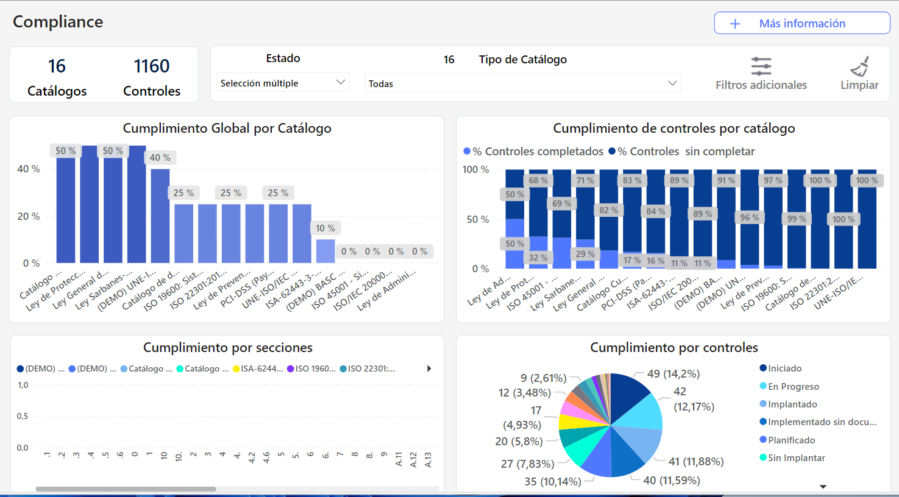

# Dashboard Compliance


Este cuadro de mando no solo optimiza la gestión del cumplimiento normativo, sino que también soporta la toma de decisiones estratégicas, la asignación de recursos y la implementación del ciclo de mejora continua, contribuyendo a un entorno de gestión más seguro y conforme a las normativas vigentes.


### Características Principales

* **Visión general del cumplimiento**: Muestra el nivel de cumplimiento de las distintas normativas, facilitando la identificación rápida de áreas de mejora y de excelencia en la conformidad normativa.
* **Requisitos no implementados:** Destaca los requisitos de las normativas que aún no están implementados en la organización, presentados por porcentaje. Esta función es crucial para priorizar esfuerzos en áreas críticas que requieren atención.
* **Niveles de madurez**: Analiza los apartados en los cuales la organización muestra un mayor nivel de madurez en cumplimiento normativo, ofreciendo insights sobre las fortalezas y permitiendo la replicación de buenas prácticas en otras áreas.
* **Estado de los controles por última revisión**: Proporciona una actualización del estado de los controles basada en la última revisión, incluyendo aquellos en progreso y destacando los responsables de cada acción dentro del ciclo de mejora continua.
* **Seguimiento por responsable**: Facilita la gestión y asignación de responsabilidades en el proceso de cumplimiento, mostrando los controles y acciones asignadas a cada responsable.
