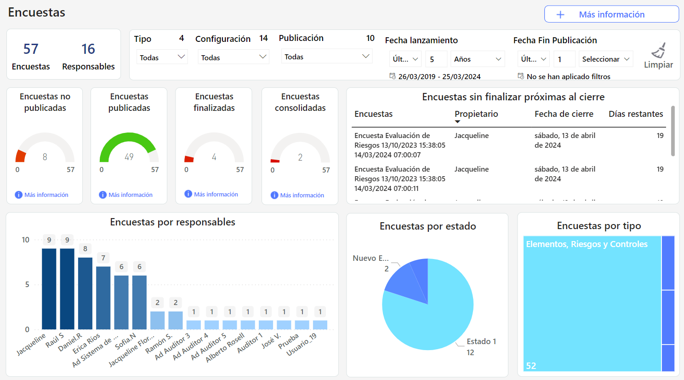

# Dashboard Encuestas


Este dashboard se ha diseñado para ofrecer una visión integral y detallada del estado de las encuestas en la organización, facilitando la monitorización y análisis.


### Características principales

* **Tipología de encuestas:** Visualiza la distribución de encuestas generadas, categorizadas por tipo (BIAS, Compliance, RRHH Críticos, Elementos, riesgos y controles), permitiendo identificar focos de atención y áreas de mejora.
* **Estado de las encuestas:** Obtén un rápido vistazo a las encuestas en diferentes etapas: desde aquellas ya finalizadas hasta las pendientes de consolidar. Esta clasificación ayuda a priorizar acciones y asegurar la completitud de los datos recopilados.
* **Seguimiento por responsable:** Descubre cómo se distribuyen las encuestas entre los diferentes responsables. Este dato es crucial para evaluar la carga de trabajo y optimizar la asignación de recursos.
* **Cronología de cierre**: Visualiza las encuestas que están próximas a finalizar y las que se encuentran cerca de su fecha de cierre. Esta información es vital para asegurar que se cumplen los plazos establecidos y facilita la planificación de futuras acciones.
